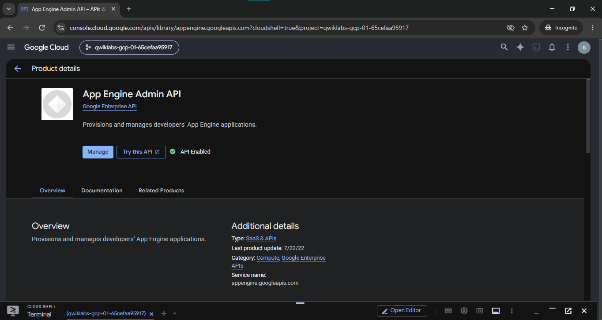
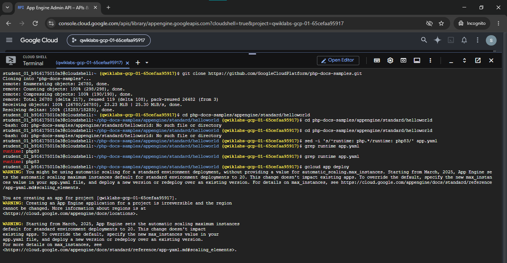
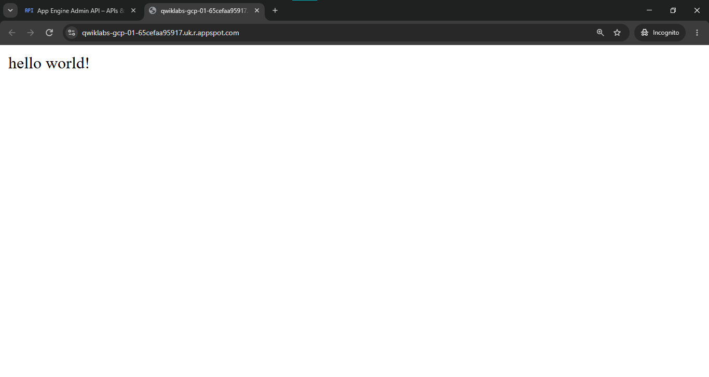
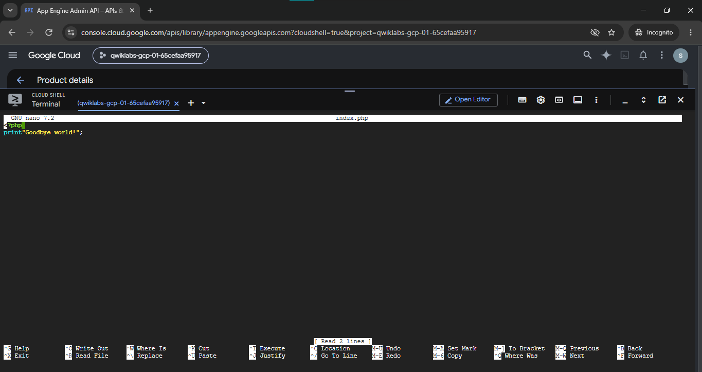
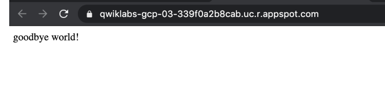

# App Engine: Qwik Start - PHP

### Lab Information

| Field | Details |
|---|---|
| **Lab Name** | App Engine: Qwik Start - PHP |
| **Lab ID** | GSP069 |
| **Platform** | Google Cloud Skills Boost |
| **Difficulty** | Introductory |
| **Duration** | 10 minutes |
| **Status** | Completed |
| **Service** | Google App Engine |
| **Runtime** | PHP 8.3 (`php83`) |
| **Environment** | App Engine Standard Environment |

---

## Overview

In this lab, I walked through the deployment lifecycle of a cloud-native web application on Google App Engine Standard Environment. I cloned an upstream PHP sample application inside Google Cloud Shell, configured its runtime parameters in `app.yaml` to target PHP 8.3, deployed the application using the `gcloud` CLI, and verified its public availability over HTTPS. 

To explore application versioning and lifecycle updates, I edited the application source code in Cloud Shell and redeployed it, observing how App Engine manages zero-downtime version transitions and routes traffic to the newly deployed release.

---

## What I Practiced

- **Enabling Core APIs:** Verified and activated the Google App Engine Admin API (`appengine.googleapis.com`) to enable programmatic application provisioning.
- **Cloud Shell Operations:** Used the browser-based Cloud Shell CLI environment to clone repositories, edit files, and issue deployment commands without local machine dependencies.
- **Repository Setup:** Cloned Google Cloud's official `php-docs-samples` repository and navigated to the Standard environment Hello World sample.
- **Runtime Configuration:** Configured `app.yaml` using `sed` to declare `runtime: php83`, ensuring compatibility with the modern PHP 8.3 container environment.
- **Cloud CLI Deployment:** Executed `gcloud app deploy` to package source code, trigger Cloud Build containerization, and provision the application on App Engine's serverless infrastructure.
- **Application Browsing & Logging:** Launched the public endpoint via `gcloud app browse` and monitored incoming HTTP requests in real time with `gcloud app logs tail`.
- **Code Modification & Redeployment:** Modified the PHP message from `hello world!` to `goodbye world!` using `nano`, redeployed the application, and confirmed the updated response in the browser.

---

## Architecture

The application runs on Google App Engine Standard Environment, where compute provisioning, OS configuration, SSL termination, and horizontal autoscaling are fully managed by Google Cloud.

```text
Cloud Shell (Source & app.yaml) ──▶ gcloud app deploy ──▶ Cloud Build & Storage ──▶ App Engine Standard (PHP 8.3) ──▶ https://<project>.r.appspot.com
```

For the complete architectural breakdown, execution workflow diagram, and component responsibilities, refer to:
👉 **[Architecture Documentation (`architecture.md`)](./architecture.md)**

---

## Important Commands

Below is a quick reference of the primary commands used throughout the lab. For the detailed execution order, parameter explanations, and sample outputs, refer to:
👉 **[Complete Command Execution Reference (`commands.md`)](./commands.md)**

```bash
# 1. Clone the PHP sample repository
git clone https://github.com/GoogleCloudPlatform/php-docs-samples.git
cd php-docs-samples/appengine/standard/helloworld

# 2. Configure PHP 8.3 runtime in app.yaml and verify
sed -i 's/^runtime: php.*/runtime: php83/' app.yaml
grep runtime app.yaml

# 3. Deploy the application to App Engine
gcloud app deploy

# 4. Open the deployed application in a browser
gcloud app browse

# 5. Tail real-time service logs
gcloud app logs tail -s default

# 6. Update message in index.php and redeploy
nano index.php
gcloud app deploy
```

---

## Application Verification

The lab validated two distinct application deployment states:

1. **Initial Deployment (`hello world!`):**
   After running the initial `gcloud app deploy`, accessing the generated public URL (`https://<project-id>.<region>.r.appspot.com`) displayed the original sample message: `hello world!`.
2. **Updated Deployment (`goodbye world!`):**
   After updating `index.php` with `print "Goodbye world!";` and running `gcloud app deploy`, refreshing the public URL confirmed that App Engine shifted traffic to the new version and served: `goodbye world!`.

---

## Forensic Screenshot Evidence

All screenshots below represent actual lab milestones captured during the hands-on session:

### 1. App Engine Admin API Enabled in Google Cloud Console
The App Engine Admin API was enabled in the temporary project, allowing programmatic provisioning of App Engine applications and services.



---

### 2. Cloud Shell Repository Setup & Runtime Configuration
Cloned `php-docs-samples`, configured `runtime: php83` in `app.yaml` using `sed`, verified the configuration with `grep`, and initialized `gcloud app deploy`.



---

### 3. Initial Web Application Verification (`hello world!`)
The deployed PHP 8.3 application serving the initial `hello world!` response on the generated `*.appspot.com` HTTPS endpoint.



---

### 4. Updating Application Source Code via Nano
Edited `index.php` in Cloud Shell using `nano` to replace the greeting string with `print "Goodbye world!";`.



---

### 5. Updated Web Application Verification (`goodbye world!`)
Verified the updated deployment in the browser, confirming that traffic was routed to the new version displaying `goodbye world!`.



---

## SQL and Database Operations

This lab does not require any database infrastructure, SQL queries, or data persistence layer. The sample application serves responses directly from PHP runtime memory.

For details, refer to:
👉 **[Database Scope Summary (`sql.md`)](./sql.md)**

---

## Key Learning & Reflections

- **Serverless Simplicity:** App Engine Standard removes the operational overhead of configuring virtual machines, web server daemons (Apache/NGINX), and network firewalls. You supply the code and runtime descriptor, and Google Cloud manages the execution environment.
- **Runtime Descriptors Matter:** Modernizing `app.yaml` to specify `runtime: php83` highlighted the importance of keeping application runtime definitions aligned with active, supported language versions rather than relying on outdated defaults.
- **Streamlined CLI Developer Experience:** Tools like `gcloud app deploy`, `gcloud app browse`, and `gcloud app logs tail` provide a productive terminal-first workflow that mirrors modern GitOps and CI/CD deployment mechanics.
- **Immutable Versioning:** In serverless platforms, updates are not applied as in-place mutations on active servers. Instead, each deployment produces a new version, enabling instant rollbacks, canary traffic splits, and zero-downtime releases.

---

## Official References

- [Google Cloud App Engine Standard Environment Documentation](https://cloud.google.com/appengine/docs/standard)
- [PHP on Google Cloud App Engine Documentation](https://cloud.google.com/appengine/docs/standard/php)
- [Google Cloud CLI `gcloud app deploy` Reference](https://cloud.google.com/sdk/gcloud/reference/app/deploy)
- [Google Cloud PHP Documentation Samples Repository (GitHub)](https://github.com/GoogleCloudPlatform/php-docs-samples)
- [Google Cloud Skills Boost Catalog](https://www.skills.google/)

