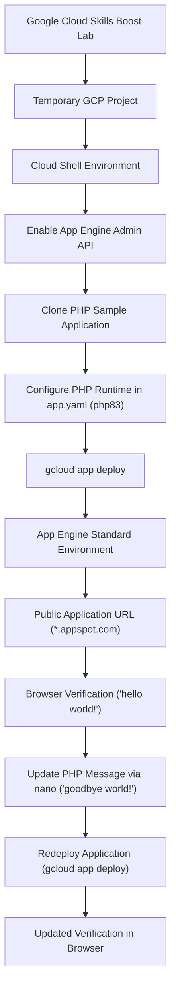

# System & Deployment Architecture — App Engine: Qwik Start - PHP (GSP069)

This document outlines the architectural components, deployment workflow, and execution model used during the **App Engine: Qwik Start - PHP** lab (`GSP069`) on Google Cloud Platform.

---

## 1. End-to-End Deployment Workflow

The deployment follows a standard serverless lifecycle from Cloud Shell source code manipulation to managed PaaS hosting on Google App Engine:

---

## 2. Architecture Components & Responsibilities

| Component | Responsibility in Lab Workflow | Technical Characteristics |
|---|---|---|
| **Google Cloud Project** | Isolated administrative container for all resources, billing, and IAM permissions. | Ephemeral lab environment provisioned via Google Cloud Skills Boost. |
| **Cloud Shell** | Browser-based interactive development workstation with pre-installed tools (`gcloud`, `git`, `nano`, `sed`). | Debian-based ephemeral VM with a persistent 5 GB home directory and pre-authenticated CLI access. |
| **App Engine Admin API (`appengine.googleapis.com`)** | Programmatic control plane for provisioning App Engine applications, creating versions, and managing traffic splits. | Required before any deployment; enabled via Google Cloud Console or CLI. |
| **PHP Sample Application (`php-docs-samples`)** | Upstream repository provided by Google Cloud containing standard reference implementations. | Cloned locally into Cloud Shell; targeted directory: `appengine/standard/helloworld`. |
| **Runtime Descriptor (`app.yaml`)** | Configuration manifest defining runtime environment, instance classes, scaling behavior, and handlers. | Specified `runtime: php83` to target the modern PHP 8.3 container runtime in the Standard environment. |
| **Google App Engine (Standard)** | Fully managed Platform as a Service (PaaS) that runs containers sandboxed in Google's infrastructure. | Serverless execution, automatic scaling to zero when idle, automatic HTTPS certificate provisioning, and zero server management. |
| **Cloud Storage Staging Bucket** | Ephemeral storage bucket created automatically by App Engine (`staging.<project-id>.appspot.com`). | Stores packaged application source zip archives uploaded during deployment. |
| **Cloud Build** | Managed build service invoked behind the scenes during `gcloud app deploy`. | Builds the runtime container image from source files and descriptors. |
| **Edge URL Routing (`*.appspot.com`)** | Global external HTTPS endpoint directing incoming requests to the default active service version. | Formatted as `https://<project-id>.<region-code>.r.appspot.com`. |

---

## 3. Core Concepts & Distinctions

Understanding the distinction between source code, runtime descriptor, deployment mechanics, and hosted runtime is key to cloud-native development:

### A. Application Source Code (`index.php`)
The source code contains the actual application logic written in PHP. In this lab, it consists of a single entry point script responding to HTTP `GET` requests:
- **Initial:** Outputs `hello world!`
- **Updated:** Outputs `goodbye world!`

The source code does not manage servers, listen on fixed host ports manually, or configure web servers like Apache or NGINX directly; App Engine's runtime handles HTTP routing to the script.

### B. Runtime Configuration (`app.yaml`)
`app.yaml` acts as the declarative contract between the developer and App Engine. It tells Google Cloud:
- Which language runtime to provision (`runtime: php83`).
- How instances scale (automatic scaling default).
- Which handlers route traffic to specific scripts.

Without `app.yaml`, the `gcloud app deploy` command cannot determine which runtime environment or execution sandbox to instantiate.

### C. The Deployment Process (`gcloud app deploy`)
Running `gcloud app deploy` initiates a multi-step orchestration:
1. Local files in the working directory are zipped into a deployment package (excluding ignored files).
2. The package is uploaded to a project-specific staging bucket in Cloud Storage.
3. App Engine triggers Cloud Build to produce the container image targeting the PHP 8.3 runtime.
4. A new immutable application **version** is created under the `default` service.
5. Traffic routing is automatically shifted 100% to the newly deployed version.

### D. The Hosted Application (`*.appspot.com`)
Once deployed, the application runs inside Google App Engine Standard Environment. Key characteristics include:
- **Serverless Operations:** No virtual machine provisioning, OS patching, or firewall rules to manually configure.
- **Auto-Scaling:** App Engine scales instance count dynamically based on incoming HTTP request volume, scaling down to zero instances when traffic ceases.
- **Built-in Security:** Automatic SSL/TLS encryption certificates provided out of the box on the `*.appspot.com` domain.

---

## 4. Versioning & Application Updates

In App Engine, code modifications do not mutate running instances in place. When `index.php` was updated from `hello world!` to `goodbye world!`:
1. The local file was modified on Cloud Shell disk.
2. A second `gcloud app deploy` command created a distinct, incremental version of the service.
3. Traffic was migrated cleanly from the old version to the new version without service downtime.
4. Refreshing the browser window verified that incoming traffic hit the newly active version.

