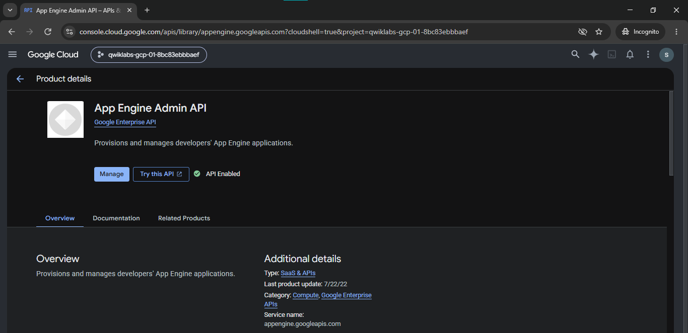
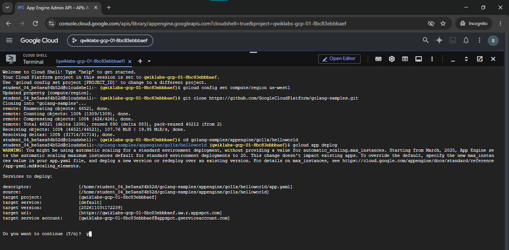
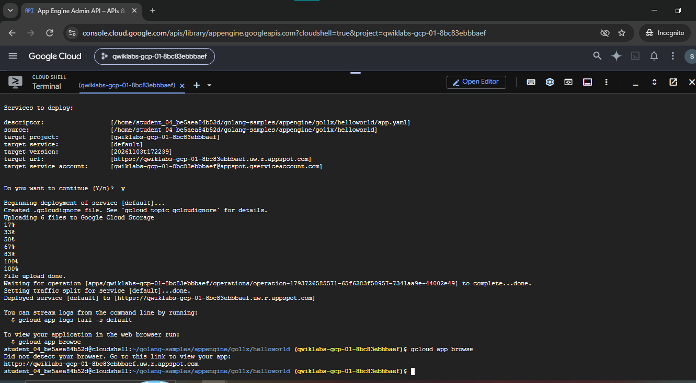
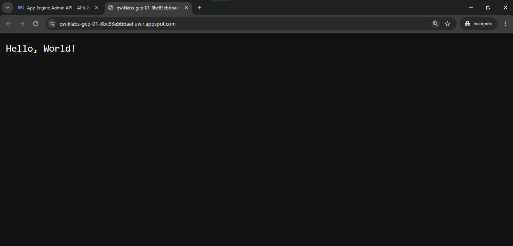

# App Engine: Qwik Start - Go

### Lab Information

| Field | Details |
|---|---|
| **Lab Name** | App Engine: Qwik Start - Go |
| **Lab ID** | GSP070 |
| **Platform** | Google Cloud Skills Boost |
| **Difficulty** | Introductory |
| **Duration** | 10 minutes |
| **Status** | Completed |
| **Service** | Google App Engine |
| **Runtime** | Go (`go11x` / Modern Go Runtimes: Go 1.25, Go 1.26) |
| **Environment** | App Engine Standard Environment |

---

## Overview

In this lab, I deployed a lightweight web application written in Go to the **Google App Engine Standard Environment**. I verified and activated the App Engine Admin API, configured default compute region parameters, cloned Google Cloud's official `golang-samples` repository inside Cloud Shell, deployed the application using `gcloud app deploy`, and validated public HTTPS accessibility via `gcloud app browse`.

The exercise demonstrated how Google App Engine abstracts infrastructure management—including virtual machine provisioning, container runtime setup, and automatic SSL/TLS termination—enabling developers to focus entirely on application code.

---

## What I Practiced

- **Enabling Administrative APIs:** Verified and activated the Google App Engine Admin API (`appengine.googleapis.com`) to allow programmatic deployment and lifecycle operations.
- **Cloud Shell CLI Configuration:** Initialized the terminal environment, verified authenticated credentials (`gcloud auth list`), and configured compute regions (`gcloud config set compute/region`).
- **Repository Setup:** Cloned Google Cloud's official `golang-samples` repository and navigated to the Go 1.1x Hello World sample (`appengine/go11x/helloworld`).
- **Runtime Understanding:** Inspected `app.yaml` declaring `runtime: go11x`, exploring how App Engine Standard provisions secure, preconfigured sandbox containers supporting modern Go runtimes.
- **Serverless Cloud Deployment:** Executed `gcloud app deploy` to package source code, upload archives to Cloud Storage staging buckets, trigger Cloud Build containerization, and route traffic to the `default` service version.
- **Endpoint Verification & Log Streaming:** Accessed the live HTTPS endpoint with `gcloud app browse`, confirmed the `Hello, World!` response, and verified log streaming capabilities with `gcloud app logs tail`.

---

## Architecture

The Go web application runs on Google App Engine Standard Environment, featuring automatic scaling down to zero when idle and rapid scale-up under load.

```text
Cloud Shell (Source & app.yaml) ──▶ gcloud app deploy ──▶ Cloud Build & Storage ──▶ App Engine Standard (Go) ──▶ https://<project>.uw.r.appspot.com
```

For the complete architectural breakdown and component responsibilities, refer to:  
👉 **[Architecture Documentation (`architecture.md`)](./architecture.md)**

---

## Important Commands

Below is a quick reference of the primary commands used throughout the lab. For the complete command guide with outputs, refer to:  
👉 **[Complete Command Execution Reference (`commands.md`)](./commands.md)**

```bash
# 1. Configure default compute region
gcloud config set compute/region us-west1

# 2. Clone the Go sample repository
git clone https://github.com/GoogleCloudPlatform/golang-samples.git
cd golang-samples/appengine/go11x/helloworld

# 3. Deploy the application to App Engine
gcloud app deploy

# 4. Open the deployed application in a browser
gcloud app browse

# 5. Tail real-time service logs (optional)
gcloud app logs tail -s default
```

---

## Application Verification

- **Deployment Status:** `gcloud app deploy` completed successfully, deploying service `[default]` to target version `20261103t172239`.
- **Public URL:** `https://qwiklabs-gcp-01-8bc83ebbbaef.uw.r.appspot.com`
- **Verified Response:** Accessing the endpoint in the browser returned:
  ```text
  Hello, World!
  ```

---

## Forensic Screenshot Evidence

All screenshots below represent actual lab milestones captured during the hands-on session:

### 1. App Engine Admin API Enabled in Google Cloud Console
The App Engine Admin API was activated in the Google Cloud project to allow service provisioning.



---

### 2. Cloud Shell Repository Clone & Deployment Launch
Cloned `golang-samples`, navigated to `appengine/go11x/helloworld`, reviewed target version/service descriptor, and confirmed deployment.



---

### 3. Build Completion, Traffic Splitting & Endpoint Generation
Source files uploaded to Cloud Storage, container image compiled by Cloud Build, traffic split allocated 100% to default service, and browse link generated.



---

### 4. Public Web Application Verification (`Hello, World!`)
The deployed Go application serving live HTTPS traffic on the generated `uw.r.appspot.com` domain.



---

## SQL and Database Operations

This lab does not require any database infrastructure, SQL queries, or persistence layer.

For details, refer to:  
👉 **[Database Scope Summary (`sql.md`)](./sql.md)**

---

## Key Learning & Reflections

- **Developer Productivity:** App Engine eliminates server management friction. With a single declarative line in `app.yaml` (`runtime: go11x`), developers can publish production-ready HTTPS endpoints in seconds.
- **Go Standard Environment Efficiency:** The Go standard runtime offers near-instant container startup times, making it well-suited for microservices and event-driven architectures that scale from zero.
- **Enterprise Release Mechanics:** `gcloud app deploy` orchestrates source archiving, Cloud Storage staging, Cloud Build container compilation, and atomic traffic splitting automatically.

---

## Official References

- [Google Cloud App Engine Standard Environment Documentation](https://cloud.google.com/appengine/docs/standard)
- [Go on Google Cloud App Engine Documentation](https://cloud.google.com/appengine/docs/standard/go)
- [Google Cloud CLI `gcloud app deploy` Reference](https://cloud.google.com/sdk/gcloud/reference/app/deploy)
- [Google Cloud Go Documentation Samples Repository (GitHub)](https://github.com/GoogleCloudPlatform/golang-samples)
- [Google Cloud Skills Boost Catalog](https://www.skills.google/)

