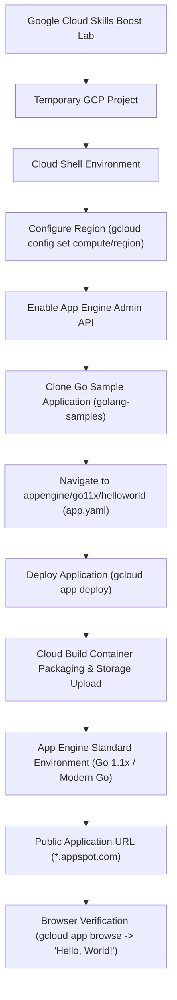

# System & Deployment Architecture — App Engine: Qwik Start - Go (GSP070)

This document outlines the architectural components, deployment workflow, and execution model used during the **App Engine: Qwik Start - Go** lab (`GSP070`) on Google Cloud Platform.

---

## 1. End-to-End Deployment Workflow

The deployment follows a serverless Platform-as-a-Service (PaaS) lifecycle from Cloud Shell source retrieval to containerized managed hosting on Google App Engine Standard:



---

## 2. Architecture Components & Responsibilities

| Component | Responsibility in Lab Workflow | Technical Characteristics |
|---|---|---|
| **Google Cloud Project** | Isolated administrative boundary for all resources, billing, and IAM permissions. | Ephemeral lab environment provisioned via Google Cloud Skills Boost. |
| **Cloud Shell** | Browser-based administrative terminal workstation pre-configured with `gcloud`, `git`, and developer runtimes. | Ephemeral Debian-based VM with a persistent 5 GB home directory and pre-authenticated CLI access. |
| **App Engine Admin API (`appengine.googleapis.com`)** | Programmatic control plane for provisioning App Engine applications, creating versions, and managing traffic splits. | Required before any deployment; enabled via Google Cloud Console or CLI. |
| **Go Sample Application (`golang-samples`)** | Official Google Cloud repository containing standard Go reference implementations. | Cloned into Cloud Shell; targeted directory: `appengine/go11x/helloworld`. |
| **Runtime Descriptor (`app.yaml`)** | Configuration manifest defining runtime environment, instance scaling, and HTTP handlers. | Specifies `runtime: go11x` (targeting modern Go 1.x standard container runtime). |
| **Google App Engine (Standard)** | Fully managed Platform as a Service (PaaS) that runs containers sandboxed in Google's infrastructure. | Serverless execution, automatic scaling to zero when idle, automatic HTTPS certificate provisioning, and zero server management. |
| **Cloud Storage Staging Bucket** | Ephemeral storage bucket created automatically by App Engine (`staging.<project-id>.appspot.com`). | Stores packaged application source zip archives uploaded during deployment. |
| **Cloud Build** | Managed build service invoked behind the scenes during `gcloud app deploy`. | Compiles Go source code and builds the container image for App Engine. |
| **Edge URL Routing (`*.appspot.com`)** | Global external HTTPS endpoint directing incoming requests to the default active service version. | Formatted as `https://<project-id>.<region-code>.r.appspot.com`. |

---

## 3. Core Concepts & Distinctions

### A. Go Standard vs. Flexible Environments
- **Standard Environment (Used in Lab):** Extremely fast startup times (seconds), scales rapidly from zero to thousands of instances, ideal for lightweight web services, microservices, and rapid request cycles with zero underlying OS maintenance.
- **Flexible Environment:** Runs application containers inside custom Compute Engine virtual machines, supporting non-standard runtimes, background worker threads, and persistent disk access.

### B. Declarative Configuration (`app.yaml`)
In Go standard environment, `app.yaml` acts as the declarative deployment contract:
```yaml
runtime: go11x
```
It instructs Google Cloud to provision a managed Go container without requiring manual Dockerfile authoring or container registry orchestration.

### C. Zero-Downtime Deployment Lifecycle
Running `gcloud app deploy` compiles Go binary artifacts, provisions container instances, and performs an atomic traffic migration to route 100% of user traffic to the newly created version.

