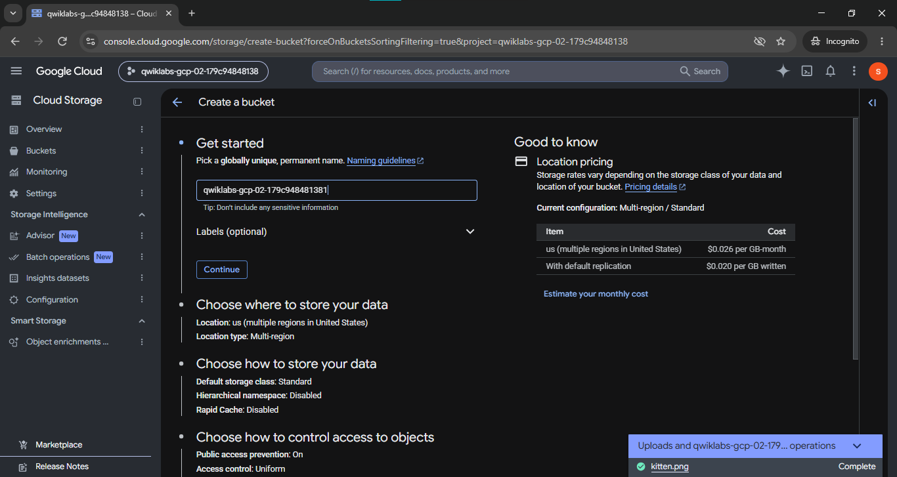
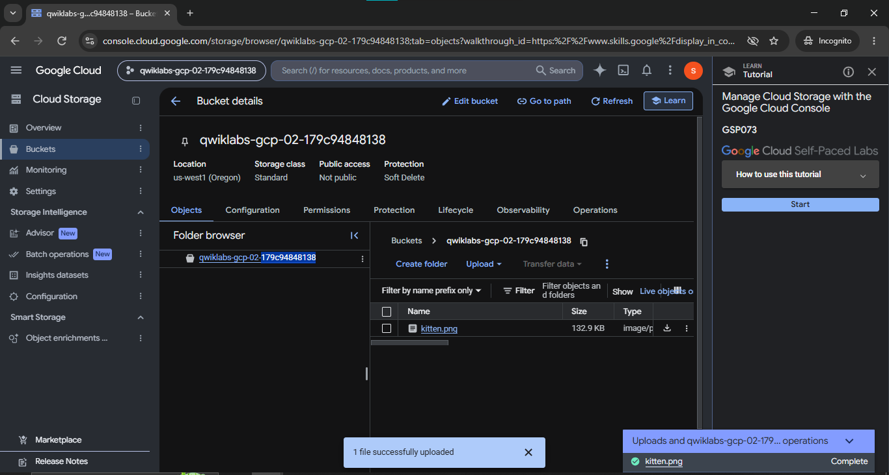

# Manage Cloud Storage with the Google Cloud Console

> Practical hands-on demonstration of cloud object storage operations, bucket configuration, simulated directory structures, object lifecycle management, and IAM public access governance using the Google Cloud Console.

[-4285F4?logo=googlecloud&logoColor=white)](https://cloud.google.com/storage)

[-brightgreen)](https://www.skills.google/public_profiles/e1158899-3f93-4f1a-be6a-398d495945a0)

---

## 📌 Project Overview

This project documents the practical completion of the **Manage Cloud Storage with the Google Cloud Console** (`GSP073`) lab on Google Cloud Skills Boost.

In this lab, I navigated the Google Cloud Console to provision a globally unique Cloud Storage bucket, configured storage parameters (Region location type, Standard storage class, and Uniform access control), uploaded binary image objects (`kitten.png`), managed nested simulated folder hierarchies (`folder1/folder2/`), configured public accessibility using Google Cloud IAM roles (`allUsers` $\rightarrow$ `Storage Object Viewer`), and executed cleanup operations by deleting bucket resources.

---

## 📋 Lab Information

| Metadata Field | Lab Details |
|---|---|
| **Official Lab Name** | Manage Cloud Storage with the Google Cloud Console |
| **Lab ID** | GSP073 |
| **Platform** | Google Cloud Skills Boost |
| **Track / Domain** | Cloud Storage, Infrastructure, and Security Foundations |
| **Difficulty Level** | Introductory |
| **Duration** | 10 minutes |
| **Cost** | No cost (Free Tier / Skills Boost credits) |
| **Completion Status** | **100% Completed & Verified** |

---

## 🎯 Learning Objectives

By completing this hands-on lab, I demonstrated how to:
1. Navigate the Google Cloud Console to create and configure a Cloud Storage bucket.
2. Adhere to universal bucket naming constraints (globally unique namespace, DNS compliance, lowercase alphanumeric formatting).
3. Select appropriate location types (Region vs. Multi-region) and storage classes (`Standard`).
4. Apply modern **Uniform Access Control** to centralize permissions under Cloud IAM.
5. Upload and manage binary media objects (`kitten.png`).
6. Organize unstructured data using simulated directory paths (`folder1/folder2/`).
7. Share objects publicly over HTTPS by binding the `Storage Object Viewer` role to `allUsers`.
8. Safely delete objects and remove storage buckets during decommissioning.

---

## 🛠️ Technologies & Services Used

- **Google Cloud Storage (GCS):** Scalable, high-durability object storage for unstructured data and media assets.
- **Google Cloud Console:** Graphical web interface used for provisioning, uploading, configuring, and monitoring storage resources.
- **Storage Buckets:** Global containers holding objects and providing location, class, and security boundaries.
- **Objects & Simulated Folders:** Immutable data files and hierarchical key prefixes (`folder1/folder2/`).
- **Cloud IAM (Identity and Access Management):** Access governance managing principal assignments and roles.
- **Public Object Access:** Edge HTTPS sharing via `allUsers` principal bindings.

---

## 🚀 Practical Implementation

The lab was executed through the following step-by-step console operations:

### 1. Storage Bucket Creation & Location Sizing
- Navigated to **Cloud Storage > Buckets** in the Google Cloud Console.
- Selected **Create**.
- Entered a globally unique, DNS-compliant bucket name adhering to Cloud Storage naming guidelines.
- Selected **Region** location type targeting the assigned lab region (e.g., `us-west1 (Oregon)`).

### 2. Storage Class & Uniform Access Control Configuration
- Chose **Standard** storage class, designed for frequently accessed data with low latency.
- Enforced **Uniform** access control (disabling legacy per-object ACLs in favor of unified Cloud IAM policies).
- Left default data protection settings (such as soft-delete retention) active and clicked **Create**.

### 3. Object Ingestion (`kitten.png`)
- Downloaded the sample image `kitten.png` locally.
- In the **Objects** tab of the newly created bucket, clicked **Upload files** and selected `kitten.png`.
- Verified upload completion through the console notification toast and confirmed object presence in the file table (132.9 KB, `image/png`).

### 4. Public Access Governance (IAM Policy Binding)
- Navigated to the bucket's **Permissions** tab.
- Clicked **Grant access**.
- Under **New principals**, entered `allUsers`.
- Assigned the role: **Cloud Storage > Storage Object Viewer**.
- Acknowledged the security warning confirming that the resource would be publicly accessible over the Internet.
- Verified that `kitten.png` became accessible publicly via its direct edge URL (`https://storage.googleapis.com/<BUCKET_NAME>/kitten.png`).

> [!WARNING]
> **Production Security Note:** Granting `allUsers` the `Storage Object Viewer` role makes objects accessible to anyone on the Internet without authentication. In enterprise production environments, public access should be strictly governed or disabled via Organization Policy constraints (`constraints/storage.publicAccessPrevention`) to prevent sensitive data leaks.

### 5. Hierarchical Folder Organization
- Clicked **Create folder** and named it `folder1`.
- Entered `folder1` and clicked **Create folder** to create a nested subfolder named `folder2`.
- Navigated into `folder1/folder2/` and uploaded a local image asset.
- Observed how Cloud Storage uses key prefixes with delimiter slashes to simulate traditional directory hierarchies in a flat object namespace.

### 6. Bucket Cleanup & Resource Deletion
- Selected the root bucket and all contained objects.
- Clicked **Delete** and confirmed deletion by entering `DELETE`.
- Cleaned up all provisioned storage resources without orphaned data.

---

## 📷 Forensic Screenshot Evidence

Both screenshots below represent genuine forensic evidence captured directly during the lab session:

### 1. Bucket Creation & Storage Class Configuration
Shows the Google Cloud Console **Create a bucket** wizard displaying the unique bucket identifier, location pricing, default **Standard** storage class, and **Uniform** access control:

---

### 2. Uploaded Objects & Bucket Verification
Shows the bucket overview for `qwiklabs-gcp-02-179c94848138` with `us-west1 (Oregon)` location, **Standard** storage class, uploaded `kitten.png` (132.9 KB) object, upload completion notification, and the official GSP073 tutorial panel:

---

## 🖱️ Key Console Operations Reference

| Task | Console Navigation Path | Key Settings / Values |
|---|---|---|
| **Create Bucket** | Cloud Storage > Buckets > *Create* | Globally unique name, Region (`us-west1`), Standard class, Uniform access |
| **Upload File** | Bucket Details > Objects tab > *Upload files* | Uploaded `kitten.png` (132.9 KB) |
| **Grant Public Access** | Bucket Details > Permissions tab > *Grant access* | Principal: `allUsers`, Role: `Storage Object Viewer` |
| **Create Folder** | Bucket Details > Objects tab > *Create folder* | Created `folder1` and nested `folder2` |
| **Delete Bucket** | Cloud Storage > Buckets > Select Bucket > *Delete* | Typed `DELETE` to confirm removal |

---

## 💡 Key Learning Outcomes

- **Namespace Awareness:** Cloud Storage bucket names exist in a single global namespace shared across all GCP projects worldwide; duplicate names are instantly rejected.
- **Uniform vs. Fine-Grained Access:** Uniform access control simplifies compliance audits by delegating all authorization to IAM policies, preventing shadow permissions caused by individual object ACLs.
- **Flat Namespace Topology:** Unlike local filesystems, Cloud Storage does not contain physical directories. Slashes (`/`) in object names are string prefixes used by the Google Cloud Console to render virtual folder views.
- **Data Durability & Edge Distribution:** Uploaded objects are automatically distributed with $99.999999999\%$ (11 9's) annual durability and served via Google's low-latency edge network.

---

## 🌐 Real-World DevOps & Cloud Use Cases

1. **Static Website Hosting & CDN Backends:** Storing HTML, CSS, JavaScript, and image assets served directly via Cloud Storage or fronted by Cloud CDN.
2. **CI/CD Pipeline Artifact Repositories:** Staging build packages, release archives, and compiled container binaries.
3. **Data Lake Storage:** Ingesting raw multi-terabyte log files, telemetry datasets, and CSV exports for processing by BigQuery or Dataproc.
4. **Disaster Recovery & Backup Archives:** Automating database snapshots and VM machine images for long-term retention.

---

## ✅ Completion Status

- **Lab ID:** GSP073
- **Hands-On Score:** **100% Verified**
- **Assessment Validation:** All progress tracking checkpoints passed successfully in Google Cloud Skills Boost.

---

## 📚 Official References

- [Google Cloud Storage Documentation](https://cloud.google.com/storage/docs)
- [Cloud Storage Bucket Naming Guidelines](https://cloud.google.com/storage/docs/buckets#naming-requirements)
- [Uniform Bucket-Level Access Overview](https://cloud.google.com/storage/docs/uniform-bucket-level-access)
- [Google Cloud Storage IAM Roles](https://cloud.google.com/storage/docs/access-control/iam-roles)
- [Google Cloud Skills Boost Catalog](https://www.skills.google/)

