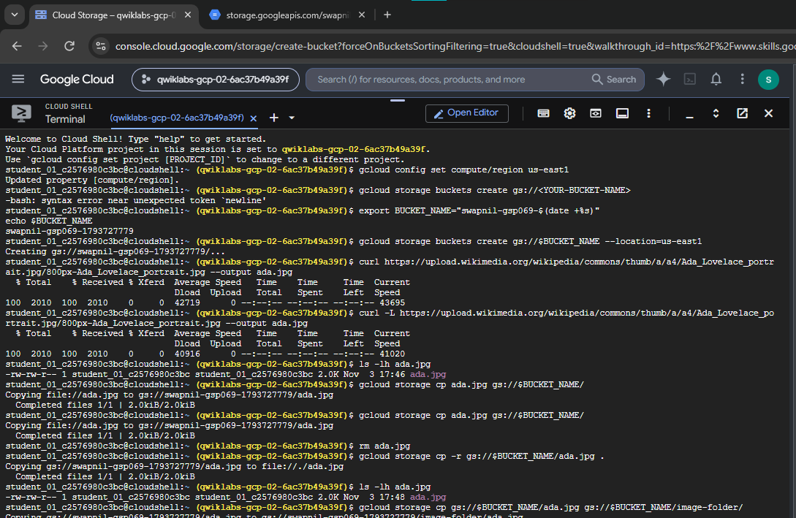
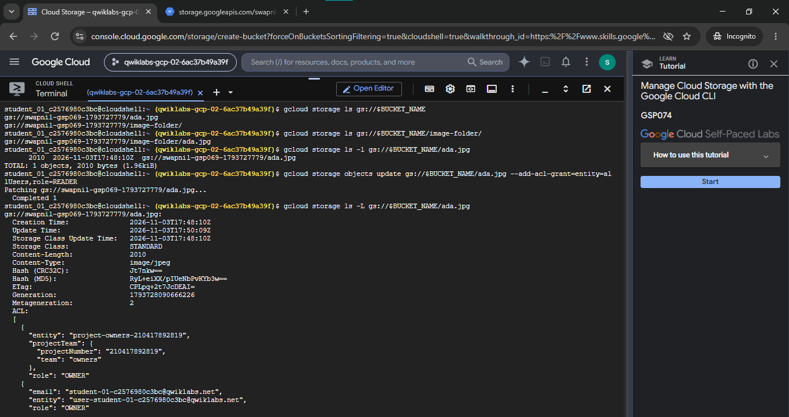

# Manage Cloud Storage with Google Cloud CLI (GSP074)

> Production-grade documentation demonstrating hands-on cloud object storage administration, bucket provisioning, binary data transfers, simulated folder hierarchies, and Access Control List (ACL) security governance using the next-generation `gcloud storage` CLI subsystem.

[-4285F4?logo=googlecloud&logoColor=white)](https://cloud.google.com/storage)
[](https://cloud.google.com/storage/docs/gcloud-storage)
[-brightgreen)](https://www.skills.google/public_profiles/e1158899-3f93-4f1a-be6a-398d495945a0)
[](https://www.skills.google/)

---

## 📌 Lab Overview

This project showcases the completion of the **Manage Cloud Storage with the Google Cloud CLI** (`GSP074`) lab on Google Cloud Skills Boost. The lab demonstrates terminal-based administrative control over Google Cloud Storage buckets and objects using the modern `gcloud storage` CLI.

| Metadata Field | Lab Details |
|---|---|
| **Official Lab Name** | Manage Cloud Storage with the Google Cloud CLI |
| **Lab ID** | GSP074 |
| **Platform** | Google Cloud Skills Boost |
| **Track / Domain** | Cloud Storage Administration & CLI Automation |
| **Difficulty Level** | Introductory |
| **Duration** | 15 minutes |
| **Cost** | No cost (Skills Boost credits / Free Tier) |
| **Completion Status** | **Successfully Completed & Verified** |

---

## 🎯 Learning Objectives

By executing this lab, I gained practical proficiency in:
- Configuring project and compute region properties in Google Cloud Shell.
- Provisioning Cloud Storage buckets while observing global DNS and naming constraints.
- Ingesting, downloading, and transferring binary assets using `gcloud storage cp`.
- Managing simulated directory structures within Cloud Storage's flat namespace model.
- Inspecting object metadata, cryptographic checksums (MD5, CRC32C), and storage classes.
- Granting and revoking public access using object-level Access Control Lists (ACLs).
- Deleting individual storage objects and cleaning up bucket resources from the command line.

---

## 🛠️ Technologies Used

- **Google Cloud Platform (GCP):** Enterprise public cloud provider and infrastructure backbone.
- **Google Cloud Storage (GCS):** Globally distributed, highly durable object storage service.
- **Google Cloud Shell:** Ephemeral Debian-based management workstation with pre-authenticated CLI access.
- **Google Cloud CLI (`gcloud storage`):** Google's next-generation unified command-line tool delivering optimized multi-threaded storage operations.
- **Cloud Storage Buckets & Objects:** Global namespace storage containers and binary payload files.
- **Access Control Lists (ACLs):** Granular legacy authorization mechanisms defining per-object read and write permissions.

---

## 🚀 Practical Implementation

The lab implementation followed a structured sequence of 14 practical milestones:

1. **Configure Environment:** Initialized Google Cloud Shell and verified active credentials via `gcloud auth list`.
2. **Verify Project & Region:** Validated the active project context with `gcloud config list project` and set the geographical region using `gcloud config set compute/region`.
3. **Create Cloud Storage Bucket:** Defined a unique bucket identifier (`gs://YOUR-BUCKET-NAME`) observing lowercase alphanumeric, length (3-63 characters), and DNS formatting rules, and provisioned it with `gcloud storage buckets create`.
4. **Download Sample Image:** Retrieved a portrait of computing pioneer Ada Lovelace (`ada.jpg`) from Wikimedia Commons via `curl`.
5. **Upload Object to Bucket:** Uploaded `ada.jpg` to the bucket root using `gcloud storage cp ada.jpg gs://YOUR-BUCKET-NAME`.
6. **Remove Local Image:** Deleted the local copy (`rm ada.jpg`) to prepare for retrieval testing.
7. **Download Object from Bucket:** Pulled `ada.jpg` back down to Cloud Shell using `gcloud storage cp -r gs://YOUR-BUCKET-NAME/ada.jpg .`, verifying egress download integrity.
8. **Copy Object to Simulated Subfolder:** Structured data by copying the object into a simulated directory prefix with `gcloud storage cp gs://YOUR-BUCKET-NAME/ada.jpg gs://YOUR-BUCKET-NAME/image-folder/`.
9. **List Bucket Contents:** Enumerated top-level bucket objects and folders using `gcloud storage ls gs://YOUR-BUCKET-NAME`.
10. **Inspect Object Metadata:** Queried object size, creation timestamp, and storage class using `gcloud storage ls -l gs://YOUR-BUCKET-NAME/ada.jpg`.
11. **Grant Public Access via ACL:** Updated the object ACL to grant public read access to anonymous internet users via `gcloud storage objects update gs://YOUR-BUCKET-NAME/ada.jpg --add-acl-grant=entity=allUsers,role=READER`.
12. **Verify Public Accessibility:** Accessed the public URL (`https://storage.googleapis.com/YOUR-BUCKET-NAME/ada.jpg`) in a web browser, confirming unauthenticated access.
13. **Remove Public Access:** Revoked public permissions with `gcloud storage objects update gs://YOUR-BUCKET-NAME/ada.jpg --remove-acl-grant=allUsers`, verifying that the public URL returned an `AccessDenied` error.
14. **Delete Original Object:** Executed clean resource removal from the root bucket using `gcloud storage rm gs://YOUR-BUCKET-NAME/ada.jpg`, while confirming that the copy inside `image-folder/` remained intact.

---

## 💻 Important CLI Commands Reference

Below are the reusable commands utilized throughout the lab workflow. Placeholders such as `YOUR-BUCKET-NAME` should be replaced with your unique bucket identifier:

### 1. Project Verification & Bucket Provisioning
```bash
# Verify active project context
gcloud config list project

# Create a new Cloud Storage bucket
gcloud storage buckets create gs://YOUR-BUCKET-NAME
```
*Creates a globally unique bucket with default regional and standard storage class settings.*

---

### 2. Ingestion & Local Download
```bash
# Download sample image via curl
curl https://upload.wikimedia.org/wikipedia/commons/thumb/a/a4/Ada_Lovelace_portrait.jpg/800px-Ada_Lovelace_portrait.jpg --output ada.jpg

# Upload image to the root of the bucket
gcloud storage cp ada.jpg gs://YOUR-BUCKET-NAME

# Remove local copy from Cloud Shell
rm ada.jpg

# Download object back to local workstation
gcloud storage cp -r gs://YOUR-BUCKET-NAME/ada.jpg .
```
*Transfers objects between local storage and remote Cloud Storage buckets.*

---

### 3. Folder Organization & Metadata Listing
```bash
# Copy object to a simulated subfolder
gcloud storage cp gs://YOUR-BUCKET-NAME/ada.jpg gs://YOUR-BUCKET-NAME/image-folder/

# List all objects in the bucket
gcloud storage ls gs://YOUR-BUCKET-NAME

# View object details (size, creation timestamp, storage class)
gcloud storage ls -l gs://YOUR-BUCKET-NAME/ada.jpg
```
*Organizes data in flat namespaces and inspects object metadata and sizes.*

---

### 4. Access Control List (ACL) Governance & Object Deletion
```bash
# Grant public read permissions to anyone on the Internet
gcloud storage objects update gs://YOUR-BUCKET-NAME/ada.jpg --add-acl-grant=entity=allUsers,role=READER

# Revoke public read access
gcloud storage objects update gs://YOUR-BUCKET-NAME/ada.jpg --remove-acl-grant=allUsers

# Delete an object from the bucket
gcloud storage rm gs://YOUR-BUCKET-NAME/ada.jpg
```
*Applies granular security policies and removes unwanted assets from the bucket.*

> [!NOTE]
> The commands above are reusable reference examples designed for any Cloud Storage deployment. In the specific lab session documented below, the bucket identifier used was `swapnil-gsp069-1793727779`.

---

## 📷 Forensic Screenshot Evidence

Both screenshots below represent genuine forensic evidence captured directly during the Cloud Shell session:

### 1. Bucket Creation & Ingestion Workflow
Shows Cloud Shell configuring the compute region, generating a unique bucket name variable, creating the bucket (`gcloud storage buckets create`), downloading `ada.jpg` with `curl`, uploading to the bucket, downloading locally, and copying into `image-folder/`:


*Figure 1: Bucket creation, image upload, download, and folder copying executed in Google Cloud Shell.*

---

### 2. Listing, Metadata Inspection & Public ACL Grant
Shows Cloud Shell enumerating bucket contents (`gcloud storage ls`), inspecting object size and creation date with `-l`, patching the object ACL with `--add-acl-grant=entity=allUsers,role=READER`, and querying detailed metadata and hashes with `-L`:


*Figure 2: Object enumeration, metadata inspection, and public ACL grant verification in Google Cloud Shell.*

---

## 💡 Key Learning Outcomes

- **Fast Unified CLI (`gcloud storage`):** The modern `gcloud storage` command family replaces legacy `gsutil` with faster multi-threaded transfer speeds and consistent CLI syntax.
- **Flat Namespace & Prefix Delimiters:** Cloud Storage does not have physical filesystem directories. Forward slashes (`/`) in object names act as key prefixes, allowing hierarchical browsing without filesystem bottlenecks.
- **Egress & Ingress Transfer Verification:** Uploading and retrieving objects via CLI ensures network connectivity, storage permissions, and data integrity.
- **Access Control List Operations:** Managing `allUsers` entity grants demonstrates how access permissions can be applied directly to individual storage objects.

---

## 🌐 Real-World Applications

- **Automated Backup & Recovery:** Scripting nightly database dumps or application state exports directly to GCS using `gcloud storage cp`.
- **Static Website Asset Delivery:** Storing images, stylesheets, and client-side scripts distributed globally via Google's edge cache network.
- **Application File Storage:** Serving as a reliable, infinitely scalable repository for user-uploaded media and documents.
- **Cold Data Archival:** Offloading aging data to nearline, coldline, or archive tiers for compliance and regulatory retention.
- **CI/CD Pipeline Automation:** Integrating Cloud Storage upload and download steps in automated Cloud Build and Jenkins deployment pipelines.

---

## 🔒 Security Considerations

- **Avoid Public Access by Default:** Making storage objects accessible to `allUsers` should be strictly restricted to deliberate public assets (e.g., public website graphics).
- **Enforce Least Privilege:** Grant only the minimum necessary permissions (`READER` vs `OWNER`) to specific authenticated accounts or service accounts.
- **Prefer Uniform Bucket-Level Access (UBLA):** In modern enterprise deployments, Uniform access control is recommended over per-object ACLs to prevent accidental public data leaks and unify governance under Cloud IAM.
- **Prevent Sensitive Data Exposure:** Never store unencrypted credentials, API keys, or personally identifiable information (PII) in public or weakly secured buckets.
- **Audit Access Regularly:** Frequently inspect bucket ACLs and IAM policy bindings using `gcloud storage buckets get-iam-policy` to ensure compliance.

> [!WARNING]
> The public access grant (`allUsers`) performed in this lab was executed strictly for educational validation within a temporary sandbox environment.

---

## ✅ Completion Summary

- **Lab ID:** GSP074
- **Lab Name:** Manage Cloud Storage with the Google Cloud CLI
- **Platform:** Google Cloud Skills Boost
- **Status:** **Successfully Completed**
- **Assessment Verification:** All lab objectives and checkpoint validation steps were passed with 100% completion score.

