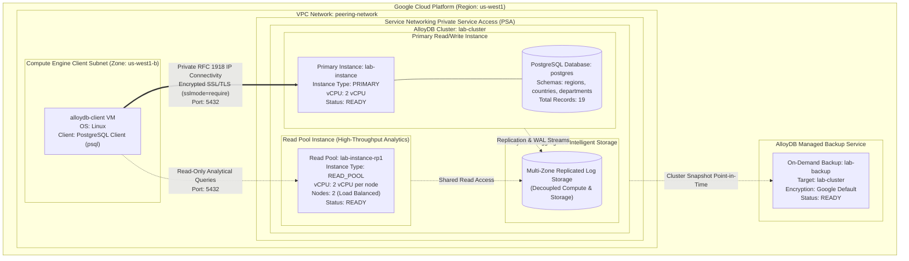
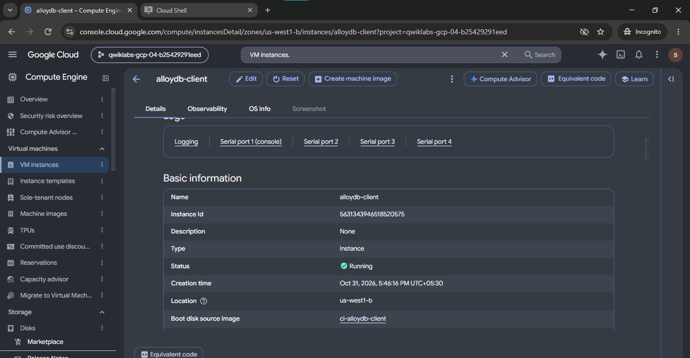
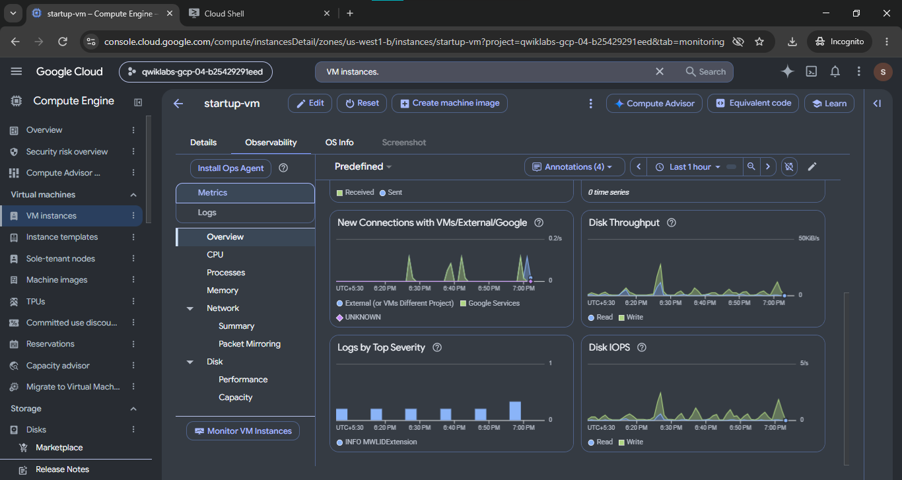
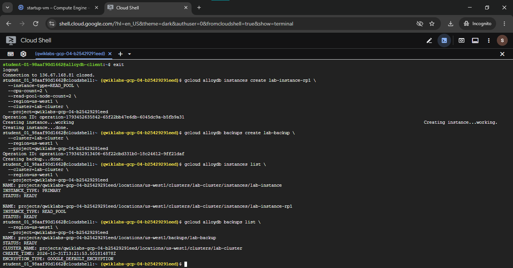

# Create and Manage AlloyDB Instances (GSP395)

A comprehensive Google Cloud Database Engineering, SRE, and DevOps portfolio project demonstrating how to provision, configure, secure, and manage **Google Cloud AlloyDB for PostgreSQL** clusters and instances. This project covers Private Service Access (PSA) network peering, primary read/write instance lifecycle management, secure SSL/TLS client connectivity from Compute Engine VMs, relational schema definition and data population, horizontal read scalability with a multi-node read pool, and on-demand cluster backup creation.

[](https://cloud.google.com/)
[](https://cloud.google.com/alloydb)
[](https://cloud.google.com/compute)
[](https://www.postgresql.org/)
[](https://cloud.google.com/vpc/docs/private-services-access)

---

## Lab Information

| Configuration Field | Verified Lab Specification |
|---|---|
| **Official Lab Title** | Create and Manage AlloyDB Instances |
| **Lab ID** | GSP395 |
| **Cloud Platform** | Google Cloud Platform (GCP) |
| **Database Engine** | AlloyDB for PostgreSQL |
| **Target Region** | `us-west1` (The Dalles, Oregon, USA) |
| **Client VM Name** | `alloydb-client` |
| **Client VM Zone** | `us-west1-b` |
| **VPC Network** | `peering-network` |
| **Cluster Name** | `lab-cluster` |
| **Primary Instance Name** | `lab-instance` |
| **Primary Instance Type** | `PRIMARY` (Read/Write) |
| **Primary CPU** | `2 vCPU` |
| **Read Pool Name** | `lab-instance-rp1` |
| **Read Pool Type** | `READ_POOL` (Read-Only) |
| **Read Pool Specification** | `2 vCPU per node`, `2 nodes` |
| **Backup Name** | `lab-backup` |
| **Database Name** | `postgres` |
| **Database User** | `postgres` |
| **Connection Security** | SSL/TLS Required (`sslmode=require`) |
| **Completion Status** | Completed *(Verified with terminal outputs and cloud console evidence)* |

---

## Overview

Modern cloud-native enterprises require relational databases capable of handling high-throughput transactional workloads (OLTP) while simultaneously serving real-time analytical queries (HTAP) without performance degradation. Traditional PostgreSQL deployments hosted on virtual machines or basic managed services often encounter bottlenecks in storage I/O, replication latency between primary and read replicas, and manual failover orchestration.

**Google Cloud AlloyDB for PostgreSQL** is an enterprise-grade, fully managed relational database service that is 100% compatible with open-source PostgreSQL. AlloyDB features a disaggregated architecture that separates compute nodes from a shared, multi-zone replicated intelligent storage layer. This architecture provides up to 4x faster transaction processing and up to 100x faster analytical queries compared to standard PostgreSQL, along with zero-lag read replicas, automatic failover within seconds, and non-disruptive continuous backups.

This hands-on project implements an end-to-end AlloyDB enterprise topology:
1. Provisioning a cluster (`lab-cluster`) within a private VPC network (`peering-network`) using Private Service Access.
2. Launching a primary read/write database instance (`lab-instance`) with 2 vCPUs.
3. Accessing the database over private internal IP from a dedicated Compute Engine client (`alloydb-client`) using encrypted SSL/TLS channels.
4. Structuring relational schemas (`regions`, `countries`, `departments`) and populating 19 records.
5. Provisioning an horizontally scalable, load-balanced 2-node read pool (`lab-instance-rp1`) to decouple analytical query traffic from the primary instance.
6. Generating an on-demand cluster backup (`lab-backup`) without interrupting database transactions.

---

## Learning Objectives

- Configure and manage Google Cloud CLI (`gcloud`) environment parameters for database operations.
- Provision an enterprise AlloyDB cluster attached to custom VPC networks via Private Service Access.
- Deploy a primary read/write AlloyDB instance configured with compute parameters.
- Establish secure SSH connectivity to a bastion/client Compute Engine VM.
- Securely connect to AlloyDB via `psql` enforcing encrypted transport (`sslmode=require`).
- Implement relational DDL and DML scripts (tables, primary keys, relational data insertion, validation).
- Provision an AlloyDB read pool instance with multiple nodes to support high-throughput read scaling.
- Execute non-disruptive on-demand database backups using Google Cloud storage snapshot mechanisms.
- Audit and verify cloud resource states across clusters, instances, and backups.

---

## Technology Stack

- **Cloud Platform:** Google Cloud Platform (GCP)
- **Database Engine:** Google Cloud AlloyDB for PostgreSQL (PostgreSQL 14/15 compatible)
- **Compute Infrastructure:** Google Compute Engine (Linux client VM)
- **Database Client:** PostgreSQL Interactive Terminal (`psql`)
- **Networking:** Cloud VPC, Private Service Access (PSA), VPC Network Peering, Internal RFC 1918 IP Addressing
- **Security & Encryption:** Google-managed database encryption at rest, transit encryption via TLS/SSL (`sslmode=require`)
- **Automation & CLI:** Google Cloud CLI (`gcloud alloydb`, `gcloud compute`)

---

## Architecture Overview

The following diagram illustrates the disaggregated architecture of the lab environment:



> [!NOTE]
> AlloyDB instances do not have public IP addresses. All client access is routed through internal private IP addresses within the VPC using Private Service Access (PSA). Transport encryption is enforced using SSL/TLS.

---

## Google Cloud Resources

| Resource Name | Resource Type | Location / Scope | Configuration Attributes |
|---|---|---|---|
| `peering-network` | Cloud VPC Network | Global | Pre-configured VPC with Private Service Access peering connection |
| `alloydb-client` | Compute Engine VM | `us-west1-b` | Linux client with `psql` installed, attached to `peering-network` |
| `lab-cluster` | AlloyDB Cluster | `us-west1` | Attached to `peering-network`, managed storage backend |
| `lab-instance` | AlloyDB Primary Instance | `us-west1` | Type: `PRIMARY`, 2 vCPU, read/write database engine |
| `lab-instance-rp1` | AlloyDB Read Pool | `us-west1` | Type: `READ_POOL`, 2 vCPU per node, 2 nodes (load-balanced) |
| `lab-backup` | AlloyDB Backup | `us-west1` | On-demand cluster backup snapshot, Google default encryption |

---

## Implementation Steps

### 1. Environment Setup (Cloud Shell)

Configure the target Google Cloud region and verify environment variables:

```bash
# Cloud Shell
export REGION="us-west1"
export ZONE="us-west1-b"
export CLUSTER_ID="lab-cluster"
export PRIMARY_ID="lab-instance"
export READ_POOL_ID="lab-instance-rp1"
export BACKUP_ID="lab-backup"
export NETWORK_ID="peering-network"
export PROJECT_ID=$(gcloud config get-value project)

gcloud config set compute/region $REGION
gcloud config set compute/zone $ZONE
```

*Reference script:* [`commands/01-environment-setup.sh`](./commands/01-environment-setup.sh)

---

### 2. Create the AlloyDB Cluster (Cloud Shell)

Provision the AlloyDB cluster attached to the custom private VPC network (`peering-network`):

```bash
# Cloud Shell
gcloud alloydb clusters create lab-cluster \
  --region=us-west1 \
  --network=peering-network \
  --password="${ALLOYDB_PASSWORD}" \
  --project="${PROJECT_ID}"
```

*Reference script:* [`commands/02-create-cluster.sh`](./commands/02-create-cluster.sh)

---

### 3. Create Primary Read/Write Instance (Cloud Shell)

Deploy the primary database instance with 2 vCPUs:

```bash
# Cloud Shell
gcloud alloydb instances create lab-instance \
  --instance-type=PRIMARY \
  --cpu-count=2 \
  --region=us-west1 \
  --cluster=lab-cluster \
  --project="${PROJECT_ID}"
```

Retrieve the private IP address assigned to `lab-instance`:

```bash
# Cloud Shell
gcloud alloydb instances describe lab-instance \
  --cluster=lab-cluster \
  --region=us-west1 \
  --format="value(ipAddress)"
```

*Reference script:* [`commands/03-create-primary-instance.sh`](./commands/03-create-primary-instance.sh)

---

### 4. Connect to AlloyDB Client VM (Cloud Shell)

SSH into the pre-provisioned client VM located in `us-west1-b`:

```bash
# Cloud Shell
gcloud compute ssh alloydb-client --zone=us-west1-b
```





---

### 5. Establish Encrypted PostgreSQL SSL Connection (VM Terminal)

From the `alloydb-client` VM terminal, connect to the primary instance using `psql` with SSL transport encryption enforced:

```bash
# VM Terminal (student@alloydb-client)
export ALLOYDB_IP="<PRIMARY_INSTANCE_PRIVATE_IP>"

psql -h "${ALLOYDB_IP}" -U postgres -d postgres "sslmode=require"
```

When prompted, input the database password configured during cluster creation.

Successful connection output:
```text
psql (14.x, server 14.x)
SSL connection (protocol: TLSv1.3, cipher: TLS_AES_256_GCM_SHA384, bits: 256, compression: off)
Type "help" for help.

postgres=>
```

*Reference script:* [`commands/04-connect-to-alloydb.sh`](./commands/04-connect-to-alloydb.sh)

---

## PostgreSQL Database Schema

Execute the schema definition script in the **PostgreSQL Console** (`postgres=>`):

```sql
-- PostgreSQL Console
CREATE TABLE IF NOT EXISTS regions (
    region_id BIGINT NOT NULL PRIMARY KEY,
    region_name VARCHAR(25)
);

CREATE TABLE IF NOT EXISTS countries (
    country_id CHAR(2) NOT NULL PRIMARY KEY,
    country_name VARCHAR(40),
    region_id BIGINT
);

CREATE TABLE IF NOT EXISTS departments (
    department_id SMALLINT NOT NULL PRIMARY KEY,
    department_name VARCHAR(30),
    manager_id INTEGER,
    location_id SMALLINT
);
```

*Reference SQL script:* [`sql/01-create-tables.sql`](./sql/01-create-tables.sql)

---

## SQL Data Population

Execute data insertion statements in the **PostgreSQL Console**:

```sql
-- PostgreSQL Console
-- 1. Insert 4 records into regions
INSERT INTO regions (region_id, region_name) VALUES
    (1, 'Europe'),
    (2, 'Americas'),
    (3, 'Asia'),
    (4, 'Middle East and Africa');

-- 2. Insert 9 records into countries
INSERT INTO countries (country_id, country_name, region_id) VALUES
    ('IT', 'Italy', 1),
    ('JP', 'Japan', 3),
    ('US', 'United States of America', 2),
    ('CA', 'Canada', 2),
    ('CN', 'China', 3),
    ('IN', 'India', 3),
    ('AU', 'Australia', 3),
    ('ZW', 'Zimbabwe', 4),
    ('SG', 'Singapore', 3);

-- 3. Insert 6 records into departments
INSERT INTO departments (department_id, department_name, manager_id, location_id) VALUES
    (10, 'Administration', 200, 1700),
    (20, 'Marketing', 201, 1800),
    (30, 'Purchasing', 114, 1700),
    (40, 'Human Resources', 203, 2400),
    (50, 'Shipping', 121, 1500),
    (60, 'IT', 103, 1400);
```

*Reference SQL script:* [`sql/02-insert-data.sql`](./sql/02-insert-data.sql)

---

## SQL Data Verification

Validate table definitions and record counts in the **PostgreSQL Console**:

```sql
-- PostgreSQL Console
\dt

SELECT 'regions' AS table_name, COUNT(*) AS record_count FROM regions
UNION ALL
SELECT 'countries' AS table_name, COUNT(*) AS record_count FROM countries
UNION ALL
SELECT 'departments' AS table_name, COUNT(*) AS record_count FROM departments;
```

Expected query verification output:
```text
  table_name  | record_count 
--------------+--------------
 regions      |            4
 countries    |            9
 departments  |            6
(3 rows - Total: 19 records)
```

Exit the PostgreSQL session and VM shell:
```sql
-- PostgreSQL Console
\q
```
```bash
# VM Terminal
exit
```

*Reference SQL script:* [`sql/03-verify-data.sql`](./sql/03-verify-data.sql)

---

## Read Pool Configuration (Cloud Shell)

AlloyDB Read Pools provide horizontally scalable read replicas sharing the underlying disaggregated storage. Provision a 2-node read pool (`lab-instance-rp1`) with 2 vCPUs per node:

```bash
# Cloud Shell
gcloud alloydb instances create lab-instance-rp1 \
  --instance-type=READ_POOL \
  --cpu-count=2 \
  --read-pool-node-count=2 \
  --region=us-west1 \
  --cluster=lab-cluster \
  --project="${PROJECT_ID}"
```

*Reference script:* [`commands/05-create-read-pool.sh`](./commands/05-create-read-pool.sh)

---

## Backup Configuration (Cloud Shell)

Create an on-demand cluster backup (`lab-backup`) without impacting running transactions:

```bash
# Cloud Shell
gcloud alloydb backups create lab-backup \
  --cluster=lab-cluster \
  --region=us-west1 \
  --project="${PROJECT_ID}"
```

*Reference script:* [`commands/06-create-backup.sh`](./commands/06-create-backup.sh)

---

## Verification Results

Verify all provisioned AlloyDB resources in Cloud Shell:

```bash
# Cloud Shell
# 1. Verify instances in cluster
gcloud alloydb instances list \
  --cluster=lab-cluster \
  --region=us-west1

# 2. Verify backups in region
gcloud alloydb backups list \
  --region=us-west1
```

Verified output from Cloud Shell terminal:
```text
NAME: projects/.../locations/us-west1/clusters/lab-cluster/instances/lab-instance
INSTANCE_TYPE: PRIMARY
STATUS: READY

NAME: projects/.../locations/us-west1/clusters/lab-cluster/instances/lab-instance-rp1
INSTANCE_TYPE: READ_POOL
STATUS: READY

NAME: projects/.../locations/us-west1/clusters/lab-cluster/backups/lab-backup
STATUS: READY
CLUSTER_NAME: projects/.../locations/us-west1/clusters/lab-cluster
ENCRYPTION_TYPE: GOOGLE_DEFAULT_ENCRYPTION
```



*Reference script:* [`commands/07-verify-resources.sh`](./commands/07-verify-resources.sh)

---

## Key Concepts Learned

### 1. Disaggregated Compute and Storage Architecture
AlloyDB separates compute nodes (database processing and query engines) from storage. This eliminates the replication lag inherent in traditional PostgreSQL streaming replication, as read pools read directly from the multi-zone storage layer.

### 2. Private Service Access (PSA)
AlloyDB instances are isolated from the public internet by design. VPC Network Peering and Service Networking establish private internal routes, ensuring zero-trust network boundaries.

### 3. Transport Security with SSL/TLS
Enforcing `sslmode=require` guarantees cryptographic transit encryption for all client-to-database communications, protecting credentials and sensitive application queries from packet snooping.

### 4. High-Throughput Read Scaling with Read Pools
Unlike traditional databases where each replica requires dedicated replicated disk storage, AlloyDB read pools share the multi-zone storage tier, enabling dynamic horizontal scaling without data copying.

### 5. Non-Disruptive Storage Snapshots
AlloyDB backups are taken directly at the storage layer rather than streaming data from compute instances. Consequently, creating backups produces zero performance degradation on active read/write workloads.

---

## Skills Demonstrated

- **Database Engineering:** AlloyDB cluster lifecycle, primary instance provisioning, read pool scaling, and backup automation.
- **PostgreSQL Administration:** Schema design, primary key constraints, data insertion, verification queries, and `psql` operations.
- **Cloud Security:** Private network isolation (Private Service Access) and end-to-end SSL/TLS database transit encryption.
- **Cloud Infrastructure Automation:** Scripted infrastructure management using `gcloud alloydb` and `gcloud compute` CLI tools.
- **High Availability & Disaster Recovery:** Architecture design for read scaling and point-in-time backup snapshots.

---

## Official References

- [Google Cloud AlloyDB for PostgreSQL Documentation](https://cloud.google.com/alloydb/docs)
- [Create an AlloyDB Cluster and Primary Instance](https://cloud.google.com/alloydb/docs/cluster-create)
- [Connect to AlloyDB Using PostgreSQL Client (psql)](https://cloud.google.com/alloydb/docs/connect-psql)
- [Manage AlloyDB Read Pools](https://cloud.google.com/alloydb/docs/read-pool-create)
- [Manage AlloyDB Backups and Restores](https://cloud.google.com/alloydb/docs/backup-create)
- [Configuring Private Services Access](https://cloud.google.com/vpc/docs/configure-private-services-access)
- [PostgreSQL 14 Documentation](https://www.postgresql.org/docs/14/index.html)

