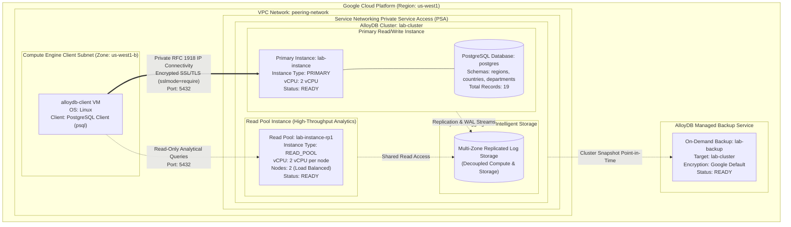

# AlloyDB Architecture Overview (GSP395)

This document details the architectural layout, network isolation, compute disaggregation, and storage tiering implemented for **Google Cloud AlloyDB for PostgreSQL** in **GSP395: Create and Manage AlloyDB Instances**.

---

## Architecture Diagram

---

## Architectural Highlights

### 1. Disaggregated Compute and Storage
Unlike traditional monolithic relational databases, Google Cloud AlloyDB separates compute processing nodes from database storage:
- **Compute Layer**: Independent compute instances (`PRIMARY` read/write node and multi-node `READ_POOL` read replicas) run PostgreSQL database engines.
- **Storage Layer**: Intelligent storage engine that handles write-ahead logs (WAL), automatic sharding, multi-zone synchronous replication, and continuous backups to Google Cloud storage tiers without impacting compute throughput.

### 2. Private Service Access (PSA) Networking
- **Zero Public Exposure**: The AlloyDB cluster is provisioned within Google-managed infrastructure connected to the customer VPC (`peering-network`) via private VPC Network Peering.
- **Private IP Connectivity**: Compute Engine VMs such as `alloydb-client` communicate directly with AlloyDB over private internal RFC 1918 IP addresses.
- **Transport Security**: Client connections enforce end-to-end cryptographic transit security using PostgreSQL SSL (`sslmode=require`).

### 3. Read Pool Horizontal Scalability
- The read pool `lab-instance-rp1` provisions 2 compute nodes sharing the underlying storage tier.
- AlloyDB provides a single read pool service IP address with built-in client load balancing across all read pool nodes, eliminating read-replica lag common in traditional physical replication setups.

### 4. Non-Disruptive On-Demand Backups
- The on-demand backup `lab-backup` captures a point-in-time snapshot of the `lab-cluster` storage layer.
- Because storage and compute are decoupled, backup generation incurs zero CPU or I/O performance penalty on the primary read/write database instance.

