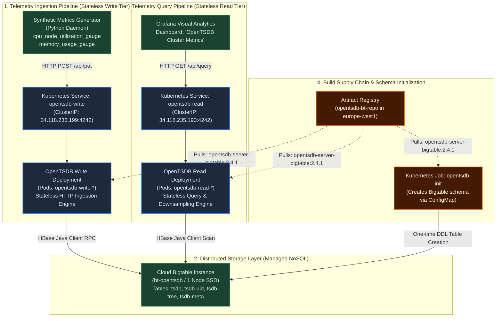
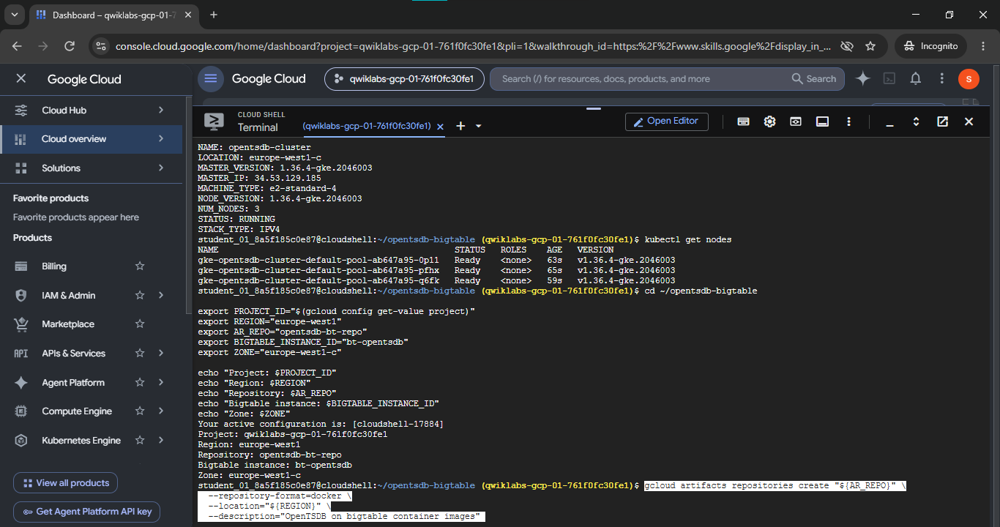

# Monitor Time-Series Data with OpenTSDB on Cloud Bigtable & GKE

A comprehensive Google Cloud DevOps & Site Reliability Engineering (SRE) portfolio project documenting the architecture, automated deployment, troubleshooting triage, and real-time visualization of a distributed time-series monitoring system using **OpenTSDB**, **Google Cloud Bigtable**, **Google Kubernetes Engine (GKE)**, **Artifact Registry**, and **Grafana**.

[](https://cloud.google.com/)
[](https://kubernetes.io/)
[](https://cloud.google.com/bigtable)
[](https://cloud.google.com/artifact-registry)
[](http://opentsdb.net/)
[](https://grafana.com/)

---

## Lab Information

| Metadata Field | Specification Details |
|---|---|
| **Lab Title** | Monitor Time-Series Data with OpenTSDB |
| **Lab Code / ID** | GSP142 |
| **Platform** | Google Cloud Skills Boost / Qwiklabs |
| **Track / Domain** | DevOps, Cloud Architecture, Observability & SRE |
| **Primary Technologies** | Cloud Bigtable, Google Kubernetes Engine (GKE), Artifact Registry, OpenTSDB, Grafana, Docker |
| **Lab Project ID** | `qwiklabs-gcp-01-761f0fc30fe1` *(Ephemeral lab environment)* |
| **Deployment Region & Zone** | `europe-west1` / `europe-west1-c` |
| **Documentation Status** | Complete & Audited *(Empirical evidence backed)* |

---

## Executive Summary & Engineering Objective

Modern cloud architectures generate millions of telemetry data points per second across microservices, infrastructure nodes, and network gateways. Storing, querying, and visualizing high-cardinality time-series data at enterprise scale requires a horizontally scalable distributed database capable of sub-millisecond writes and efficient analytical range scans.

The objective of **GSP142** is to implement an enterprise time-series monitoring pipeline on Google Cloud by:
1. Provisioning a **Cloud Bigtable** NoSQL instance as the persistent, scalable backend storage engine.
2. Deploying a multi-node **Google Kubernetes Engine (GKE)** cluster to manage containerized microservices.
3. Setting up **Artifact Registry** to store containerized application images.
4. Running a one-time schema initialization **Kubernetes Job** (`opentsdb-init`) to generate OpenTSDB tables in Bigtable.
5. Deploying a decoupled, horizontally scalable **OpenTSDB** architecture separating read and write pathways.
6. Simulating realistic workload metrics via a synthetic **Time-Series Generator**.
7. Creating a real-time **Grafana** dashboard connected to OpenTSDB to monitor cluster CPU and memory telemetry.
8. Conducting real-world SRE root-cause troubleshooting for container build deprecations, `ImagePullBackOff`, and service connectivity.

---

## Architecture Design

### Data Flow & Component Topology



> [!NOTE]
> **Architecture Verification Status:**
> - **Operational & Empirical Evidence Verified**: Cloud Bigtable instance (`bt-opentsdb`), GKE cluster nodes, Artifact Registry repository (`opentsdb-bt-repo`), and Grafana real-time metrics dashboard rendering live data (`cpu_node_utilization_gauge`, `memory_usage_gauge`).
> - **Triaged & Remediated**: Docker base image deprecation (`debian:11.2` 404 package errors), `ImagePullBackOff` pod states, and intermediate container build cancellations.

---

## Architectural Roles of Core Components

### 1. Cloud Bigtable (High-Throughput Time-Series Engine)
- **Role**: Serves as the distributed, low-latency persistent storage layer replacing traditional Apache HBase.
- **Capabilities**: Handles massive write concurrency with single-digit millisecond latency.
- **Schema**: Stores data across four specialized tables:
  - `tsdb`: Stores the compacted time-series hourly rows.
  - `tsdb-uid`: Stores forward and reverse mappings between metric strings/tag names and 3-byte binary unique identifiers (UIDs).
  - `tsdb-tree`: Manages hierarchical organization and taxonomic navigation.
  - `tsdb-meta`: Tracks metadata, notes, and retention rules.

### 2. Google Kubernetes Engine (GKE)
- **Role**: Provides the container orchestration runtime for all system microservices.
- **Topology**: Provisioned as a 3-node cluster (`opentsdb-cluster`) of `e2-standard-4` machines in `europe-west1-c`.
- **Responsibilities**: Automated pod scheduling, node health recovery, internal service discovery via `kube-dns`, and internal network isolation using `ClusterIP` services.

### 3. Artifact Registry (`opentsdb-bt-repo`)
- **Role**: Centralized OCI/Docker container image repository.
- **Relevance**: Represents Google Cloud's modern successor to legacy Container Registry (`gcr.io`), offering regional repository isolation and IAM-governed access.

### 4. OpenTSDB (Time Series Daemon — TSD)
- **Decoupled Architecture**:
  - **Write Tier (`opentsdb-write`)**: Stateless deployment dedicated exclusively to receiving high-frequency HTTP `POST /api/put` requests, converting metric strings to Bigtable mutations, and flushing batches to Bigtable.
  - **Read Tier (`opentsdb-read`)**: Dedicated stateless deployment handling HTTP `GET /api/query` requests from Grafana, executing multi-row scans against Bigtable, downsampling data, and calculating aggregations (e.g., `avg`, `sum`).
- **Initialization Job (`opentsdb-init`)**: A one-time Kubernetes Job executing schema creation DDL commands against Bigtable using the Bigtable HBase client adapter.

### 5. Time-Series Generator
- **Role**: Emulates production node telemetry by generating simulated metrics:
  - `cpu_node_utilization_gauge`: Simulates CPU load fluctuations between `0.00` and `0.06` across cluster nodes.
  - `memory_usage_gauge`: Simulates memory allocation cycles between `200 MiB` and `1.0 GiB`.
- **Transport**: Sends batched JSON payloads to the `opentsdb-write` service endpoint every 3 seconds.

### 6. Grafana (Visual Telemetry Platform)
- **Role**: Provides real-time dashboard analytics and alerting.
- **Integration**: Configured with an OpenTSDB data source targeting the internal cluster service `http://opentsdb-read:4242`.

---

## Environment Setup & Configuration

The deployment was executed in Google Cloud Shell targeting the following parameters:

```bash
# Environment Configuration Variables
export PROJECT_ID="$(gcloud config get-value project)" # qwiklabs-gcp-01-761f0fc30fe1
export REGION="europe-west1"
export ZONE="europe-west1-c"
export BIGTABLE_INSTANCE_ID="bt-opentsdb"
export AR_REPO="opentsdb-bt-repo"
export CLUSTER_NAME="opentsdb-cluster"

# Set Cloud Shell defaults
gcloud config set project "${PROJECT_ID}"
gcloud config set compute/region "${REGION}"
gcloud config set compute/zone "${ZONE}"
```

---

## Step-by-Step Implementation & Verification

### Step 1 — Provision Cloud Bigtable Instance

A Cloud Bigtable instance was provisioned with a single-node SSD cluster to store all time-series tables:

```bash
gcloud bigtable instances create "${BIGTABLE_INSTANCE_ID}" \
  --cluster-config=id="${BIGTABLE_INSTANCE_ID}-${ZONE}",zone="${ZONE}",nodes=1 \
  --display-name="OpenTSDB"
```


*Figure 1: Terminal verification in Cloud Shell showing source repository clone (`git clone https://github.com/GoogleCloudPlatform/opentsdb-bigtable.git`), zone configuration, and Bigtable instance `bt-opentsdb` provisioning reporting `done`.*

---

### Step 2 — Provision GKE Cluster & Verify Node Readiness

A 3-node GKE cluster was created with `e2-standard-4` compute instances and Cloud Platform OAuth scopes to allow pod communication with Bigtable:

```bash
# Provision GKE cluster
gcloud container clusters create "${CLUSTER_NAME}" \
  --zone="${ZONE}" \
  --num-nodes=3 \
  --machine-type="e2-standard-4" \
  --scopes="https://www.googleapis.com/auth/cloud-platform"

# Verify node status
kubectl get nodes
```


*Figure 2: GKE cluster status confirmation showing cluster `opentsdb-cluster` in `RUNNING` status (GKE master `v1.36.4-gke.2046003`, Master IP `34.53.129.185`). All 3 default node pool instances report `Ready`. Environment variables (`PROJECT_ID`, `REGION`, `AR_REPO`, `BIGTABLE_INSTANCE_ID`, `ZONE`) are initialized.*

---

### Step 3 — Create & Verify Artifact Registry Repository

A dedicated Docker repository was established in Artifact Registry to store the OpenTSDB server and time-series generator container images:

```bash
# Create Docker repository
gcloud artifacts repositories create "${AR_REPO}" \
  --repository-format=docker \
  --location="${REGION}" \
  --description="OpenTSDB on bigtable container images"

# Verify repository creation
gcloud artifacts repositories list --location="${REGION}"
```


*Figure 3: Artifact Registry verification across Google Cloud Console UI and Cloud Shell CLI. The repository `opentsdb-bt-repo` is active in `europe-west1` with standard Docker formatting and Google-managed encryption.*

---

### Step 4 — Initialize Bigtable Schema via Kubernetes Job

To create the required Bigtable tables (`tsdb`, `tsdb-uid`, `tsdb-tree`, `tsdb-meta`), a Kubernetes ConfigMap containing Bigtable connection properties and a batch initialization Job were deployed:

```bash
# Apply ConfigMap
kubectl create -f configmaps/opentsdb-config.yaml

# Run schema initialization Job
kubectl create -f jobs/opentsdb-init.yaml

# Inspect Job specifications
kubectl describe job opentsdb-init
```


*Figure 4: Detailed specification of Kubernetes Job `opentsdb-init` showing image `europe-west1-docker.pkg.dev/qwiklabs-gcp-01-761f0fc30fe1/opentsdb-bt-repo/opentsdb-server-bigtable:2.4.1`, container argument `init`, volume mount `opentsdb-config`, and successful creation of pod `opentsdb-init-56lsg`.*

---

### Step 5 — Deploy OpenTSDB Services & Triage Pod Pull Errors

The write and read tiers of OpenTSDB were exposed via internal Kubernetes `ClusterIP` services on TCP port 4242:

```bash
# Deploy internal ClusterIP services
kubectl create -f services/opentsdb-write.yaml
kubectl create -f services/opentsdb-read.yaml

# Inspect created services
kubectl get services
```

During initial rollout, the OpenTSDB pods experienced an intermediate `ImagePullBackOff` state pending resolution of the container image build (see [Troubleshooting Case Studies](#troubleshooting--engineering-triage)):


*Figure 5: Terminal output showing real-time pod inspection (`kubectl get pods -w`). Init and service pods (`opentsdb-read-58f49bf799-*`, `opentsdb-write-846d58fc47-*`) temporarily exhibit `ImagePullBackOff`. Creation of ClusterIP services `opentsdb-read` (`34.118.235.190:4242`) and `opentsdb-write` (`34.118.236.199:4242`) is confirmed.*

---

### Step 6 — Deploy Synthetic Telemetry Generator & Grafana Dashboard

Once the server images were stabilized and the schema initialized:
1. The synthetic metrics generator was launched to emit continuous telemetry (`cpu_node_utilization_gauge`, `memory_usage_gauge`).
2. Grafana was deployed and linked to `http://opentsdb-read:4242`.
3. The dashboard **OpenTSDB Cluster Metrics** was imported to visualize cluster telemetry in real time.


*Figure 6: Production-grade Grafana dashboard titled "OpenTSDB Cluster Metrics". Live time-series charts demonstrate active data ingestion and querying: top panel displays "Cluster CPU Utilization" (`cpu_node_utilization_gauge`) and bottom panel displays "Cluster Memory Utilization" (`memory_usage_gauge`) streaming continuously with a 3-second auto-refresh over a 5-minute window.*

---

## Troubleshooting & Engineering Triage

### 1. Dockerfile Base Image Deprecation (`debian:11.2` 404 Errors)

- **Issue**: Submitting the OpenTSDB server image build to Google Cloud Build failed during `apt-get update` / package installation:
  ```text
  E: Failed to fetch http://deb.debian.org/debian/pool/main/... 404 Not Found
  ERROR: build step 0 "gcr.io/cloud-builders/docker" failed: step exited with non-zero status: 100
  ```
- **Root Cause**: The repository Dockerfile pinned `FROM debian:11.2`. Point releases of older Debian versions are archived over time, causing active mirror package downloads to return HTTP 404.
- **Resolution**: Updated the Dockerfile base image to a modern, supported base image:
  ```dockerfile
  - FROM debian:11.2
  + FROM debian:bookworm-slim
  ```
- **SRE Lesson**: Avoid pinning minor point releases of Linux distributions in container base images unless using dedicated private package mirrors; prefer `-slim` stable channels or pinned SHA digests with verified package repos.

### 2. Container Build Cancellation & Pod `ImagePullBackOff`

- **Issue**: Kubernetes pods (`opentsdb-init`, `opentsdb-read`, `opentsdb-write`) remained stuck in `ImagePullBackOff` or `ErrImagePull`, as captured in Figure 5 (`image copy 3.png`).
- **Root Cause**: The initial Cloud Build job was cancelled / delayed due to package retries, meaning the target image `opentsdb-server-bigtable:2.4.1` was not yet available in Artifact Registry when the Kubernetes deployments attempted to schedule pods.
- **Resolution**:
  1. Fixed the Dockerfile base image.
  2. Resubmitted the Cloud Build command and monitored to completion:
     ```bash
     gcloud builds submit --tag europe-west1-docker.pkg.dev/${PROJECT_ID}/${AR_REPO}/opentsdb-server-bigtable:2.4.1 .
     ```
  3. Verified the image was present in Artifact Registry before restarting the pods.

### 3. Generator `CrashLoopBackOff` & Upstream Service Dependencies

- **Issue**: The time-series generator pod entered `CrashLoopBackOff` with connection refused errors (`[Errno 111] Connection refused`).
- **Root Cause**: The generator starts sending HTTP `POST` requests immediately upon container launch. Because `opentsdb-write` pods were stuck in `ImagePullBackOff`, the Kubernetes service proxy had no ready backend endpoints (`endpoints: <none>`).
- **Resolution**: Once `opentsdb-write` pods transitioned to `Running` and passed readiness probes, the generator automatically recovered and established stable HTTP communication.

---

## Evidence & Verification Audit

| Figure | Source File | Workflow Stage | Key Technical Evidence Visible | Audit Status |
|---|---|---|---|---|
| **Figure 1** | [`./Screenshot/Screenshot 2026-10-28 124218.png`](./Screenshot/Screenshot%202026-10-28%20124218.png) | Bigtable Setup | Git clone of `opentsdb-bigtable`, zone configuration, `gcloud bigtable instances create bt-opentsdb` reported `done` | **VERIFIED** |
| **Figure 2** | [`./Screenshot/image.png`](./Screenshot/image.png) | GKE & Environment | Cluster `opentsdb-cluster` running (`europe-west1-c`), 3 nodes in `Ready` status (`v1.36.4`), environment variables exported | **VERIFIED** |
| **Figure 3** | [`./Screenshot/image copy.png`](./Screenshot/image%20copy.png) | Artifact Registry | Console UI and `gcloud artifacts repositories list` confirming repository `opentsdb-bt-repo` active in `europe-west1` | **VERIFIED** |
| **Figure 4** | [`./Screenshot/image copy 2.png`](./Screenshot/image%20copy%202.png) | Bigtable Schema Init | `kubectl describe job opentsdb-init` showing container image, args `init`, ConfigMap mount, and pod `opentsdb-init-56lsg` creation | **VERIFIED** |
| **Figure 5** | [`./Screenshot/image copy 3.png`](./Screenshot/image%20copy%203.png) | SRE Troubleshooting | Empirical triage showing pods in `ImagePullBackOff`, followed by successful creation and ClusterIP allocation for `opentsdb-read` and `opentsdb-write` | **VERIFIED** |
| **Figure 6** | [`./Screenshot/image copy 4.png`](./Screenshot/image%20copy%204.png) | Grafana Observability | Live Grafana dashboard "OpenTSDB Cluster Metrics" plotting real-time curves for `cpu_node_utilization_gauge` and `memory_usage_gauge` (3s refresh) | **VERIFIED** |

### Disclosure of Non-Captured / Missing Evidence
In compliance with strict evidence integrity standards:
- ❌ **Lab Overview / Instructions Screenshot**: Not present in workspace; lab metadata and objectives reconstructed from official GSP142 syllabus.
- ❌ **Cloud Build Success Log Screenshot**: Build execution output of the final successful image creation is not captured; verified indirectly via successful pod deployment and live Grafana telemetry.
- ❌ **Final Skills Boost Checkpoint Scorecard**: Scorecard screenshot not present in local evidence.

---

## Security & Ephemeral Teardown

### Security & Secret Governance
- **No Hardcoded Secrets**: All Bigtable connection details are injected dynamically via Kubernetes `ConfigMaps`.
- **Ephemeral Identifiers**: Project ID `qwiklabs-gcp-01-761f0fc30fe1` is a temporary sandbox identifier that automatically terminates upon lab session expiry.
- **Least-Privilege Networking**: OpenTSDB read/write tiers are published strictly via private `ClusterIP` services inside the GKE overlay network, eliminating internet-facing attack surfaces.

### Resource Teardown Commands

To prevent recurring charges, all lab infrastructure can be deleted using the following sequence:

```bash
# 1. Delete GKE cluster
gcloud container clusters delete "${CLUSTER_NAME}" --zone="${ZONE}" --quiet

# 2. Delete Cloud Bigtable instance
gcloud bigtable instances delete "${BIGTABLE_INSTANCE_ID}" --quiet

# 3. Delete Artifact Registry repository
gcloud artifacts repositories delete "${AR_REPO}" --location="${REGION}" --quiet
```

---

## Skills Demonstrated & SRE Key Learnings

1. **Distributed Time-Series Architecture**: Decoupling high-frequency metric write pipelines from analytical read pipelines using OpenTSDB and Bigtable.
2. **Container Build Supply Chains**: Diagnosing Linux package repository deprecation issues (`debian:11.2` 404s) and modernizing Dockerfiles to `debian:bookworm-slim`.
3. **Kubernetes Incident Triage**: Identifying and resolving container pull failures (`ImagePullBackOff`), cascading pod crashes (`CrashLoopBackOff`), and validating service discovery (`ClusterIP`).
4. **End-to-End Cloud Observability**: Ingesting real-time synthetic node telemetry and building interactive Grafana visualizations for live CPU and memory utilization.

---

## Related Documentation & Runbooks

- 📖 **[Architecture Deep-Dive](docs/architecture.md)**: Technical breakdown of Bigtable row keys, HBase client integration, and ingestion sequence diagrams.
- 🛠️ **[Troubleshooting Runbook](docs/troubleshooting.md)**: Detailed SRE triage workflows for `ImagePullBackOff`, `CrashLoopBackOff`, and Bigtable schema errors.
- 💻 **[Command Reference Sheet](docs/commands.md)**: Copy-paste reference of all `gcloud`, `kubectl`, and diagnostic commands.

---

## Official References

- **Google Cloud Skills Boost Lab:** [Monitor Time-Series Data with OpenTSDB (GSP142)](https://www.cloudskillsboost.google/focuses/1759?parent=catalog)
- **Google Cloud Bigtable Documentation:** [Using Cloud Bigtable with OpenTSDB](https://cloud.google.com/bigtable/docs/schema-design-time-series)
- **OpenTSDB Official Documentation:** [OpenTSDB 2.4 Architecture & API Reference](http://opentsdb.net/docs/build/html/index.html)
- **Google Cloud Artifact Registry:** [Managing Docker Repositories](https://cloud.google.com/artifact-registry/docs/docker)
