# OpenTSDB on Cloud Bigtable & GKE — Architecture Deep-Dive

## Architectural Overview

This document provides a technical deep-dive into the design, data pipelines, storage model, and networking architecture for monitoring time-series telemetry using **OpenTSDB**, **Google Cloud Bigtable**, and **Google Kubernetes Engine (GKE)**.

The system decouples high-throughput metric ingestion (writes) from analytical query rendering (reads), leveraging Bigtable as an horizontally scalable NoSQL storage engine and Kubernetes for microservice lifecycle management.

---

## High-Level Architecture Diagram

```mermaid
flowchart TD
    subgraph DataIngestion ["1. Telemetry Ingestion Pipeline (Intended & Verified)"]
        Gen["Synthetic Metrics Generator<br/>(cpu_node_utilization_gauge<br/>memory_usage_gauge)"]
        WriteSvc["Kubernetes Service: opentsdb-write<br/>(ClusterIP: Port 4242)"]
        WritePods["OpenTSDB Write Pods<br/>(Stateless Ingestion Tier)"]
        
        Gen -->|HTTP POST /api/put| WriteSvc
        WriteSvc --> WritePods
    end

    subgraph StorageTier ["2. Persistent Storage Tier (Verified Operational)"]
        BT["Cloud Bigtable Instance<br/>(bt-opentsdb / 1 Node SSD)<br/>Tables: tsdb, tsdb-uid, tsdb-tree, tsdb-meta"]
        WritePods -->|HBase Java Client (RPC)| BT
    end

    subgraph QueryPipeline ["3. Telemetry Query Pipeline (Verified Operational)"]
        Grafana["Grafana Visual Analytics<br/>Dashboard: OpenTSDB Cluster Metrics"]
        ReadSvc["Kubernetes Service: opentsdb-read<br/>(ClusterIP: Port 4242)"]
        ReadPods["OpenTSDB Read Pods<br/>(Stateless Query Engine)"]
        
        Grafana -->|HTTP GET /api/query| ReadSvc
        ReadSvc --> ReadPods
        ReadPods -->|HBase Java Client (Scan)| BT
    end

    subgraph ImageSupplyChain ["4. Container Registry (Build Triage)"]
        AR["Artifact Registry<br/>(opentsdb-bt-repo in europe-west1)"]
        AR -.->|Pulls Server Image<br/>(opentsdb-server-bigtable:2.4.1)| WritePods
        AR -.->|Pulls Server Image<br/>(opentsdb-server-bigtable:2.4.1)| ReadPods
        AR -.->|Pulls Init Image| InitJob["Kubernetes Job:<br/>opentsdb-init"]
        InitJob -->|One-time Table Schema Creation| BT
    end

    classDef verified fill:#1e3a1e,stroke:#4caf50,stroke-width:2px,color:#ffffff;
    classDef intended fill:#2a2a3e,stroke:#3f51b5,stroke-width:2px,color:#ffffff;
    classDef triage fill:#4a2b0f,stroke:#ff9800,stroke-width:2px,color:#ffffff;

    class BT,Grafana,Gen verified;
    class WriteSvc,ReadSvc,WritePods,ReadPods intended;
    class AR,InitJob triage;
```

---

## Architectural Separation of Concerns

### 1. Ingestion Tier (`opentsdb-write`)
- **Role**: Ingests raw metric data points from monitoring agents, exporters, and synthetic generators.
- **Protocol**: HTTP REST API (`/api/put`) and Telnet-compatible socket protocol on port `4242`.
- **Scaling Characteristics**: Horizontally scalable stateless deployments. Ingestion pods parse incoming metric payloads, resolve metric and tag strings to unique 3-byte identifiers (UIDs), and execute asynchronous `Put` batches to Cloud Bigtable.
- **Failure Domain**: Failure of a write pod does not affect historical query capability; traffic is rebalanced across surviving pods by the `opentsdb-write` Kubernetes `ClusterIP` service.

### 2. Query Tier (`opentsdb-read`)
- **Role**: Serves analytical aggregations, downsampling, and range queries to frontend visualization tools like Grafana.
- **Protocol**: HTTP REST API (`/api/query`) on port `4242`.
- **Scaling Characteristics**: Queries are read-heavy, performing multi-row scans across Bigtable row keys. Read pods are isolated from the write path to prevent large range queries from saturating CPU or memory required for real-time ingestion.
- **Failure Domain**: Heavy analytical queries do not degrade ingestion throughput or cause write-side backpressure.

### 3. Storage Engine (Cloud Bigtable)
- **Role**: Acts as the distributed, persistent storage layer replacing traditional Apache HBase.
- **Integration**: OpenTSDB communicates with Bigtable through the Google Cloud Bigtable client adapter for Apache HBase (`google-bigtable-hbase-2.x`).
- **Core Tables**:
  - `tsdb`: Stores the actual time-series data points.
  - `tsdb-uid`: Stores forward and reverse mappings between string names (metrics, tag keys, tag values) and 3-byte binary UIDs.
  - `tsdb-meta`: Optional metadata index for metrics and timeseries tags.
  - `tsdb-tree`: Hierarchical organization of metrics.

---

## Bigtable Time-Series Data Model & Row Key Design

OpenTSDB achieves high write throughput and millisecond range scans by compacting time-series points into Bigtable rows using a specialized row key layout:

```text
+-------------------+-------------------+-------------------+-------------------+
| Metric UID (3B)   | Base Timestamp (4B)| TagKey UID (3B)   | TagValue UID (3B) |
+-------------------+-------------------+-------------------+-------------------+
```

### Row Key Components
1. **Metric UID (3 bytes)**: Binary identifier representing the metric (e.g., `cpu_node_utilization_gauge`).
2. **Base Timestamp (4 bytes)**: Unix timestamp normalized to an hour boundary (e.g., `1710000000`). All data points generated within the same hour for the same metric/tag combination reside in the same row.
3. **Tags (Variable / Multiples of 6 bytes)**: Lexicographically sorted pairs of `TagKey UID (3 bytes)` + `TagValue UID (3 bytes)` (e.g., `node=gke-node-1`).

### Column Compaction
- Each column qualifier within the row represents an offset (in seconds or milliseconds) from the row's base timestamp.
- Column values store the recorded floating-point or integer metric value.
- At the end of each hour, OpenTSDB compacts all individual column cells into a single compressed column value, significantly reducing storage footprint and read latency.

---

## Telemetry Ingestion & Query Sequence

```mermaid
sequenceDiagram
    autonumber
    actor Generator as Synthetic Telemetry Generator
    participant WriteSvc as opentsdb-write (ClusterIP)
    participant TSD_Write as OpenTSDB Write Daemon
    participant Bigtable as Cloud Bigtable (bt-opentsdb)
    participant TSD_Read as OpenTSDB Read Daemon
    participant ReadSvc as opentsdb-read (ClusterIP)
    actor Grafana as Grafana Dashboard

    %% Ingestion Flow
    rect rgb(25, 45, 25)
    Note over Generator,Bigtable: Ingestion Flow (Every 3 seconds)
    Generator->>WriteSvc: POST /api/put [cpu_node_utilization, timestamp, value]
    WriteSvc->>TSD_Write: Route to healthy ingestion pod
    TSD_Write->>Bigtable: Lookup/Assign 3-byte UID in 'tsdb-uid' table
    TSD_Write->>Bigtable: Put mutation to 'tsdb' table (compacted hour row)
    Bigtable-->>TSD_Write: RPC ACK (Write persisted to Colossus/Bigtable logs)
    TSD_Write-->>Generator: HTTP 204 No Content
    end

    %% Query Flow
    rect rgb(25, 35, 55)
    Note over Grafana,Bigtable: Query & Visualization Flow (Auto-refresh: 3s)
    Grafana->>ReadSvc: GET /api/query?start=5m-ago&m=avg:cpu_node_utilization_gauge
    ReadSvc->>TSD_Read: Route to healthy query pod
    TSD_Read->>Bigtable: Scan range [Metric_UID + Start_Hour] to [Metric_UID + End_Hour]
    Bigtable-->>TSD_Read: Return row slice with delta column offsets
    TSD_Read->>TSD_Read: Decompact, downsample, and aggregate time-series
    TSD_Read-->>ReadSvc: JSON array of [timestamp, metric_value]
    ReadSvc-->>Grafana: HTTP 200 OK
    Grafana->>Grafana: Render SVG line graph on dashboard
    end
```



---

## Network & Service Discovery Layout

All inter-component communication inside the GKE cluster uses internal Kubernetes DNS resolution and ClusterIP services, avoiding external internet hops and minimizing latency.

| Service Name | Type | Cluster Port | Target Port | Protocol | Consumer | Purpose |
|---|---|---|---|---|---|---|
| `opentsdb-write` | `ClusterIP` | `4242` | `4242` | TCP / HTTP | Metrics Generator / Exporters | High-throughput point ingestion |
| `opentsdb-read` | `ClusterIP` | `4242` | `4242` | TCP / HTTP | Grafana Data Source | Low-latency range querying |
| `grafana` | `ClusterIP` / `LoadBalancer` | `3000` | `3000` | HTTP | SRE / DevOps Operators | Dashboard visualization |
| `kubernetes` | `ClusterIP` | `443` | `443` | TCP / TLS | Workloads & Controllers | GKE Control Plane API |

---

## Production SRE Considerations

1. **Bigtable Cluster Scaling**: A production Bigtable instance should utilize multi-cluster replication across distinct availability zones or regions for 99.99% availability and disaster recovery.
2. **Horizontal Pod Autoscaling (HPA)**: Both `opentsdb-write` and `opentsdb-read` tiers should be coupled with Kubernetes HPAs triggered on CPU utilization and request concurrency.
3. **Workload Identity**: In enterprise setups, GKE pods authenticate to Cloud Bigtable via Google Cloud Workload Identity instead of local service account key secrets, enforcing short-lived OAuth 2.0 token security.
