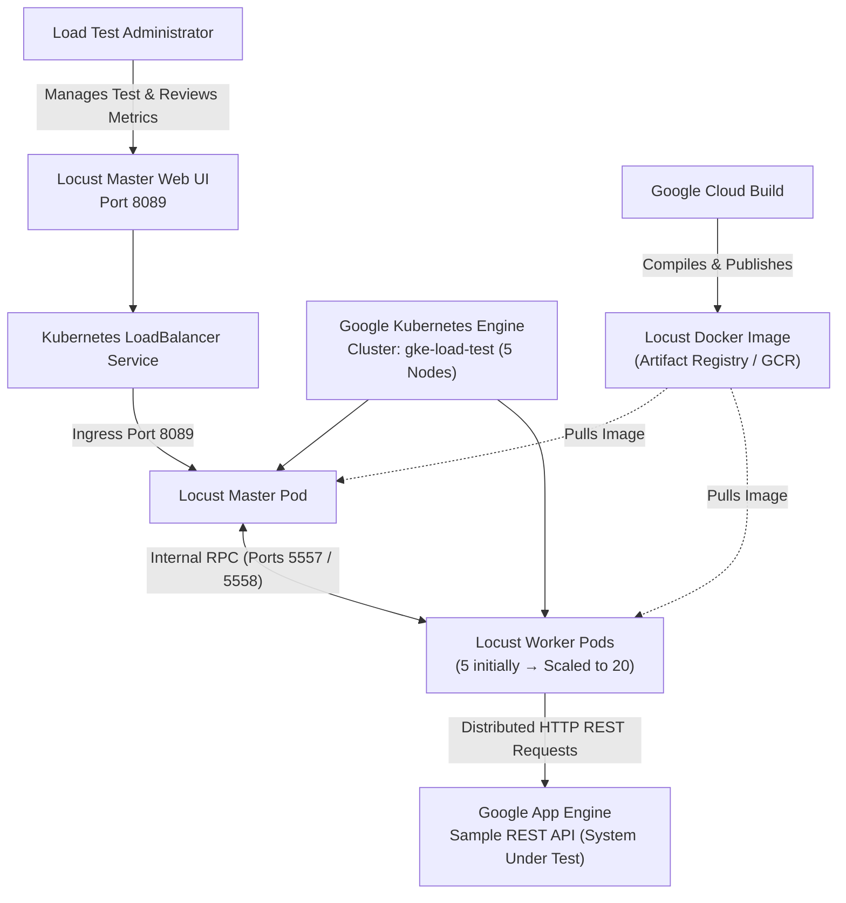
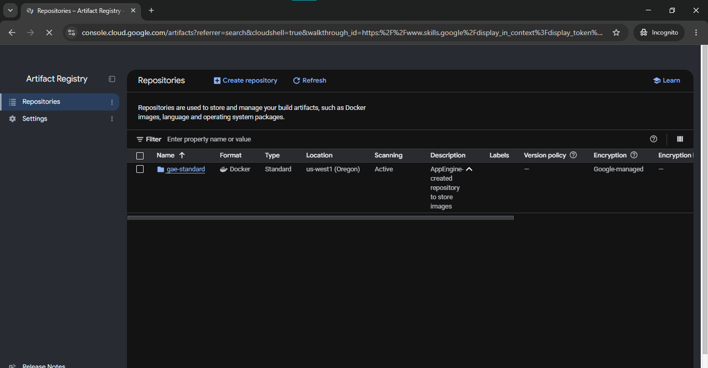
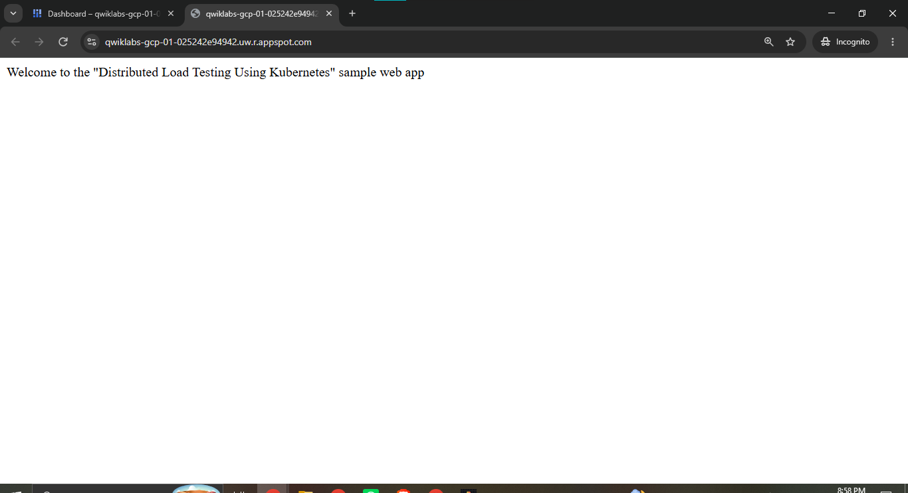
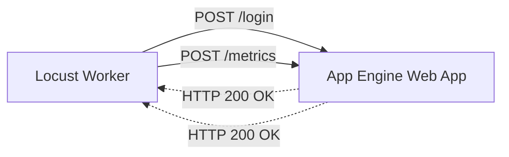
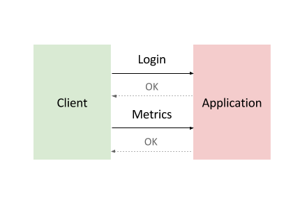
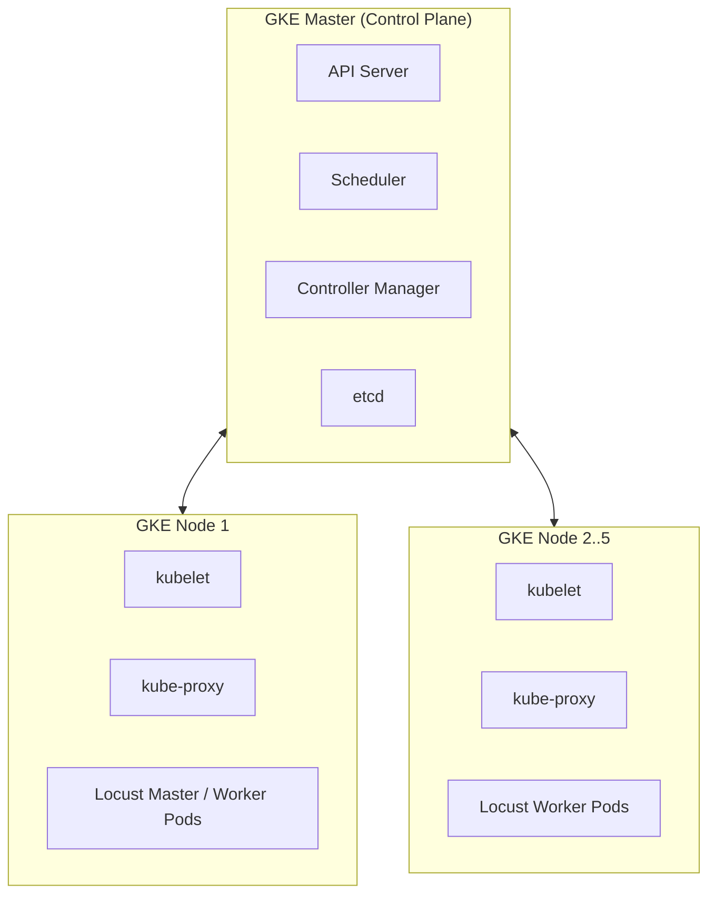
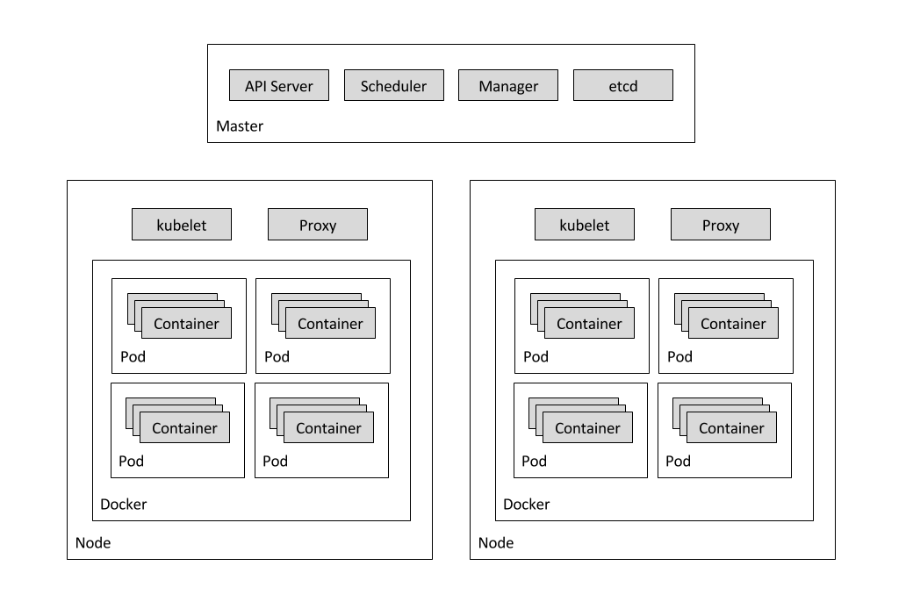

# GSP182 – Distributed Load Testing Using Kubernetes

[](https://cloud.google.com/)
[](https://cloud.google.com/kubernetes-engine)
[](https://www.docker.com/)
[](https://locust.io/)
[](#k-lab-completion)

> **Architectural Case Study:** Deploying and scaling a distributed, high-concurrency performance-testing framework on Google Kubernetes Engine (GKE) using Locust to simulate distributed HTTP traffic against a serverless target application hosted on Google App Engine.

---

## 📋 Lab Information

| Attribute | Specification |
|:---|:---|
| **Lab Name** | Distributed Load Testing Using Kubernetes |
| **Lab ID** | `GSP182` |
| **Platform** | Google Cloud Skills Boost |
| **Track / Category** | Google Cloud – Infrastructure & Performance / Kubernetes |
| **Difficulty Level** | Introductory |
| **Duration** | 20 Minutes |
| **Cost** | No cost (Google Cloud Skills Boost) |
| **Completion Status** | **Successfully Completed** ✅ |
| **Primary Focus** | Distributed load testing using Kubernetes and Locust |

---

## 📖 Project Overview

Single-machine load testing typically encounters host operating system bottlenecks—including socket exhaustion, ephemeral port limits, and local CPU starvation—long before stressing modern cloud-scale applications. To simulate genuine high-volume traffic, Site Reliability Engineers (SREs) and DevOps professionals deploy distributed load-testing clusters capable of coordinating requests across multiple worker machines.

In this project:
- **Google App Engine** hosts the sample REST API serving as the **system under test** (a demonstration web application designed to receive benchmark traffic, not a production application).
- **Docker** containerizes the Locust performance-testing workload, packing Python scripts and task definitions into portable images.
- **Google Cloud Build** asynchronously compiles and publishes the container image to Google Container Registry / Artifact Registry.
- **Google Kubernetes Engine (GKE)** provisions and orchestrates the managed compute cluster (`gke-load-test`).
- **Kubernetes Deployments** govern the lifecycle, desired replica states, and automatic restarts of the Locust master and worker Pods.
- **Kubernetes Services** provide internal service discovery (`ClusterIP` for RPC traffic) and external accessibility (`LoadBalancer` for the web interface).
- **Locust** generates distributed, asynchronous user traffic across multiple worker containers.
- **Locust Master Web Interface** aggregates real-time metrics, response-time percentiles, and request-per-second (RPS) statistics on port `8089`.

---

## 🏗️ Architecture Diagram



> [!NOTE]
> *The diagram above represents a conceptual architecture illustrating the logical relationships between the test administrator, GKE orchestration layer, Locust master-worker coordination channels, and the App Engine target application.*

### Component Responsibilities:
1. **Load Test Administrator:** Configures simulated user counts, hatch/spawn rates, and oversees live telemetry via the Locust web dashboard.
2. **Kubernetes LoadBalancer Service (`locust-master`):** Allocates a public external IP forwarding HTTP traffic on port `8089` to the Locust master Pod.
3. **Locust Master Pod:** Manages the web control plane, distributes scenario tasks to registered workers, and aggregates response metrics over internal ZeroMQ/RPC channels (ports `5557` and `5558`). The master does not generate load itself, preserving metric integrity.
4. **Locust Worker Pods:** Horizontally scaled compute containers that concurrently execute simulated user transactions against the target API.
5. **Google Kubernetes Engine (`gke-load-test`):** A 5-node managed Kubernetes cluster balancing container resources, networking, and scheduling across Compute Engine instances.
6. **Google App Engine:** Serverless PaaS environment serving the target Python web application receiving simulated load.
7. **Google Cloud Build:** Serverless container compilation engine building the Locust image directly from Dockerfile assets.

---

## 💻 Technology Stack

| Technology | Purpose |
|:---|:---|
| **Google Cloud Platform (GCP)** | Enterprise cloud infrastructure hosting compute, storage, and networking |
| **Google Kubernetes Engine (GKE)** | Managed Kubernetes cluster orchestrating master and worker workloads |
| **Kubernetes** | Declarative container orchestration (Deployments, Pods, Services, Replica Scaling) |
| **Docker** | Containerization of the Locust test runner and dependency packaging |
| **Google Cloud Build** | Serverless CI pipeline for building and publishing container images |
| **Locust** | Open-source, Python-driven distributed load-testing framework |
| **Python** | Runtime language for the App Engine REST API and Locust test scenario definitions |
| **Google App Engine** | Serverless application platform hosting the target REST application under test |
| **`kubectl`** | Command-line interface for deploying, inspecting, and scaling Kubernetes resources |
| **`gcloud` CLI** | Google Cloud management tool for cluster provisioning and deployment workflows |

---

## ⚙️ Implementation Workflow

The implementation follows eight structured technical tasks:

### Task 1 – Set Project and Zone
Configured essential shell variables in Google Cloud Shell and established persistent regional defaults:

```bash
PROJECT=$(gcloud config get-value project)
REGION="us-central1"
ZONE="us-central1-a"
CLUSTER=gke-load-test
TARGET=${PROJECT}.appspot.com

gcloud config set compute/region "$REGION"
gcloud config set compute/zone "$ZONE"
```
- `PROJECT`: Resolves the active Google Cloud project identifier.
- `REGION` & `ZONE`: Sets the geographic placement for compute and cluster resources.
- `CLUSTER`: Designates the name for the GKE cluster (`gke-load-test`).
- `TARGET`: Formulates the default serving URL hostname for the Google App Engine sample application (`[PROJECT_ID].appspot.com`).

---

### Task 2 – Download Source Code and Build Docker Image
Downloaded the official GSP182 repository from Google Cloud Storage, updated the sample application configuration to a modern Python runtime, and compiled the Locust container image using Google Cloud Build:

```bash
# 1. Download official lab assets from Cloud Storage
gcloud storage cp -r gs://spls/gsp182/distributed-load-testing-using-kubernetes .

# 2. Modernize App Engine runtime from python37 to python312
cd distributed-load-testing-using-kubernetes/sample-webapp/
sed -i "s/python37/python312/g" app.yaml

# 3. Return to project root directory where docker-image/ exists
cd ..

# 4. Trigger Cloud Build from the project root
gcloud builds submit --tag gcr.io/$PROJECT/locust-tasks:latest docker-image/.
```

> [!IMPORTANT]
> The `gcloud builds submit` command **must** be executed from the `distributed-load-testing-using-kubernetes/` root directory where the `docker-image/` subdirectory and Dockerfile context are located. Running it from an incorrect folder fails to find the build context.

#### Practical Evidence: Container Image Build & Artifact Repository

*Figure 1: Google Cloud Console Artifact Registry showing the container repository (`gae-standard`) created during deployment in region `us-west1` for project `qwiklabs-gcp-01-025242e94942`.*

---

### Task 3 – Deploy the Sample Web Application
Deployed the sample Python REST web application to Google App Engine standard environment to act as the target system under test:

```bash
# Deploy sample application to App Engine
gcloud app deploy sample-webapp/app.yaml --quiet
```

The sample application exposes endpoints (such as `/login` and `/metrics`) designed to handle HTTP traffic and return structured responses. The `TARGET` variable represents the serving domain (`https://${TARGET}`) that Locust workers target during testing.

#### Practical Evidence: Sample Web Application Under Test

*Figure 2: Browser verification of the live sample web application running on Google App Engine (`qwiklabs-gcp-01-025242e94942.uw.r.appspot.com`) displaying 'Welcome to the "Distributed Load Testing Using Kubernetes" sample web app'.*



*Figure 3: Conceptual client-to-application communication protocol illustrating simulated user login and metrics submission flows.*

---

### Task 4 – Create the GKE Cluster
Provisioned a dedicated 5-node Google Kubernetes Engine cluster (`gke-load-test`) to provide distributed compute and network capacity:

```bash
gcloud container clusters create $CLUSTER \
  --zone $ZONE \
  --num-nodes=5
```
- **Node Allocation:** 5 Compute Engine instances distribute Pod network traffic across distinct physical host interfaces.
- **Host Role:** Serves as the orchestration substrate for the single Locust master Pod and horizontally scaled worker Pods.



*Figure 4: Kubernetes cluster architecture illustrating control plane components (API Server, Scheduler, Manager, etcd) orchestrating worker nodes (kubelet, kube-proxy, container runtimes).*

---

### Task 5 – Configure Locust Master
Inspected and prepared the Locust master Kubernetes manifests:
- **Deployment Descriptor (`locust-master-controller.yaml`):** Declares 1 master replica using the compiled Locust container image.
- **Port Exposure:** Exposes web dashboard port `8089`, and worker RPC communication ports `5557` and `5558`.
- **Target Host Binding:** Injects the App Engine target domain so master and worker pods reference the correct system under test.

---

### Task 6 – Deploy Locust Master
Substituted environment variables into the controller manifest and deployed the master controller and its external service:

```bash
# Substitute target host and project ID placeholders
sed -i -e "s/\[TARGET_HOST\]/$TARGET/g" kubernetes-config/locust-master-controller.yaml
sed -i -e "s/\[PROJECT_ID\]/$PROJECT/g" kubernetes-config/locust-master-controller.yaml

# Deploy Locust Master Deployment and verify Pod status
kubectl apply -f kubernetes-config/locust-master-controller.yaml
kubectl get pods -l app=locust-master

# Deploy Locust Master LoadBalancer Service and inspect external endpoint
kubectl apply -f kubernetes-config/locust-master-service.yaml
kubectl get svc locust-master
```

The Kubernetes `LoadBalancer` service automatically provisions a Google Cloud Network Load Balancer, assigning an external IP that allows administrators to access the Locust web interface on port `8089`.

---

### Task 7 – Deploy and Scale Locust Workers
Substituted configuration values into the worker manifest, deployed the baseline worker pool, and elastically scaled the deployment:

```bash
# 1. Substitute project ID into worker manifest
sed -i -e "s/\[PROJECT_ID\]/$PROJECT/g" kubernetes-config/locust-worker-controller.yaml

# 2. Deploy baseline worker Deployment (5 Pods)
kubectl apply -f kubernetes-config/locust-worker-controller.yaml
kubectl get pods -l app=locust-worker

# 3. Horizontally scale worker Deployment from 5 to 20 replicas
kubectl scale deployment/locust-worker --replicas=20

# 4. Verify all 20 worker Pods transitioned to Running
kubectl get pods -l app=locust-worker
```

#### Worker Deployment Scaling Comparison

| Configuration State | Desired Worker Replicas | Operational Purpose |
|:---|:---:|:---|
| **Initial Deployment** | `5` | Baseline distributed test pool (1 worker per GKE node) |
| **Scaled Deployment** | `20` | High-density load generation pool (4 workers per GKE node) |

> [!NOTE]
> Scaling the worker Deployment quadruples (400%) the distributed load-generation capacity of the cluster. Actual target throughput (RPS) and latency characteristics depend on the serverless autoscaling behavior and backend capacity of the target system under test.

---

### Task 8 – Execute Distributed Load Testing
Retrieved the external IP allocated to the Locust master service to connect to the interactive management dashboard:

```bash
# Retrieve external LoadBalancer IP
EXTERNAL_IP=$(kubectl get svc locust-master -o yaml | grep ip: | awk -F": " '{print $NF}')

# Output dashboard URL
echo "http://${EXTERNAL_IP}:8089"
```

#### Load-Testing Execution Procedure:
1. Navigated to `http://[EXTERNAL_IP]:8089` in a web browser.
2. Configured test parameters in the Locust web interface (e.g., using lab reference examples such as **300 simulated users** and a **spawn rate of 10 users/second** as example values).
3. Initiated the test run and observed live telemetry:
   - **Total Requests & Failures:** Real-time request counts and HTTP status codes.
   - **Requests Per Second (RPS):** Aggregate request throughput generated across the 20 worker Pods.
   - **Response Time Percentiles:** Minimum, average, maximum, and 95th/99th percentile response latencies.
4. Concluded the test run and inspected exported statistical summaries.

---

## 📸 Lab Evidence & Screenshots

Every screenshot and architectural graphic present in the lab directory is cataloged below with forensic accuracy:

| File Path | Visual Evidence Type | Detailed Description |
|:---|:---|:---|
| [`screenshot/01-client-application-traffic-flow.png`](screenshot/01-client-application-traffic-flow.png) | **Architectural Flow** | Conceptual client-to-application HTTP interaction diagram showing login and metrics data submission request-response loops. |
| [`screenshot/02-kubernetes-master-node-architecture.png`](screenshot/02-kubernetes-master-node-architecture.png) | **Kubernetes Architecture** | Structural diagram detailing Kubernetes control plane components (API Server, Scheduler, Manager, etcd) orchestrating containerized worker nodes. |
| [`screenshot/03-artifact-registry-container-repository.png`](screenshot/03-artifact-registry-container-repository.png) | **Google Cloud Console** | Google Cloud Console Artifact Registry showing the `gae-standard` Docker repository created during the deployment workflow in region `us-west1` for project `qwiklabs-gcp-01-025242e94942`. |
| [`screenshot/04-sample-web-application-verification.png`](screenshot/04-sample-web-application-verification.png) | **Application Verification** | Live browser window accessing the sample web app deployed on App Engine (`qwiklabs-gcp-01-025242e94942.uw.r.appspot.com`) verifying readiness to receive test traffic. |

> [!NOTE]
> **Data Integrity Notice:** Transient metrics, live graphs, and active worker counters on port `8089` were observed and validated interactively during the lab run. In adherence to strict technical documentation standards, no synthetic graphs, artificial RPS values, or fabricated terminal outputs have been generated.

---

## 📦 Kubernetes Resource Overview

| Kubernetes Resource | Resource Type | Operational Purpose in Distributed Load Testing |
|:---|:---|:---|
| **Master Deployment** | `apps/v1.Deployment` | Manages 1 replica of the Locust master container running the web interface and coordinator |
| **Worker Deployment** | `apps/v1.Deployment` | Manages horizontally scalable replicas (5 → 20) of the Locust worker containers generating HTTP load |
| **Master Pod** | `v1.Pod` | Executes the central Locust coordinator process listening on ports `8089`, `5557`, and `5558` |
| **Worker Pods** | `v1.Pod` | Executes concurrent worker processes issuing HTTP requests against the App Engine target |
| **Master Service** | `v1.Service` (`LoadBalancer`) | Allocates an external Google Cloud IP exposing the Locust web UI on port `8089` to administrators |
| **Internal RPC Communication** | `TCP 5557 / 5558` | Direct worker-to-master communication channels for test instruction dispatch and metric aggregation |

---

## 💡 Important Concepts Learned

1. **Distributed Load Testing:** Distributing load generation across multiple worker instances to avoid single-machine CPU, memory, and socket bottlenecks.
2. **Locust Master-Worker Architecture:** Decoupling test orchestration (master) from traffic generation (workers) to preserve telemetry accuracy under intense load.
3. **Containerization:** Packaging Python runtime dependencies and Locust test scripts into standard OCI Docker containers.
4. **Cloud-Native Image Building:** Compiling container images asynchronously using Google Cloud Build without requiring a local Docker daemon.
5. **Kubernetes Deployments:** Declaratively maintaining desired state, automatic pod restarts, and rolling updates for distributed applications.
6. **Kubernetes Pods:** The smallest deployable computing units in Kubernetes, running single or multi-container workloads.
7. **Kubernetes Services:** Providing durable IP addressing and DNS abstraction across ephemeral Pod lifecycles.
8. **Cloud LoadBalancer Ingress:** Seamlessly binding Google Cloud network load balancers to Kubernetes service ports.
9. **Horizontal Pod Scaling:** Modulating worker replicas (`kubectl scale`) to dynamically expand or contract load-generation capacity.
10. **REST API Load Testing:** Simulating realistic HTTP request flows (`GET`, `POST`) against backend endpoints.
11. **Requests Per Second (RPS):** The core throughput metric measuring server capacity under concurrent demand.
12. **User Spawn Rate (Hatch Rate):** The rate at which simulated virtual users are introduced per second until reaching peak concurrency.
13. **Response Time Percentiles:** Analyzing p50, p95, and p99 latency distributions to detect latency tail degradation under load.
14. **Cloud Performance Validation:** Evaluating serverless autoscaling and infrastructure resilience prior to production releases.

---

## 🛠️ DevOps & Real-World Relevance

Distributed load testing on Kubernetes represents a core competency for modern DevOps, SRE, and Cloud Architects:
- **Pre-Production Peak Readiness Testing:** Simulating major traffic events (e.g., flash sales, Black Friday, product launches) to uncover performance bottlenecks before end users encounter them.
- **Autoscaling Policy Validation:** Confirming that Horizontal Pod Autoscalers (HPA), Compute Engine Managed Instance Groups (MIG), and Cloud Run/App Engine autoscalers scale out and cool down according to expected SLO thresholds.
- **Microservices SLA/SLO Benchmarking:** Establishing contractual response-time baselines across distributed microservice boundaries.
- **Capacity Planning & FinOps:** Identifying the minimum necessary infrastructure compute scale required to sustain projected user traffic without over-provisioning.
- **Chaos Engineering & Resilience:** Injecting network latency or node terminations during distributed load tests to validate graceful service degradation.

### 🚀 Future Production Improvements (Portfolio Extension Ideas)

The following enhancements represent recommended next steps for elevating this lab into an enterprise-grade automated performance pipeline:
1. **CI/CD Integration:** Trigger ephemeral Locust runs as a post-deployment verification stage in GitHub Actions or Cloud Build pipelines.
2. **Prometheus Telemetry Export:** Deploy `locust-exporter` to scrape real-time RPS, latency, and error counts directly into Google Cloud Managed Service for Prometheus.
3. **Grafana Dashboards:** Build centralized Grafana dashboards visualizing historical load-test trends across releases.
4. **Automated SLO Gate Thresholds:** Implement automated pipeline gates failing builds if 95th-percentile response latency exceeds defined SLOs (e.g., `p95 > 250ms`).
5. **Multi-Replica Benchmark Matrix:** Programmatically execute comparative load tests at 5, 10, 20, and 50 workers to map the exact scaling ceiling of the target application.
6. **Artifact Archiving:** Store detailed HTML/CSV test execution reports automatically in Cloud Storage buckets for compliance audits.
7. **Dedicated VPC Peering & Security:** Enforce private master endpoints behind Identity-Aware Proxy (IAP) or VPNs rather than exposing public LoadBalancer services.

---

## 🏁 Key Takeaways

- ✅ Packaged a custom Locust load-testing harness into a container image using Google Cloud Build.
- ✅ Deployed a benchmark target REST application to Google App Engine standard environment.
- ✅ Provisioned a 5-node Google Kubernetes Engine cluster (`gke-load-test`) optimized for distributed workloads.
- ✅ Deployed Locust master coordinator and bound a Kubernetes `LoadBalancer` service to expose port `8089`.
- ✅ Deployed and elastically scaled the Locust worker pool from 5 to 20 replicas via `kubectl scale`.
- ✅ Demonstrated how distributed container orchestration eliminates client-side socket and CPU bottlenecks during load simulation.

---

## 🏆 Lab Completion

- **Lab ID:** `GSP182`
- **Lab Title:** Distributed Load Testing Using Kubernetes
- **Completion Status:** **Completed (100%)**
- **Documentation Reference:** [`Arcade--Google_Cloud_DevOps`](https://github.com/SwapnilSP000/Arcade--Google_Cloud_DevOps)

