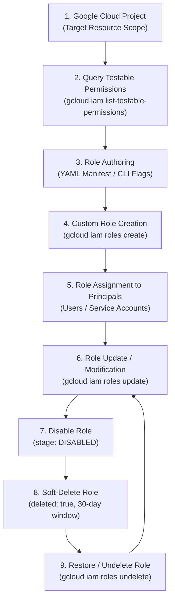
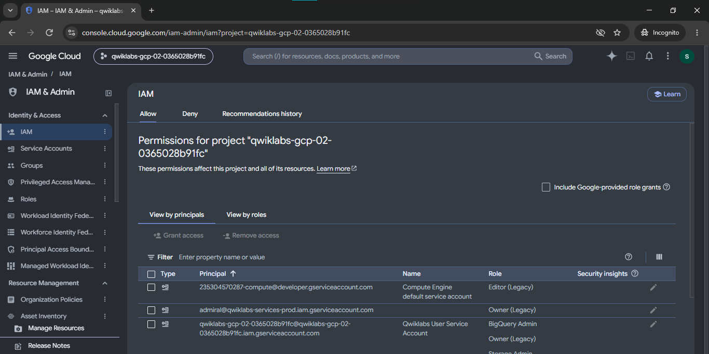
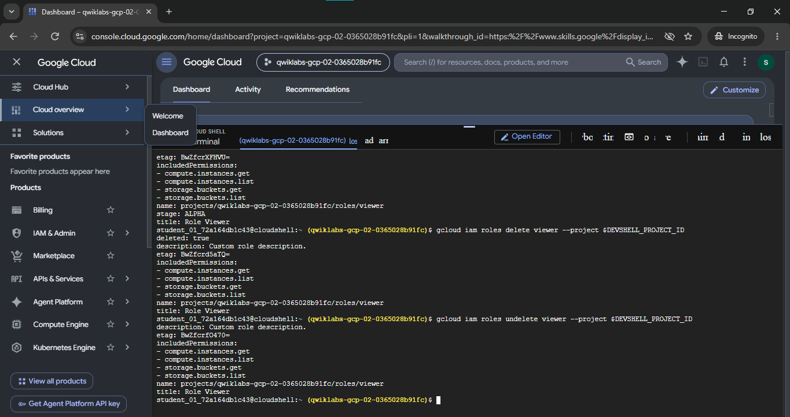
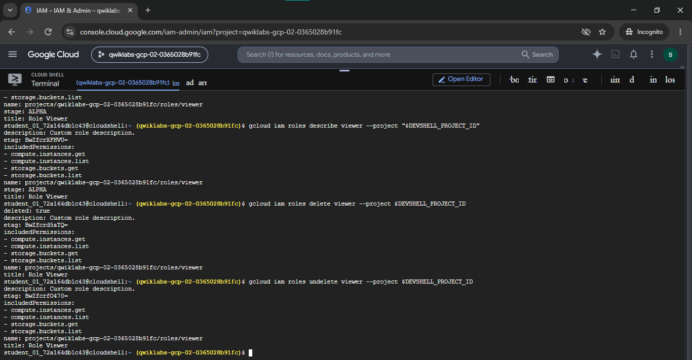

# Google Cloud IAM Custom Roles Engineering Lab

### Granular Access Control, Least Privilege Architecture, and Role Lifecycle Management

[](https://cloud.google.com/iam)
[](https://cloud.google.com/iam/docs/understanding-roles)
[](./yaml/)
[-brightgreen)](https://www.skills.google/public_profiles/e1158899-3f93-4f1a-be6a-398d495945a0)

> **Hands-on cloud security implementation** demonstrating how to design, create, update, audit, disable, delete, and restore granular Custom IAM Roles in Google Cloud Platform using both declarative YAML definitions and the Google Cloud CLI (`gcloud`).

---

## 📋 Lab Information & Metadata

| Configuration Property | Technical Specification |
|---|---|
| **Official Lab Name** | IAM Custom Roles |
| **Lab ID** | GSP190 |
| **Platform** | Google Cloud Skills Boost / The Arcade |
| **Track / Domain** | Identity and Access Management (IAM) & DevSecOps |
| **Execution Environment** | Google Cloud Shell & Cloud Resource Manager API |
| **Completion Status** | **Completed Successfully** |
| **Author** | Swapnil Patil (MCA Graduate & DevOps / Cloud Engineer) |

---

## 🎯 Lab Objectives

1. **Permission Discovery:** Query testable permissions supported by Google Cloud resources using `gcloud iam list-testable-permissions`.
2. **Metadata Inspection:** Extract role structures, stages, and permission arrays from predefined Google Cloud roles with `gcloud iam roles describe`.
3. **Grantable Scope Analysis:** Identify all roles eligible for assignment on a target project with `gcloud iam list-grantable-roles`.
4. **Declarative Role Creation:** Provision custom IAM roles via version-controlled YAML configuration manifests.
5. **Imperative Role Creation:** Provision custom IAM roles via command-line flags (`--permissions`, `--stage`, `--title`).
6. **Role Inventory & Auditing:** List and inspect project-level custom roles.
7. **Declarative Updates:** Update custom roles by applying modified YAML manifests.
8. **Flag-Based Incremental Updates:** Add and remove permissions selectively using `--add-permissions` and `--remove-permissions`.
9. **Role Deactivation:** Disable an active role by transitioning its release stage to `DISABLED`.
10. **Role Deprecation & Deletion:** Delete an obsolete custom role into a 30-day soft-delete grace period.
11. **Disaster Recovery (Undelete):** Restore a soft-deleted custom role back to active status without data loss.

---

## 🏗️ Architecture & IAM Lifecycle Workflow



---

## 📂 Repository File Structure

```text
GSP190-IAM-Custom-Roles/
├── README.md                               # Primary technical documentation
├── commands/                               # Copy-paste-ready shell execution scripts
│   ├── iam-permissions.sh                  # Permission queries and grantable role inspection
│   ├── create-custom-roles.sh              # Declarative & flag-based custom role creation
│   ├── update-custom-roles.sh              # Declarative & flag-based permission modifications
│   └── role-lifecycle.sh                   # Disabling, deleting, and undeleting roles
├── yaml/                                   # Declarative Infrastructure-as-Code manifests
│   ├── role-definition.yaml                # Initial custom editor role definition
│   └── updated-role-definition.yaml        # Incremental custom editor role definition
├── screenshots/                            # Forensic visual lab completion evidence
│   ├── 01-iam-project-permissions-console.png
│   ├── 02-custom-role-describe-delete-undelete.png
│   ├── 03-iam-role-lifecycle-browser-console.png
│   ├── 04-custom-role-verification-terminal.png
│   └── README.md                           # Detailed screenshot audit catalog
└── docs/                                   # Deep-dive engineering guides
    └── iam-custom-roles-overview.md        # Comprehensive IAM architecture reference
```

---

## 🛠️ Step-by-Step Implementation Guide

### Phase 1: Environment Initialization & Account Verification
Before executing IAM operations, verify active Cloud Shell authentication and capture the project identifier:

```bash
gcloud auth list
export PROJECT_ID=$(gcloud config get-value project)
echo "Active Project: $PROJECT_ID"
```

---

### Phase 2: Permission Discovery & Role Inspection

#### 1. List Testable Permissions on the Project
Query valid permissions that can be granted on the project's resource URI:
```bash
gcloud iam list-testable-permissions "//cloudresourcemanager.googleapis.com/projects/$PROJECT_ID" \
  --format="table(name,customRolesSupportLevel,stage)" \
  | head -n 25
```

#### 2. Filter Permissions for Specific Services
Extract permissions specifically applicable to App Engine versions and Cloud Storage buckets:
```bash
gcloud iam list-testable-permissions "//cloudresourcemanager.googleapis.com/projects/$PROJECT_ID" \
  --filter="name:appengine.versions OR name:storage.buckets" \
  --format="value(name)"
```

#### 3. Inspect Predefined Role Metadata
Inspect the permission footprint of an existing Google-managed role to borrow granular permissions:
```bash
gcloud iam roles describe roles/appengine.appViewer
```

#### 4. List Grantable Roles on Resource Scope
```bash
gcloud iam list-grantable-roles "//cloudresourcemanager.googleapis.com/projects/$PROJECT_ID" \
  --format="table(name,title,description)" \
  | head -n 20
```

---

### Phase 3: Creating Custom IAM Roles

This lab implements two distinct custom roles demonstrating both declarative and imperative paradigms:

#### A. Role 1: `editor` (Declarative YAML Creation)
- **Role Identifier:** `editor`
- **Title:** `Role Editor`
- **Description:** `Edit access for App Versions`
- **Permissions:**
  - `appengine.versions.create`
  - `appengine.versions.delete`
  - `storage.buckets.get`
  - `storage.buckets.list`

##### Manifest: [`yaml/role-definition.yaml`](./yaml/role-definition.yaml)
```yaml
title: "Role Editor"
description: "Edit access for App Versions"
stage: "ALPHA"
includedPermissions:
- appengine.versions.create
- appengine.versions.delete
- storage.buckets.get
- storage.buckets.list
```

##### Command:
```bash
gcloud iam roles create editor \
  --project "$PROJECT_ID" \
  --file yaml/role-definition.yaml
```

---

#### B. Role 2: `viewer` (Imperative Flag-Based Creation)
- **Role Identifier:** `viewer`
- **Title:** `Role Viewer`
- **Description:** `Custom role description.`
- **Permissions:**
  - `compute.instances.get`
  - `compute.instances.list`
  - `storage.buckets.get`
  - `storage.buckets.list`

##### Command:
```bash
gcloud iam roles create viewer \
  --project "$PROJECT_ID" \
  --title "Role Viewer" \
  --description "Custom role description." \
  --permissions "compute.instances.get,compute.instances.list,storage.buckets.get,storage.buckets.list" \
  --stage "ALPHA"
```

---

### Phase 4: Listing & Auditing Custom Roles

Verify that the custom roles were successfully registered in the project scope:
```bash
gcloud iam roles list --project "$PROJECT_ID"
```

Expected output:
```text
---
description: Edit access for App Versions
etag: BwZf...
name: projects/[PROJECT_ID]/roles/editor
title: Role Editor
---
description: Custom role description.
etag: BwZf...
name: projects/[PROJECT_ID]/roles/viewer
title: Role Viewer
```

---

### Phase 5: Updating Custom Roles

#### A. Declarative Update via YAML (`editor` role)
Update `description` and promote `stage` to `BETA`:

##### Manifest: [`yaml/updated-role-definition.yaml`](./yaml/updated-role-definition.yaml)
```yaml
title: "Role Editor"
description: "Edit access for App Versions and Storage Buckets"
stage: "BETA"
includedPermissions:
- appengine.versions.create
- appengine.versions.delete
- storage.buckets.get
- storage.buckets.list
```

##### Command:
```bash
gcloud iam roles update editor \
  --project "$PROJECT_ID" \
  --file yaml/updated-role-definition.yaml
```

#### B. Imperative Flag-Based Updates (`viewer` role)
Incrementally append permissions and modify attributes:
```bash
# Add a single permission
gcloud iam roles update viewer \
  --project "$PROJECT_ID" \
  --add-permissions "storage.objects.get"

# Update stage and description
gcloud iam roles update viewer \
  --project "$PROJECT_ID" \
  --stage "BETA" \
  --description "Custom role with Compute Engine and Cloud Storage read access."

# Remove a permission
gcloud iam roles update viewer \
  --project "$PROJECT_ID" \
  --remove-permissions "storage.objects.get"
```

---

### Phase 6: Custom Role Lifecycle Management

```text
Active (ALPHA/BETA/GA) ──▶ Disabled (DISABLED) ──▶ Deleted (deleted: true) ──▶ Restored (deleted: false)
```

#### 1. Disable the Custom Role
When a role is set to `DISABLED`, all principals bound to this role immediately lose access, while preserving the policy bindings:
```bash
gcloud iam roles update viewer --project "$PROJECT_ID" --stage "DISABLED"
```

#### 2. Delete the Custom Role (30-Day Soft-Delete)
```bash
gcloud iam roles delete viewer --project "$PROJECT_ID"
```

Verify deleted state:
```bash
gcloud iam roles describe viewer --project "$PROJECT_ID"
```
Output:
```yaml
deleted: true
description: Custom role description.
etag: BwZfcrd5aTQ=
includedPermissions:
- compute.instances.get
- compute.instances.list
- storage.buckets.get
- storage.buckets.list
name: projects/[PROJECT_ID]/roles/viewer
stage: ALPHA
title: Role Viewer
```

#### 3. List Roles Including Deleted Ones
```bash
gcloud iam roles list --project "$PROJECT_ID" --show-deleted
```

#### 4. Restore / Undelete the Custom Role
Recover the role from soft-deleted status:
```bash
gcloud iam roles undelete viewer --project "$PROJECT_ID"
```

Verify restored state:
```bash
gcloud iam roles describe viewer --project "$PROJECT_ID"
```
*(Notice that `deleted: true` is removed from the metadata)*.

---

## 📷 Forensic Screenshot Evidence

| Evidence Milestone | Console / Terminal Verification |
|---|---|
| **Project IAM Overview** |  |
| **Describe, Delete & Undelete** |  |
| **Split Console & Shell Session** |  |
| **Role Verification Proof** |  |

---

## 💡 Key Learning & DevOps Relevance

- **Eliminating Primitive Roles:** Basic roles (`Viewer`, `Editor`, `Owner`) represent severe security risks in production due to unrestricted service-wide reach. Custom roles enforce **Zero Trust** by granting only the exact API actions required by workloads.
- **GitOps Infrastructure-as-Code:** Managing custom roles via YAML files (`role-definition.yaml`) enables continuous security integration: peer-reviewing privilege changes via pull requests, auditing diffs, and deploying role updates through automated CI/CD pipelines.
- **Incident Mitigation via Role Disabling:** Setting `stage: DISABLED` allows security engineers to instantly revoke elevated privileges during an active credential compromise without deleting policy bindings, accelerating incident containment.
- **Disaster Recovery Safeguards:** The 30-day soft-delete window prevents catastrophic outages resulting from accidental role deletion, providing a reliable safety net through `gcloud iam roles undelete`.

---

## 📚 Official Google Cloud References

- [Google Cloud IAM Custom Roles Documentation](https://cloud.google.com/iam/docs/creating-custom-roles)
- [Understanding Google Cloud IAM Roles](https://cloud.google.com/iam/docs/understanding-roles)
- [Managing Custom Roles with `gcloud`](https://cloud.google.com/sdk/gcloud/reference/iam/roles)
- [Google Cloud IAM Permissions Reference](https://cloud.google.com/iam/docs/permissions-reference)
- [Google Cloud Skills Boost Lab GSP190](https://www.skills.google/)

