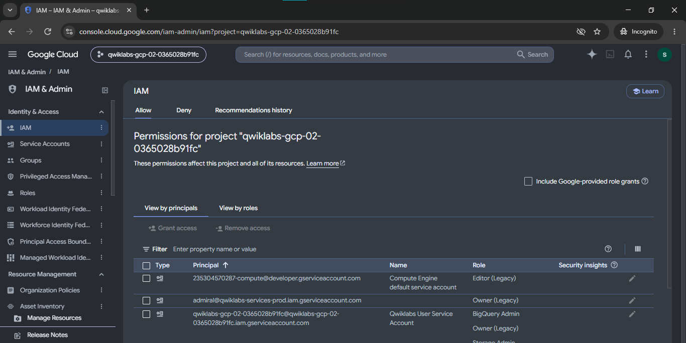
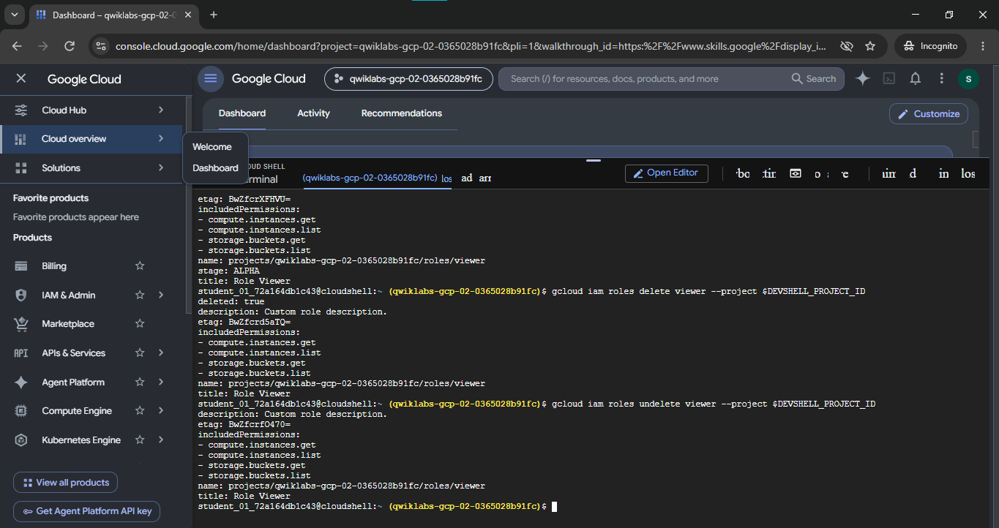
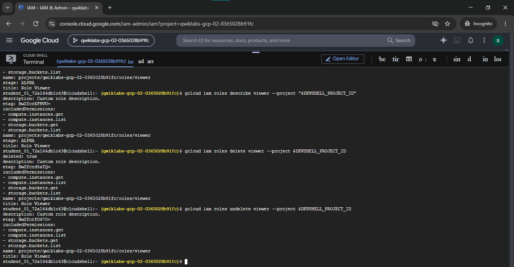

# Lab Screenshot Evidence — IAM Custom Roles (GSP190)

This directory contains forensic image evidence captured during the execution of the **IAM Custom Roles** lab (`GSP190`) on Google Cloud Skills Boost.

---

## Screenshot Inventory & Verification

| Screenshot File | Verification Objective | Captured State / Evidence |
|---|---|---|
| [`01-iam-project-permissions-console.png`](./01-iam-project-permissions-console.png) | Project IAM Access Control | Cloud Console showing IAM & Admin interface, project principals, service accounts, and assigned roles. |
| [`02-custom-role-describe-delete-undelete.png`](./02-custom-role-describe-delete-undelete.png) | Custom Role Lifecycle Verification | Terminal output displaying `describe`, `delete` (`deleted: true`), and `undelete` recovery commands. |
| [`03-iam-role-lifecycle-browser-console.png`](./03-iam-role-lifecycle-browser-console.png) | Full-Console Integration | Split view of Cloud Console dashboard and Cloud Shell terminal executing role lifecycle transitions. |
| [`04-custom-role-verification-terminal.png`](./04-custom-role-verification-terminal.png) | Terminal State Validation | Full browser view confirming role permissions, stage flags (`ALPHA`), and successful role restoration. |

---

## Detailed Evidence Breakdown

### 1. Project IAM Roles & Permissions Overview
Validates project access control baseline and service account bindings in Google Cloud Console.

---

### 2. Custom Role Inspection, Deletion, and Restoration
Validates terminal execution of `gcloud iam roles describe`, `gcloud iam roles delete`, and `gcloud iam roles undelete` for role `viewer`.

---

### 3. Integrated Console & Terminal Environment
Shows the authenticated Cloud Shell session actively running within the temporary Qwiklabs project context.

---

### 4. Full Terminal State & Permission Attributes
Confirms custom role schema attributes (`name: projects/[PROJECT_ID]/roles/viewer`, `stage: ALPHA`, `includedPermissions`) before and after lifecycle modifications.

