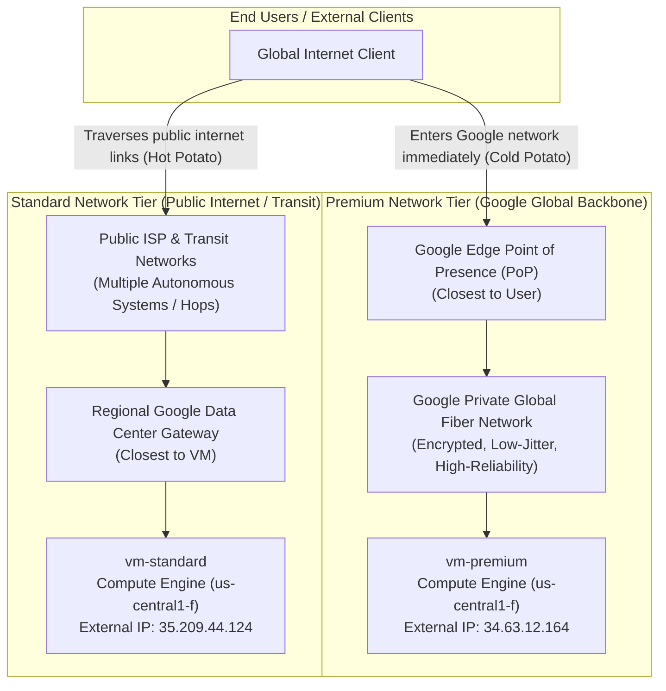
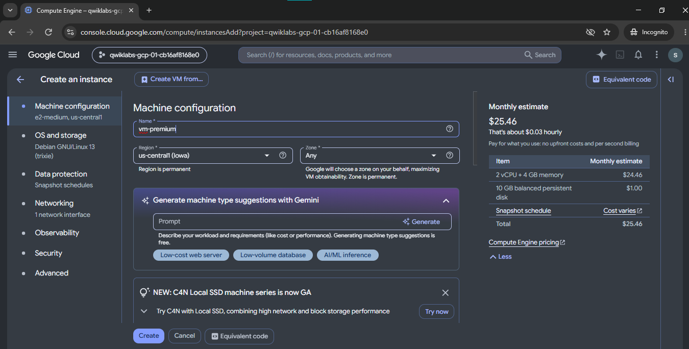
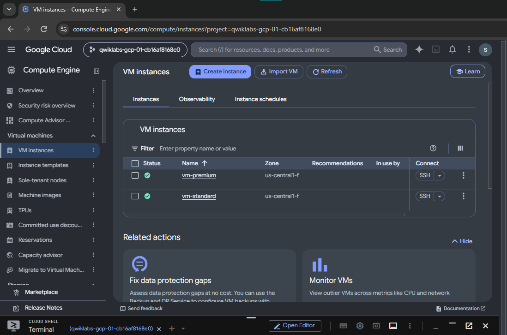
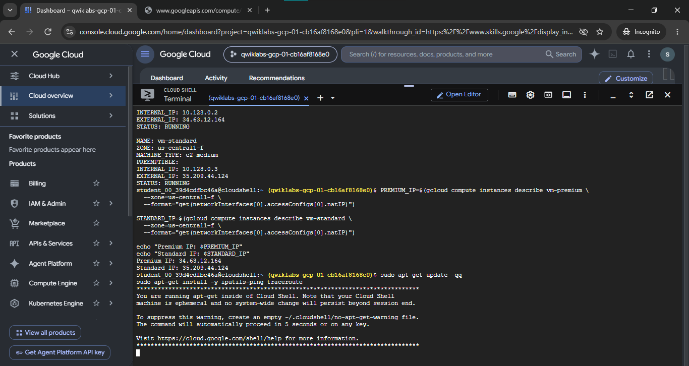
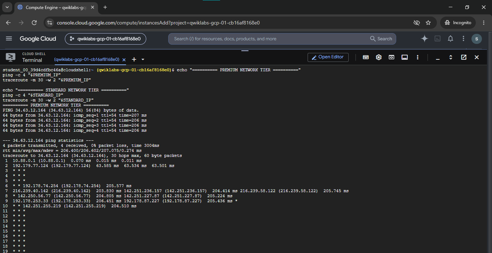

# Network Tiers - Optimizing Network Spend (GSP219)

[](https://cloud.google.com/network-tiers)
[](https://cloud.google.com/compute)
[](https://cloud.google.com/network-tiers/docs/overview)
[](#completion-summary)

> **Architectural Case Study:** Evaluating Google Cloud Network Service Tiers (Premium vs. Standard) by provisioning identical Compute Engine virtual machines, analyzing traffic routing via ICMP Ping latency and Traceroute hop analysis, and optimizing cloud network cost versus performance.

---

## 📋 Lab Information

| Attribute | Specification |
|:---|:---|
| **Lab Name** | Network Tiers - Optimizing Network Spend |
| **Lab ID** | `GSP219` |
| **Platform** | Google Cloud Skills Boost |
| **Track / Category** | Google Cloud – Infrastructure & Core Services / Networking |
| **Difficulty Level** | Introductory |
| **Duration** | 10 Minutes |
| **Cost** | No cost (Google Cloud Skills Boost) |
| **Completion Status** | **Successfully Completed** ✅ |

---

## 🎯 Learning Objectives

Google Cloud is the first major public cloud provider to offer a tiered cloud network service. Selecting the appropriate network tier allows organizations to tailor performance and spending to specific application profiles.

Key engineering objectives achieved:
1. **Premium Tier VM Provisioning:** Provisioned a Compute Engine virtual machine (`vm-premium`) leveraging Google's global private fiber backbone.
2. **Standard Tier VM Provisioning:** Provisioned an identical Compute Engine virtual machine (`vm-standard`) leveraging public transit networks and local ISPs.
3. **Delivery Path Analysis:** Analyzed how ingress and egress traffic navigate Points of Presence (PoPs) under "Cold Potato" vs. "Hot Potato" routing models.
4. **Network Latency Assessment:** Measured Round Trip Time (RTT) to both virtual machines using ICMP Ping from an external vantage point.
5. **Hop-by-Hop Route Tracing:** Executed Traceroute diagnostics to count intermediate public network hops and inspect ISP border router traversal.
6. **Cost vs. Performance Optimization:** Built an architectural framework to balance cloud network egress costs against latency sensitivity.

---

## 💻 Technologies & Services

| Technology | Category | Role in Solution |
|:---|:---|:---|
| **Google Cloud Platform (GCP)** | Cloud Infrastructure | Foundational enterprise cloud hosting environment |
| **Compute Engine** | Infrastructure as a Service (IaaS) | Hosted Linux virtual machine workloads |
| **Virtual Private Cloud (VPC)** | Software-Defined Networking | Default virtual network providing private IP routing |
| **Premium Network Tier** | Cloud Delivery Network | High-performance routing over Google's global fiber backbone |
| **Standard Network Tier** | Cloud Delivery Network | Cost-optimized routing over public transit and ISP backbones |
| **Ping (`iputils-ping`)** | Network Diagnostic Tool | Evaluated packet loss and Round Trip Time (RTT) statistics |
| **Traceroute** | Network Diagnostic Tool | Enumerated intermediate routing hops and network boundaries |
| **Google Cloud Console & CLI** | Administrative Interfaces | Infrastructure deployment and configuration telemetry |

---

## 🌐 Network Architecture & Concepts

Google Cloud Network Service Tiers provide two distinct paths for traffic between internet users and cloud workloads:



### 1. Premium Network Tier ("Cold Potato" Routing)
- **Global Backbone Delivery:** Inbound traffic enters Google's high-speed private fiber network at the Point of Presence (PoP) nearest to the client. Outbound traffic travels on Google's private network all the way to the PoP closest to the destination before exiting to the public internet.
- **SLA & Performance:** Delivers superior throughput, minimal latency, low packet jitter, and global anycast routing backed by enterprise reliability guarantees.
- **Default Cloud Standard:** Pre-selected by default for Google Cloud services and Compute Engine instances.

### 2. Standard Network Tier ("Hot Potato" Routing)
- **Transit & ISP Routing:** Traffic remains on third-party public internet transit providers and ISP networks until it reaches the Google Cloud region where the VM resides. Outbound traffic is handed off immediately to public transit at the local region border.
- **Cost Efficiency:** Offloads traffic from Google's private backbone, resulting in a significantly lower network egress cost per gigabyte.
- **Workload Fit:** Ideal for regional applications, non-critical workloads, batch data transfers, or scenarios where budget optimization takes precedence over microsecond latency.

---

## ⚙️ Practical Implementation

The lab was conducted across four structured engineering phases:

### Task 1: Create Premium Tier Virtual Machine
- **Instance Identifier:** `vm-premium`
- **Machine Configuration:** Series `E2`, Machine Type `e2-medium` (2 vCPU, 4 GB Memory)
- **Placement:** Region `us-central1` (Iowa), Zone `us-central1-f`
- **Network Interface Tier:** **Premium**
- **Observed Network Attributes:**
  - Internal IP: `10.128.0.2`
  - External IP: `34.63.12.164`

#### Practical Evidence: Premium VM Provisioning Form

*Figure 1: Google Cloud Console Compute Engine instance configuration form provisioning `vm-premium` with E2 series (`e2-medium`) in `us-central1 (Iowa)`.*

---

### Task 2: Create Standard Tier Virtual Machine
- **Instance Identifier:** `vm-standard`
- **Machine Configuration:** Series `E2`, Machine Type `e2-medium` (2 vCPU, 4 GB Memory)
- **Placement:** Identical Region `us-central1` (Iowa), Zone `us-central1-f`
- **VPC Subnet:** Identical default VPC subnet (`10.128.0.0/20`)
- **Network Interface Tier:** **Standard**
- **Observed Network Attributes:**
  - Internal IP: `10.128.0.3`
  - External IP: `35.209.44.124`

#### Practical Evidence: Running VM Instances Overview

*Figure 2: Google Cloud Console VM instances dashboard displaying both `vm-premium` and `vm-standard` running side by side in zone `us-central1-f`.*

---

### Task 3: Compare Network Latency with ICMP Ping
Ping tests were initiated to evaluate packet round-trip times to both external IP endpoints:
- **Round Trip Time (RTT):** The total elapsed milliseconds required for an ICMP echo request packet to reach the remote target and return the echo response.
- **Metrics Collected:** Minimum RTT (`min`), Average RTT (`avg`), Maximum RTT (`max`), and Mean Deviation (`mdev`).
- **Observed Premium RTT:** 4 packets transmitted, 4 received, 0% packet loss, RTT `min/avg/max = 206.400 / 206.602 / 207.075 ms` with extremely tight deviation (`0.274 ms`), demonstrating stable fiber transit.

---

### Task 4: Compare Network Paths with Traceroute
Traceroute diagnostic was executed to dissect the intermediate network hops:
- **Network Hops:** Each intermediate router or gateway decrementing the IP Time-To-Live (TTL) field.
- **Autonomous System Hand-offs:** Premium Tier enters Google's internal network infrastructure (`192.178.x.x`, `142.250.x.x`, `142.251.x.x`) early in the path. In contrast, Standard Tier traverses diverse commercial transit providers before reaching the regional Google gateway.

---

## 📊 Technical Comparison: Premium vs. Standard Tier

| Architectural Dimension | Premium Network Tier | Standard Network Tier |
|:---|:---|:---|
| **Underlying Network Path** | Google's private worldwide fiber backbone | Public ISPs, carrier networks, and transit backbones |
| **Primary Engineering Focus** | Peak performance, minimal jitter, and low latency | Maximum cost optimization and budget efficiency |
| **Observed Network Latency** | Typically lower and highly consistent | Subject to public internet congestion; can be higher |
| **Ingress Point of Presence** | Nearest Edge PoP to the user ("Cold Potato") | Regional Google gateway nearest to destination VM ("Hot Potato") |
| **Egress Routing Hand-off** | Carried across Google fiber to user's nearest PoP | Handed off immediately to public transit at local region |
| **Global Load Balancing Support**| Fully supported (Single global anycast IP) | Regional load balancing only |
| **Data Egress Pricing** | Standard enterprise cloud rates | Substantially discounted per gigabyte |

> [!NOTE]
> Actual latency and hop counts vary depending on geographic client location, transient ISP routing policies, and real-time internet weather.

---

## ⌨️ Reusable Verification Commands

The following Google Cloud CLI commands can be used to inspect instance metadata and retrieve external NAT IPs:

```bash
# 1. Enumerate all running Compute Engine instances in the project
gcloud compute instances list

# 2. Inspect detailed network interface and tier for vm-premium
gcloud compute instances describe vm-premium \
  --zone=us-central1-f \
  --format="yaml(name,zone,networkInterfaces[0].accessConfigs[0].networkTier,networkInterfaces[0].accessConfigs[0].natIP)"

# 3. Inspect detailed network interface and tier for vm-standard
gcloud compute instances describe vm-standard \
  --zone=us-central1-f \
  --format="yaml(name,zone,networkInterfaces[0].accessConfigs[0].networkTier,networkInterfaces[0].accessConfigs[0].natIP)"

# 4. Extract external IP addresses for automated network tests
PREMIUM_IP=$(gcloud compute instances describe vm-premium \
  --zone=us-central1-f \
  --format="get(networkInterfaces[0].accessConfigs[0].natIP)")

STANDARD_IP=$(gcloud compute instances describe vm-standard \
  --zone=us-central1-f \
  --format="get(networkInterfaces[0].accessConfigs[0].natIP)")

echo "Target Premium IP:  $PREMIUM_IP"
echo "Target Standard IP: $STANDARD_IP"
```

---

## 📸 Lab Evidence & Screenshots

### Screenshot 1: VM Instance Configuration & IP Extraction

*Figure 3: Cloud Shell terminal output for project `qwiklabs-gcp-01-cb16af8168e0` verifying running instances `vm-premium` (`34.63.12.164`) and `vm-standard` (`35.209.44.124`) in zone `us-central1-f`, and extracting external IP variables.*

---

### Screenshot 2: Actual Ping Latency & Traceroute Hop Analysis

*Figure 4: Cloud Shell diagnostic execution showing ICMP Ping statistics (4 packets, 0% loss, avg RTT 206.602 ms, mdev 0.274 ms) and 30-hop Traceroute routing across intermediate Google infrastructure hops (`192.178.74.254`, `142.251.236.157`, `142.250.56.77`, `142.251.255.219`).*

---

## 💡 Key Learning Outcomes

Completing this lab established core proficiencies in cloud networking and FinOps:
- **Dissecting Network Service Tiers:** Practical understanding of how Google's software-defined networking stack separates private fiber transport from commodity public transit.
- **Decoding Ingress/Egress Mechanics:** Recognizing how cold potato routing shields user packets from congested public autonomous systems.
- **Interpreting RTT Telemetry:** Evaluating latency percentiles, average Round Trip Times, and packet jitter metrics.
- **Analyzing Traceroute Hops:** Identifying network boundary transitions between external carriers and Google backbone edge routers.
- **Architectural FinOps Decision-Making:** Choosing when to pay for premium transport versus when to optimize spend using standard network tiers.

---

## 🌍 Real-World Engineering Applications

The choice between Premium and Standard Network Tiers impacts real-world architectural design:

1. **Global High-Availability Applications:** Workloads requiring single anycast IPs and minimal cross-continental latency (e.g., e-commerce checkouts, real-time gaming, financial trading) mandate **Premium Tier**.
2. **Cloud-Hosted Public APIs:** Low-latency API gateways serving global clients achieve lower p99 latency when routing over Google's fiber.
3. **Regional SaaS & Internal Enterprise Tools:** Applications serving users in the same metropolitan area or country as the data center achieve virtually identical performance using **Standard Tier** at a fraction of the bandwidth cost.
4. **Data Ingestion & Nightly Backup Syncs:** Massive asynchronous batch transfers, database replication dumps, and log archiving pipelines benefit immensely from **Standard Tier** bandwidth savings.
5. **Content Distribution Optimization:** Pairing Standard Tier storage origins with external CDNs (like Cloudflare or Fastly) enables high-performance edge caching with reduced cloud origin egress expenses.

---

## 🛠️ DevOps & Cloud Engineering Relevance

For DevOps, Site Reliability, and Cloud Support Engineers, network tier knowledge is critical:
- **Root-Cause Analysis (RCA):** Distinguishing whether application latency spikes stem from compute saturation, database bottlenecks, or third-party ISP transit degradation.
- **FinOps Infrastructure Governance:** Cloud network egress is often one of the largest and least-monitored cost drivers. Configuring Standard Tier on development, staging, or high-volume non-critical egress endpoints yields significant monthly savings.
- **Infrastructure as Code (IaC):** Explicitly declaring `network_tier = "PREMIUM"` or `network_tier = "STANDARD"` in Terraform configurations guarantees predictable deployment budgets.

---

## 🏁 Completion Summary

- **Lab Code:** `GSP219`
- **Track:** Private Clusters and Traffic Spikes
- **Assessment Outcome:** **Successfully Completed (100%)**
- **Repository Location:** [`Private Clusters and Traffic Spikes/Network Tiers - Optimizing Network Spend`](./)

