# Implement Load Balancing on Compute Engine

A hands-on Google Cloud DevOps portfolio documentation detailing the configuration of Layer 4 Regional Passthrough Network Load Balancing and Layer 7 Global External Application (HTTP) Load Balancing across Compute Engine backend VM instances and Managed Instance Groups (MIG) on Google Cloud Platform.

---

## Lab Information

| Attribute | Details |
|---|---|
| **Arcade Game** | Arcade Simulator: DevOps Engineer |
| **Lab Title** | Implement Load Balancing on Compute Engine: Challenge Lab |
| **Lab ID** | GSP313 |
| **Platform** | Google Cloud Skills Boost |
| **Region** | `us-east4` |
| **Zone** | `us-east4-b` |
| **Focus** | Compute Engine Load Balancing (Network LB & HTTP LB) |

---

## Objective

This challenge lab demonstrates the architecture and configuration of two distinct Google Cloud load balancing paradigms:

1. **Regional External Network Load Balancing (Layer 4)**: Distributes incoming TCP traffic at line-rate across multiple standalone Compute Engine web server instances (`web1`, `web2`, `web3`) using a target pool and regional forwarding rule.
2. **Global External HTTP Load Balancing (Layer 7)**: Distributes HTTP application traffic globally across an autoscaled Managed Instance Group (MIG) using instance templates, HTTP health checks, global backend services, URL maps, and target HTTP proxies.

---

## Architecture Diagram

```mermaid
flowchart TD
    subgraph Layer4["Layer 4 Passthrough Network Load Balancer"]
        ClientL4["External Client"] -->|TCP:80| NetIP["Static Regional IP<br/>network-lb-ip-1"]
        NetIP --> NetFWRule["Regional Forwarding Rule<br/>www-rule"]
        NetFWRule --> TargetPool["Target Pool<br/>www-pool<br/>(Health Check: basic-check)"]
        TargetPool --> VM1["VM: web1<br/>(e2-small / us-east4-b)"]
        TargetPool --> VM2["VM: web2<br/>(e2-small / us-east4-b)"]
        TargetPool --> VM3["VM: web3<br/>(e2-small / us-east4-b)"]
    end

    subgraph Layer7["Layer 7 Global External HTTP Load Balancer"]
        ClientL7["External Client"] -->|HTTP:80| HTTPIP["Global Anycast IP<br/>lb-ipv4-1"]
        HTTPIP --> HTTPProxy["Target HTTP Proxy<br/>http-lb-proxy"]
        HTTPProxy --> URLMap["URL Map<br/>web-map-http"]
        URLMap --> BackendSvc["Global Backend Service<br/>web-backend-service<br/>(Health Check: http-basic-check)"]
        BackendSvc --> MIG["Managed Instance Group<br/>lb-backend-group<br/>(Template: lb-backend-template)"]
        MIG --> MIGVM1["MIG Instance 1<br/>(e2-medium / us-east4-b)"]
        MIG --> MIGVM2["MIG Instance 2<br/>(e2-medium / us-east4-b)"]
    end
```

---

## Technical Specifications & Configuration Steps

### Task 1 — Create Multiple Web Server Instances

Created three individual Compute Engine VM instances to serve Apache HTTP content.

* **Instances**: `web1`, `web2`, `web3`
* **Region / Zone**: `us-east4` / `us-east4-b`
* **Machine Type**: `e2-small`
* **Operating System**: Debian 12 (`debian-cloud/debian-12`)
* **Network**: `default`
* **Network Tag**: `network-lb-tag`
* **Startup Script**: Installs Apache2, restarts service, and injects customized HTML identifying the specific instance name into `/var/www/html/index.html`.
* **Firewall Rule**: `www-firewall-network-lb`
  * **Network**: `default`
  * **Allowed Protocol/Port**: `tcp:80`
  * **Target Tags**: `network-lb-tag`

---

### Task 2 — Configure Network Load Balancing Service

Configured a Layer 4 passthrough Network Load Balancer targeting the standalone web instances.

* **Static Regional External IP**: `network-lb-ip-1` (Region: `us-east4`)
* **Legacy HTTP Health Check**: `basic-check` (Port: `80`, Request Path: `/`)
* **Target Pool**: `www-pool`
  * **Region**: `us-east4`
  * **Health Check**: `basic-check`
  * **Instances**: `web1`, `web2`, `web3`
* **Forwarding Rule**: `www-rule`
  * **Region**: `us-east4`
  * **Ports**: `80`
  * **IP Address**: `network-lb-ip-1`
  * **Target Pool**: `www-pool`

---

### Task 3 — Configure Global HTTP Load Balancer

Configured a Layer 7 Global External Application Load Balancer with a Managed Instance Group backend.

* **Backend Instance Template**: `lb-backend-template`
  * **Machine Type**: `e2-medium`
  * **Image**: Debian 12 (`debian-cloud/debian-12`)
  * **Network / Subnet**: `default` / `default`
  * **Network Tag**: `allow-health-check`
  * **Startup Script**: Installs Apache2, retrieves instance hostname from GCP metadata server (`http://169.254.169.254/computeMetadata/v1/instance/name`), writes `Page served from: <hostname>` to `/var/www/html/index.html`, and restarts Apache.
* **Managed Instance Group (MIG)**: `lb-backend-group`
  * **Base Template**: `lb-backend-template`
  * **Target Size**: `2` instances
  * **Zone**: `us-east4-b`
  * **Named Port**: `http:80`
* **Health Check Firewall Rule**: `fw-allow-health-check`
  * **Direction**: Ingress (`ALLOW`)
  * **Source Ranges**: `130.211.0.0/22`, `35.191.0.0/16` (GCP Health Checking Probes)
  * **Target Tags**: `allow-health-check`
  * **Allowed Protocol/Port**: `tcp:80`
* **Global External IP**: `lb-ipv4-1` (IPv4, Global)
* **Global Health Check**: `http-basic-check` (HTTP, Port `80`)
* **Global Backend Service**: `web-backend-service`
  * **Protocol**: `HTTP`
  * **Port Name**: `http`
  * **Health Checks**: `http-basic-check`
  * **Backend**: `lb-backend-group` (`us-east4-b`)
* **URL Map**: `web-map-http` (Default service: `web-backend-service`)
* **Target HTTP Proxy**: `http-lb-proxy` (URL Map: `web-map-http`)
* **Global Forwarding Rule**: `http-content-rule` (Target Proxy: `http-lb-proxy`, IP: `lb-ipv4-1`, Port: `80`)

---

## Verification & Repository Evidence

### Summary of Captured Artifacts

The execution artifacts and GCP Console state captured during lab completion are organized in the [`screenshots/`](./screenshots/) directory and documented below:

| Screenshot | Description & Visible Resource State | Target Task | Evidence Provided |
|---|---|---|---|
| [`01-task1-web-instances-creation.png`](./screenshots/01-task1-web-instances-creation.png) | Cloud Shell output showing initialization of project config (`us-east4`/`us-east4-b`) and creation of `web1` (`10.150.0.2` / `136.107.164.243`) and `web2` (`10.150.0.3` / `136.107.192.110`) in `RUNNING` status. | Task 1 | Verifies initial instance parameters (e2-small, debian-12, network-lb-tag) and status. |
| [`02-task2-task3-resource-creation.png`](./screenshots/02-task2-task3-resource-creation.png) | Cloud Shell output displaying creation of `www-firewall-network-lb`, static IP `network-lb-ip-1`, target pool `www-pool`, forwarding rule `www-rule`, instance template `lb-backend-template`, and MIG `lb-backend-group`. | Task 2 & Task 3 | Verifies programmatic creation of Layer 4 and Layer 7 infrastructural components. |
| [`03-gsp313-commands-completion.png`](./screenshots/03-gsp313-commands-completion.png) | Cloud Shell terminal displaying final script execution summary, outputting Network LB IP (`136.90.74.54`) and HTTP LB IP (`136.88.222.202`). | Task 2 & Task 3 | Verifies IP assignment and script completion. |
| [`04-gcp-console-vm-instances.png`](./screenshots/04-gcp-console-vm-instances.png) | GCP Console Compute Engine VM Instances list showing 5 active VMs (`web1`, `web2`, `web3`, `lb-backend-group-74bf`, `lb-backend-group-xhwp`) in `us-east4-b`. | Task 1, 2, 3 | Visual proof of running backend VMs and managed instance group instances. |
| [`05-gcp-console-load-balancers.png`](./screenshots/05-gcp-console-load-balancers.png) | GCP Console Network Services Load Balancing dashboard showing `web-map-http` (Application Classic, External HTTP) and `www-pool` (Network Passthrough, External TCP) both with healthy backend indicators. | Task 2 & Task 3 | Visual proof of configured Network Load Balancer and HTTP Load Balancer with active backends. |

### Command Reference

All Cloud Shell commands used during execution are preserved and formatted in the LaTeX reference document:
* [GSP313 Command Reference (LaTeX)](./GSP313-commands.tex)

---

## Technical Concepts

* **Layer 4 vs. Layer 7 Load Balancing**: Layer 4 Network Load Balancing operates at the transport layer (TCP/UDP), passing traffic directly to backend VMs without terminating connections. Layer 7 HTTP Load Balancing proxies client connections, terminates TLS/HTTP requests at the edge, and supports advanced URL routing, SSL termination, and global Anycast IP routing.
* **Target Pools vs. Backend Services**: Target pools are regional constructs used by Layer 4 Network Load Balancers to route incoming TCP traffic to individual VM instances. Backend services are global or regional abstractions used by Layer 7 Application Load Balancers to define protocol, health check, and MIG capacity settings.
* **Managed Instance Groups (MIGs)**: Automated clusters of identical VM instances generated from an Instance Template. MIGs provide high availability, health monitoring, auto-healing, and dynamic scaling.
* **GCP Health Checking Probe IP Ranges**: Firewall rules allowing ingress traffic from `130.211.0.0/22` and `35.191.0.0/16` are mandatory for GCP load balancer health checkers to probe backend VM health endpoints.

---

## Portfolio Relevance

This project demonstrates practical competency in:
* Designing and provisioning dual-tier Compute Engine load balancing topologies on Google Cloud.
* Automated provisioning of Compute Engine instances and Managed Instance Groups via `gcloud` CLI scripting.
* Firewall management for HTTP traffic ingress and GCP load balancer health probe IP ranges.
* Configuring URL Maps, Target HTTP Proxies, and Global External Anycast IP addresses for cloud application delivery.
