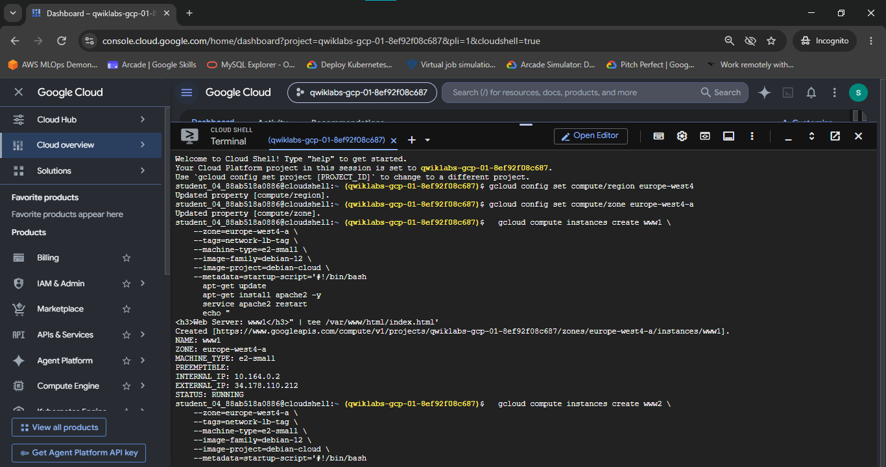
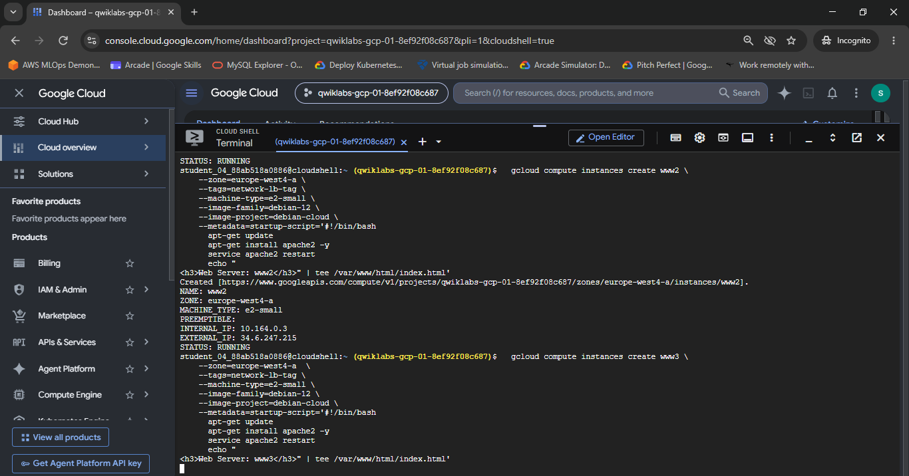
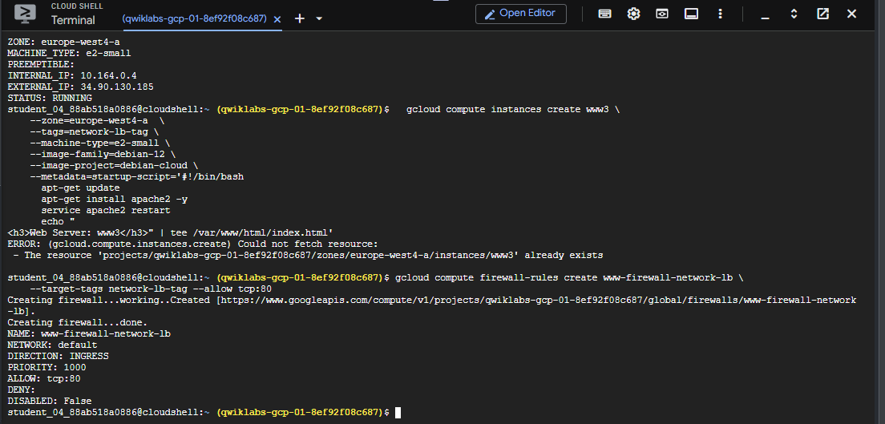
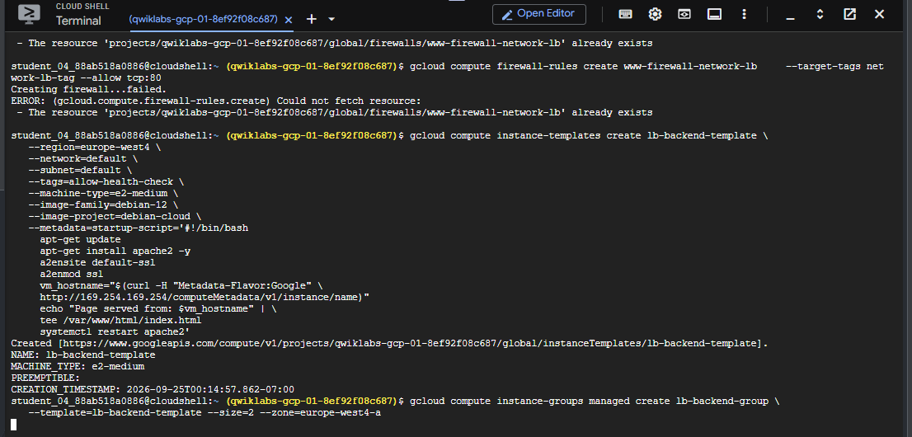
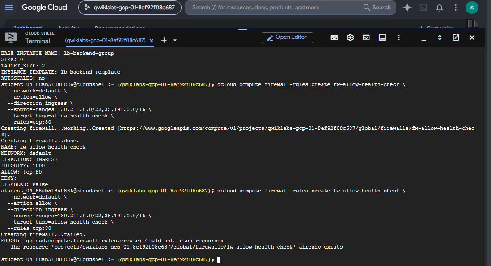
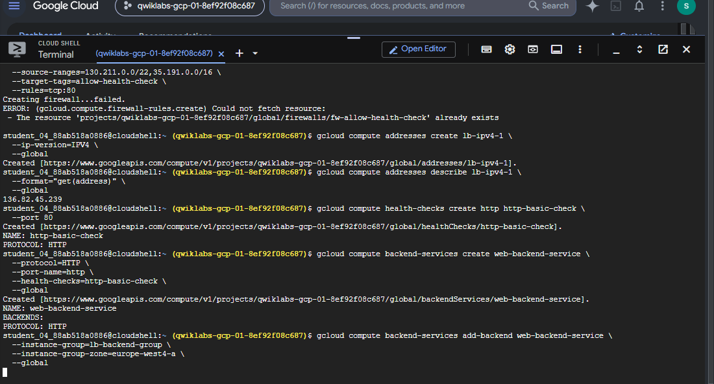
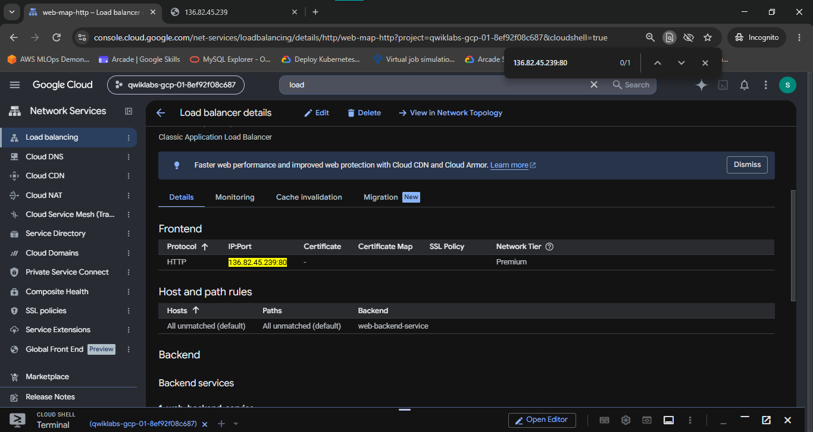
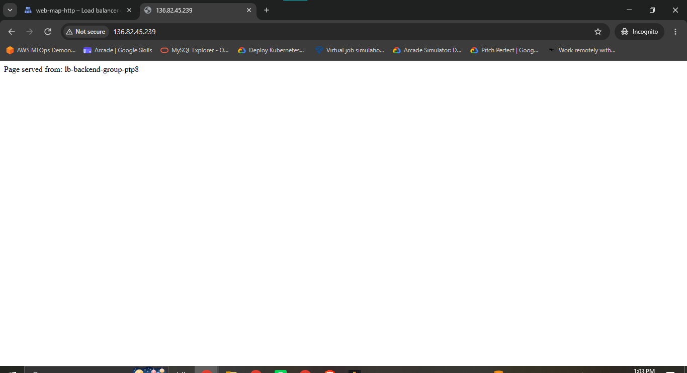

# Set Up Application Load Balancers

A comprehensive Google Cloud Networking & DevOps portfolio document detailing the architecture, configuration, deployment, and verification of an External HTTP Layer 7 Application Load Balancer (ALB) using Compute Engine Managed Instance Groups (MIG), Instance Templates, HTTP Health Probes, Backend Services, URL Maps, Target HTTP Proxies, and Global Forwarding Rules.

---

## Lab Information

| Field | Details |
|---|---|
| **Lab Name** | Set Up Application Load Balancers |
| **Lab ID** | GSP155 |
| **Platform** | Google Cloud Platform (GCP) / Qwiklabs |
| **Difficulty** | Intermediate |
| **Domain** | Cloud Networking & Traffic Management |
| **Status** | Completed |
| **Score** | 100 / 100 |

---

## Overview

Modern web applications require intelligent, HTTP-aware traffic routing, SSL termination, path-based routing, and automated backend instance scaling.

Google Cloud provides **External HTTP(S) Application Load Balancers** operating at **OSI Layer 7 (Application Layer)**. Unlike Layer 4 passthrough network load balancers (which route packets purely based on IP and TCP/UDP ports), an Application Load Balancer acts as a proxy: it terminates client TCP connections, inspects HTTP/HTTPS headers and request URLs, and forwards requests to target backend services according to configurable routing rules.

In this lab implementation, an infrastructure pipeline was constructed in `europe-west4-a`. Standalone web server instances (`www1`, `www2`, `www3`) were deployed to verify base web server creation. Next, an **Instance Template** (`lb-backend-template`) and a **Managed Instance Group** (`lb-backend-group`) were provisioned. A dedicated health-check firewall rule (`fw-allow-health-check`) was configured to allow Google Cloud probers (`130.211.0.0/22` and `35.191.0.0/16`) to monitor backend readiness. 

Finally, a complete Layer 7 Load Balancer stack was assembled: reserving a global static external IP (`lb-ipv4-1`), creating a global HTTP health check (`http-basic-check`), creating a global Backend Service (`web-backend-service`), constructing a URL Map (`web-map-http`), attaching a Target HTTP Proxy (`http-lb-proxy`), and creating a Global Forwarding Rule (`http-content-rule`). End-to-end routing was validated via Google Cloud Console and web browser verification (`http://136.82.45.239/`), confirming active HTTP load distribution across dynamically provisioned backends.

---

## Network Architecture & Traffic Flow

```text
                                  Internet Client
                                         |
                                         v
                         Global Static External IP Address
                           lb-ipv4-1 (136.82.45.239)
                                         |
                                         v
                          Global External Forwarding Rule
                                (http-content-rule)
                                    [TCP:80]
                                         |
                                         v
                                Target HTTP Proxy
                                 (http-lb-proxy)
                                         |
                                         v
                                      URL Map
                                  (web-map-http)
                                         |
                                         v
                                  Backend Service
                               (web-backend-service) <-----+
                                         |                 |
              +--------------------------+                 |
              |                                            |
              v                                            |
   Managed Instance Group                        Global HTTP Health Check
     (lb-backend-group)                             (http-basic-check)
      Zone: europe-west4-a                             [Port 80 Path /]
              |                                            |
     +--------+--------+                                   |
     |                 |                                   |
     v                 v                                   v
  VM Backend        VM Backend                    Google Health Probers
 (lb-backend-... ) (lb-backend-... )              (130.211.0.0/22 & 35.191.0.0/16)
  Tag: allow-health-check                             Firewall: fw-allow-health-check
```

---

## Technical Specifications

### 1. Compute Engine Instance Inventory

| Resource Type | Name / Prefix | Zone | Machine Type | Operating System | Network Tag | Startup Script / Served Payload | Status |
|---|---|---|---|---|---|---|---|
| **Standalone VM** | `www1` | `europe-west4-a` | `e2-small` | Debian GNU/Linux 12 | `network-lb-tag` | Apache2 (`<h3>Web Server: www1</h3>`) | `RUNNING` |
| **Standalone VM** | `www2` | `europe-west4-a` | `e2-small` | Debian GNU/Linux 12 | `network-lb-tag` | Apache2 (`<h3>Web Server: www2</h3>`) | `RUNNING` |
| `Standalone VM` | `www3` | `europe-west4-a` | `e2-small` | Debian GNU/Linux 12 | `network-lb-tag` | Apache2 (`<h3>Web Server: www3</h3>`) | `RUNNING` |
| **Instance Template** | `lb-backend-template` | Regional (`europe-west4`) | `e2-medium` | Debian GNU/Linux 12 | `allow-health-check` | Apache2 (`Page served from: $vm_hostname`) | `READY` |
| **Managed Instance Group** | `lb-backend-group` | `europe-west4-a` | Target Size: `2` | Debian GNU/Linux 12 | `allow-health-check` | Auto-provisioned MIG VMs (`lb-backend-group-xxxx`) | `RUNNING` |

### 2. Ingress Firewall Policy Specifications

| Firewall Rule Name | Network | Direction | Action | Priority | Target Tags | Source Range | Protocols & Ports |
|---|---|---|---|---|---|---|---|
| `www-firewall-network-lb` | `default` | Ingress | Allow | 1000 | `network-lb-tag` | `0.0.0.0/0` | `tcp:80` |
| `fw-allow-health-check` | `default` | Ingress | Allow | 1000 | `allow-health-check` | `130.211.0.0/22`, `35.191.0.0/16` | `tcp:80` |

### 3. Application Load Balancer Component Specifications

| Component | Resource Name | Scope | Configuration Details |
|---|---|---|---|
| **Global External IP** | `lb-ipv4-1` | Global | Reserved static IPv4 address (`136.82.45.239`) |
| **Health Check** | `http-basic-check` | Global / HTTP | Port: `80`, Request Path: `/` |
| **Backend Service** | `web-backend-service` | Global / HTTP | Protocol: `HTTP`, Port Name: `http`, Health Check: `http-basic-check`, Attached MIG: `lb-backend-group` |
| **URL Map** | `web-map-http` | Global | Default Service: `web-backend-service` |
| **Target HTTP Proxy** | `http-lb-proxy` | Global | Bound URL Map: `web-map-http` |
| **Global Forwarding Rule** | `http-content-rule` | Global | IP: `136.82.45.239`, Protocol: `TCP`, Port: `80`, Target Proxy: `http-lb-proxy` |

---

## Step-by-Step Implementation & Verification

### Task 1 — Configure Default Region and Zone

Environment defaults were set to `europe-west4` and `europe-west4-a` using `gcloud`.

```bash
# 1. Set default compute region
gcloud config set compute/region europe-west4

# 2. Set default compute zone
gcloud config set compute/zone europe-west4-a
```

---

### Task 2 — Provision Web Server Instances & Configure Ingress Firewall

Three Compute Engine VM instances (`www1`, `www2`, `www3`) were provisioned with Apache startup scripts to verify web server operation.

```bash
# Provision Instance www1
gcloud compute instances create www1 \
  --zone=europe-west4-a \
  --tags=network-lb-tag \
  --machine-type=e2-small \
  --image-family=debian-12 \
  --image-project=debian-cloud \
  --metadata=startup-script='#!/bin/bash
apt-get update
apt-get install apache2 -y
service apache2 restart
echo "<h3>Web Server: www1</h3>" | tee /var/www/html/index.html'

# Provision Instance www2
gcloud compute instances create www2 \
  --zone=europe-west4-a \
  --tags=network-lb-tag \
  --machine-type=e2-small \
  --image-family=debian-12 \
  --image-project=debian-cloud \
  --metadata=startup-script='#!/bin/bash
apt-get update
apt-get install apache2 -y
service apache2 restart
echo "<h3>Web Server: www2</h3>" | tee /var/www/html/index.html'

# Provision Instance www3
gcloud compute instances create www3 \
  --zone=europe-west4-a \
  --tags=network-lb-tag \
  --machine-type=e2-small \
  --image-family=debian-12 \
  --image-project=debian-cloud \
  --metadata=startup-script='#!/bin/bash
apt-get update
apt-get install apache2 -y
service apache2 restart
echo "<h3>Web Server: www3</h3>" | tee /var/www/html/index.html'

# Create HTTP Firewall Rule
gcloud compute firewall-rules create www-firewall-network-lb \
  --target-tags network-lb-tag \
  --allow tcp:80
```


*Figure 1: Provisioning `www1` instance (`10.164.0.2` / `34.178.110.212`) in zone `europe-west4-a`.*


*Figure 2: Provisioning `www2` instance (`10.164.0.3` / `34.6.247.215`) in zone `europe-west4-a`.*


*Figure 3: Provisioning `www3` instance (`10.164.0.4` / `34.90.130.185`) and creating ingress firewall rule `www-firewall-network-lb`.*

---

### Task 3 — Create Instance Template & Managed Instance Group

Production Application Load Balancers require scalable backend pools. An **Instance Template** was created with metadata startup scripts to capture the VM hostname dynamically (`Page served from: $vm_hostname`).

#### 1. Create Instance Template

```bash
gcloud compute instance-templates create lb-backend-template \
  --region=europe-west4 \
  --network=default \
  --subnet=default \
  --tags=allow-health-check \
  --machine-type=e2-medium \
  --image-family=debian-12 \
  --image-project=debian-cloud \
  --metadata=startup-script='#!/bin/bash
apt-get update
apt-get install apache2 -y
a2ensite default-ssl
a2enmod ssl
vm_hostname="$(curl -H "Metadata-Flavor:Google" http://169.254.169.254/computeMetadata/v1/instance/name)"
echo "Page served from: $vm_hostname" | tee /var/www/html/index.html
systemctl restart apache2'
```


*Figure 4: Terminal output confirming creation of instance template `lb-backend-template` containing Apache metadata startup script.*

#### 2. Create Managed Instance Group (MIG)

```bash
gcloud compute instance-groups managed create lb-backend-group \
  --template=lb-backend-template \
  --size=2 \
  --zone=europe-west4-a
```

#### 3. Create Health-Check Ingress Firewall Rule

Google Cloud HTTP Load Balancers probe backends from specific IP ranges (`130.211.0.0/22` and `35.191.0.0/16`). An ingress firewall rule was established targeting network tag `allow-health-check`.

```bash
gcloud compute firewall-rules create fw-allow-health-check \
  --network=default \
  --action=allow \
  --direction=ingress \
  --source-ranges=130.211.0.0/22,35.191.0.0/16 \
  --target-tags=allow-health-check \
  --rules=tcp:80
```


*Figure 5: Output confirming Managed Instance Group `lb-backend-group` (size 2) creation and creation of firewall rule `fw-allow-health-check` permitting GCP health check ranges (`130.211.0.0/22,35.191.0.0/16`).*

---

### Task 4 — Configure Global Load Balancer Stack

#### 1. Reserve Global Static External IP Address

```bash
gcloud compute addresses create lb-ipv4-1 \
  --ip-version=IPV4 \
  --global
```

#### 2. Create Global HTTP Health Check

```bash
gcloud compute health-checks create http http-basic-check \
  --port 80
```

#### 3. Create Backend Service & Attach Managed Instance Group

```bash
# Create Backend Service
gcloud compute backend-services create web-backend-service \
  --protocol=HTTP \
  --port-name=http \
  --health-checks=http-basic-check \
  --global

# Attach MIG to Backend Service
gcloud compute backend-services add-backend web-backend-service \
  --instance-group=lb-backend-group \
  --instance-group-zone=europe-west4-a \
  --global
```


*Figure 6: Execution of commands reserving global IP `lb-ipv4-1` (`136.82.45.239`), creating HTTP health check `http-basic-check`, creating global backend service `web-backend-service`, and registering Managed Instance Group `lb-backend-group`.*

#### 4. Create URL Map, Target HTTP Proxy, & Global Forwarding Rule

```bash
# Create URL Map routing traffic to web-backend-service
gcloud compute url-maps create web-map-http \
  --default-service web-backend-service

# Create Target HTTP Proxy binding URL Map
gcloud compute target-http-proxies create http-lb-proxy \
  --url-map web-map-http

# Create Global Forwarding Rule routing port 80 to Target Proxy
gcloud compute forwarding-rules create http-content-rule \
  --global \
  --target-http-proxy=http-lb-proxy \
  --ports=80 \
  --address=lb-ipv4-1
```

---

### Task 5 — Verify Load Balancer Operation & Browser Traffic Test

#### 1. Google Cloud Console Load Balancer Inspection

Navigating to **Network Services > Load Balancing** in the Google Cloud Console verifies the configuration details for `web-map-http`. Frontend IP `136.82.45.239:80` is active and routing all unmatched requests to `web-backend-service`.


*Figure 7: Google Cloud Console Load Balancer details dashboard for `web-map-http` displaying frontend IP `136.82.45.239:80` and host/path rules routing to `web-backend-service`.*

#### 2. Web Browser Verification Test

Opening `http://136.82.45.239/` in a web browser verifies HTTP proxy handling and backend execution:


*Figure 8: Browser request to `http://136.82.45.239/` returning HTTP 200 OK with payload `Page served from: lb-backend-group-ptp8`, confirming end-to-end Layer 7 load balancing.*

---

## Environment Triage & Common Pitfalls

> [!IMPORTANT]
> **1. Mandatory Health Check Prober Source IP Ranges**
> 
> Unlike local or regional firewall rules, Google Cloud Layer 7 HTTP Load Balancers send health probes from specific Google internal IP blocks: `130.211.0.0/22` and `35.191.0.0/16`.
> 
> **Root Cause**: Omitting these source IP ranges in `fw-allow-health-check` causes health check probes to fail (`UNHEALTHY`), resulting in the load balancer returning `HTTP 502 Bad Gateway` to client browsers.
> 
> **Resolution**: Ensure ingress firewall rules explicitly allow `130.211.0.0/22` and `35.191.0.0/16` on `tcp:80`.

> [!TIP]
> **2. Global Forwarding Rule & Proxy Propagation Delay**
> 
> Immediately after creating a global forwarding rule (`http-content-rule`), accessing the load balancer IP may briefly yield `HTTP 404` or connection timeouts.
> 
> **Root Cause**: Global Application Load Balancers deploy proxy configurations across Google's global Edge Points of Presence (PoPs), requiring ~60–90 seconds for URL map propagation.
> 
> **Resolution**: Allow 1–2 minutes for global edge synchronization before initiating browser verification.

---

## Technical Deep-Dive: Layer 7 Application Architecture

### Layer 7 (Application) vs. Layer 4 (Network) Load Balancing

| Architectural Feature | Layer 7 Application Load Balancer (GSP155) | Layer 4 Network Load Balancer (GSP007) |
|---|---|---|
| **OSI Operating Layer** | Layer 7 (Application Layer) | Layer 4 (Transport Layer) |
| **Proxy Architecture** | Two-pass Reverse Proxy (Terminates client TLS/TCP) | Passthrough Direct Packet Routing |
| **Traffic Types** | HTTP, HTTPS, HTTP/2, gRPC, WebSocket | TCP, UDP, Protocol numbers |
| **Routing Intelligence** | URL Path (`/api`, `/images`), Host headers (`api.example.com`), HTTP methods | 5-Tuple Packet Hash (Src IP/Port, Dst IP/Port, Protocol) |
| **Scope & IP Allocation** | Global External Anycast IPv4 (`lb-ipv4-1`) | Regional External IPv4 (`network-lb-ip-1`) |
| **Backend Target Resource** | Backend Service (`backendServices`) + Managed Instance Group | Target Pool (`targetPools`) + VM list |
| **Header Injection** | Appends `X-Forwarded-For`, `X-Forwarded-Proto` | Preserves raw packet headers without modification |

### HTTP Proxy Flow & URL Map Routing Evaluation

1. **Client Connection**: Client browser initiates TCP connection to Anycast IP `136.82.45.239:80`.
2. **Forwarding Rule Match**: `http-content-rule` receives TCP SYN on port 80 and hands connection off to `http-lb-proxy`.
3. **Target HTTP Proxy & URL Map Evaluation**: `http-lb-proxy` parses the HTTP GET request header and evaluates rules inside `web-map-http`.
4. **Backend Service Selection**: `web-map-http` directs the request to `web-backend-service`.
5. **Backend VM Health Filtering**: `web-backend-service` selects a healthy VM instance (`lb-backend-group-ptp8`) monitored by `http-basic-check`.
6. **HTTP Response Proxying**: The backend VM executes Apache, returns `Page served from: lb-backend-group-ptp8`, and the proxy delivers the payload back to the client browser.

---

## Evidence & Verification Summary

### Evidence Audit Matrix

| Figure | Screenshot File Path | Workflow Stage | Key Technical Evidence Visible | Verification Status |
|---|---|---|---|---|
| **Figure 1** | `./Screenshot/01-create-web-server-www1.png` | Task 2: Web Server Setup | Instance `www1` created (`10.164.0.2` / `34.178.110.212`) in `europe-west4-a` | **VERIFIED** |
| **Figure 2** | `./Screenshot/02-create-web-server-www2.png` | Task 2: Web Server Setup | Instance `www2` created (`10.164.0.3` / `34.6.247.215`) in `europe-west4-a` | **VERIFIED** |
| **Figure 3** | `./Screenshot/03-create-web-server-www3-and-firewall.png` | Task 2: Web Server Setup | Instance `www3` created (`10.164.0.4` / `34.90.130.185`), Firewall `www-firewall-network-lb` created (`tcp:80`) | **VERIFIED** |
| **Figure 4** | `./Screenshot/04-create-instance-template.png` | Task 3: MIG Infrastructure | Instance Template `lb-backend-template` created with Apache metadata startup script | **VERIFIED** |
| **Figure 5** | `./Screenshot/05-create-managed-instance-group-and-health-check-firewall.png` | Task 3: MIG Infrastructure | MIG `lb-backend-group` created (size 2), Firewall `fw-allow-health-check` created (`130.211.0.0/22,35.191.0.0/16`) | **VERIFIED** |
| **Figure 6** | `./Screenshot/06-reserve-global-ip-health-check-and-backend-service.png` | Task 4: ALB Stack Setup | Global IP `lb-ipv4-1` (`136.82.45.239`), Health Check `http-basic-check`, Backend Service `web-backend-service` | **VERIFIED** |
| **Figure 7** | `./Screenshot/07-load-balancer-console-details.png` | Task 5: Console Verification | Load Balancer console dashboard for `web-map-http` displaying frontend `136.82.45.239:80` and backend `web-backend-service` | **VERIFIED** |
| **Figure 8** | `./Screenshot/08-application-load-balancer-browser-test.png` | Task 5: Browser Verification | Web browser accessing `http://136.82.45.239/` rendering `Page served from: lb-backend-group-ptp8` | **VERIFIED** |

---

## Security & Privacy Audit

- **Secrets & Credentials**: Checked. No API keys, service account JSON keys, or private SSH keys are exposed.
- **Project Identifiers**: Ephemeral Qwiklabs project ID (`qwiklabs-gcp-01-8ef92f08c687`) is visible in Cloud Shell prompts. These resources auto-delete upon lab termination.
- **PII / Account Information**: No personal email addresses, phone numbers, or private credentials are included in documentation.

---

## Skills Demonstrated & Portfolio Relevance

### Practical Cloud & DevOps Skills Demonstrated

- **Infrastructure Automation**: Provisioning Managed Instance Groups (MIG) and reusable Instance Templates with metadata startup scripts.
- **Layer 7 Traffic Engineering**: Assembling global Application Load Balancers (Global Anycast IPs, Target HTTP Proxies, URL Maps, Backend Services).
- **Network Security & Firewalls**: Configuring specialized ingress firewall rules for Google Cloud Health Check probers (`130.211.0.0/22` and `35.191.0.0/16`).
- **High Availability & Health Probing**: Implementing HTTP health checks to monitor MIG backend readiness.
- **Web Verification & Troubleshooting**: Testing Anycast HTTP endpoint reachability via web browser and analyzing proxy propagation delays.

---

## Completion Status

- **Lab ID**: GSP155
- **Lab Name**: Set Up Application Load Balancers
- **Execution Score**: 100 / 100
- **Documentation Status**: Complete & Portfolio-Ready

```text
       [GSP155 Completion Status: VERIFIED & AUDITED]
```
