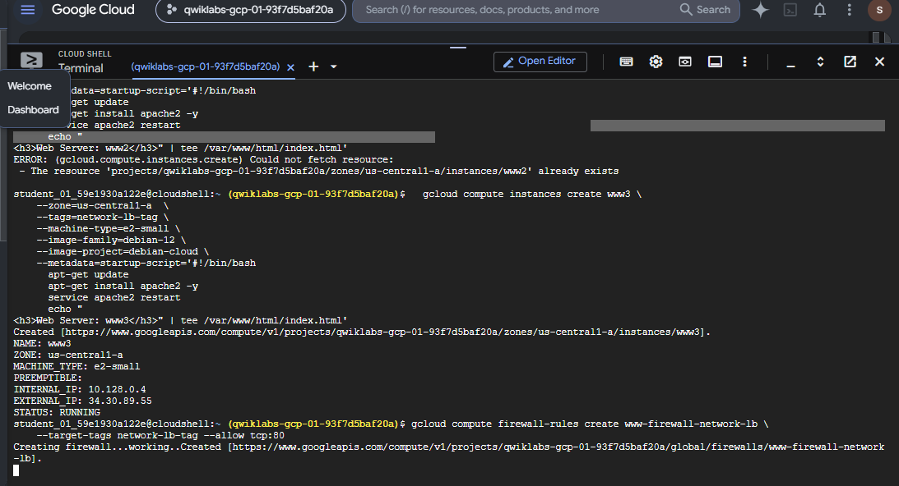
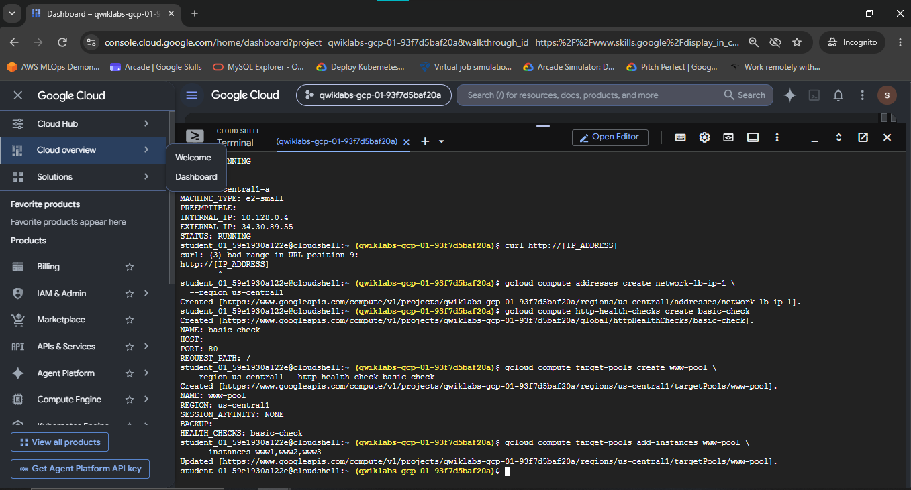
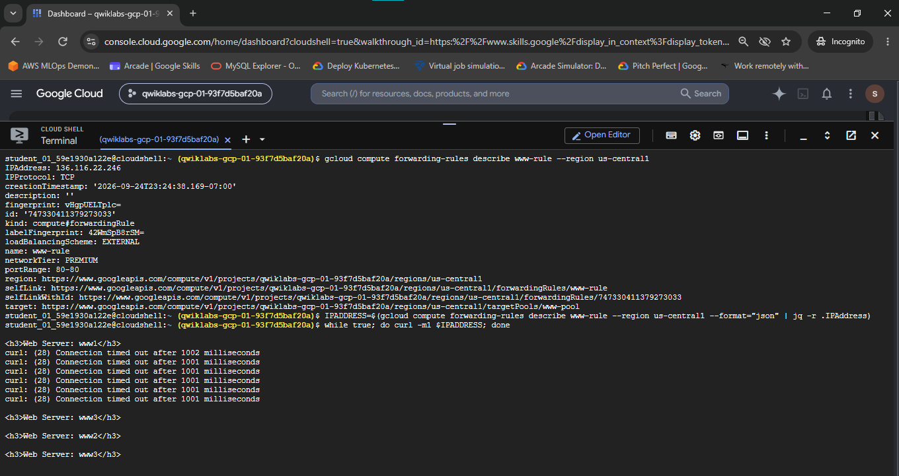

# Set Up Network Load Balancers

A comprehensive Google Cloud Networking & SRE portfolio document detailing the architecture, configuration, deployment, and verification of an External Passthrough Layer 4 Network Load Balancer (NLB) using Compute Engine backend instances, HTTP health probes, regional target pools, forwarding rules, and bash traffic distribution verification.

---

## Lab Information

| Field | Details |
|---|---|
| **Lab Name** | Set Up Network Load Balancers |
| **Lab ID** | GSP007 |
| **Platform** | Google Cloud Platform (GCP) / Qwiklabs |
| **Difficulty** | Introductory / Intermediate |
| **Domain** | Cloud Networking & Traffic Management |
| **Status** | Completed |
| **Score** | 100 / 100 |

---

## Overview

In Google Cloud architecture, balancing incoming application and network traffic across multiple compute instances is essential for achieving high availability, fault tolerance, and horizontal scalability.

Google Cloud provides multiple types of load balancers categorized by OSI layer operations (Layer 4 vs. Layer 7) and traffic scope (External vs. Internal). This lab focuses on constructing an **External Passthrough Layer 4 Network Load Balancer**. 

Unlike Layer 7 Application Load Balancers (which inspect HTTP headers, cookies, and URL paths), a Layer 4 Network Load Balancer operates strictly at the transport layer (TCP/UDP). It distributes incoming client connections based on IP protocol data (source IP, source port, destination IP, destination port) without terminating or proxying the underlying application payload. This passthrough architecture delivers ultra-low latency and high throughput for TCP/UDP traffic.

In this lab implementation, three Apache web server VM instances (`www1`, `www2`, `www3`) were provisioned across `us-central1-a`. An HTTP firewall rule was established to permit web traffic, a regional Target Pool (`www-pool`) with HTTP Health Checking (`basic-check`) was configured, and a Forwarding Rule (`www-rule`) was bound to a reserved static external IP (`network-lb-ip-1`). End-to-end traffic distribution was validated by sending continuous HTTP requests through the load balancer's external IP and observing responses across backend VMs.

---

## Network Architecture & Traffic Flow

```text
                                  Internet Client
                                         |
                                         v
                         Static External IP Address
                       network-lb-ip-1 (136.116.22.246)
                                         |
                                         v
                    Google Cloud Layer 4 Network Load Balancer
                          Forwarding Rule (www-rule)
                                  [TCP:80]
                                         |
                                         v
                                Regional Target Pool
                                     (www-pool)
                                         |
              +--------------------------+--------------------------+
              |                          |                          |
              v                          v                          v
          www1 VM                    www2 VM                    www3 VM
     (us-central1-a)            (us-central1-a)            (us-central1-a)
      Apache Server              Apache Server              Apache Server
    Tag: network-lb-tag        Tag: network-lb-tag        Tag: network-lb-tag
        [TCP:80]                   [TCP:80]                   [TCP:80]
              ^                          ^                          ^
              |                          |                          |
              +--------------------------+--------------------------+
                                         |
                             HTTP Health Check Probe
                                  (basic-check)
                                [Port 80 Path /]
```

---

## Technical Specifications

### 1. Compute Engine Instance Inventory

| Instance Name | Zone | Machine Type | Operating System | Network Tag | Startup Script / Served Payload | Status |
|---|---|---|---|---|---|---|
| `www1` | `us-central1-a` | `e2-small` | Debian GNU/Linux 12 | `network-lb-tag` | Apache2 (`<h3>Web Server: www1</h3>`) | `RUNNING` |
| `www2` | `us-central1-a` | `e2-small` | Debian GNU/Linux 12 | `network-lb-tag` | Apache2 (`<h3>Web Server: www2</h3>`) | `RUNNING` |
| `www3` | `us-central1-a` | `e2-small` | Debian GNU/Linux 12 | `network-lb-tag` | Apache2 (`<h3>Web Server: www3</h3>`) | `RUNNING` |

### 2. Ingress Firewall Policy Specifications

| Firewall Rule Name | Network | Direction | Action | Priority | Target Tags | Source Range | Protocols & Ports |
|---|---|---|---|---|---|---|---|
| `www-firewall-network-lb` | `default` | Ingress | Allow | 1000 | `network-lb-tag` | `0.0.0.0/0` | `tcp:80` |

### 3. Load Balancer Component Specifications

| Component | Resource Name | Region / Scope | Configuration Details |
|---|---|---|---|
| **Static External IP** | `network-lb-ip-1` | `us-central1` | Reserved external IPv4 address (`136.116.22.246`) |
| **Health Check** | `basic-check` | Global / Legacy HTTP | Port: `80`, Request Path: `/` |
| **Target Pool** | `www-pool` | `us-central1` | Members: `www1`, `www2`, `www3`; Health Check: `basic-check`; Session Affinity: `NONE` |
| **Forwarding Rule** | `www-rule` | `us-central1` | IP: `136.116.22.246`, Protocol: `TCP`, Port: `80`, Target: `www-pool`, Scheme: `EXTERNAL` |

---

## Step-by-Step Implementation & Verification

### Task 1 — Configure Default Region and Zone

To ensure consistent deployment across Google Cloud resources, default `compute/region` and `compute/zone` properties were initialized using the Google Cloud CLI (`gcloud`).

```bash
# 1. Set default compute region
gcloud config set compute/region us-central1

# 2. Set default compute zone
gcloud config set compute/zone us-central1-a
```

---

### Task 2 — Create Web Server Instances & Configure Ingress Firewall

Three Compute Engine instances (`www1`, `www2`, `www3`) were provisioned with an Apache2 web server via startup scripts. Each instance was assigned the network tag `network-lb-tag` and configured to serve a distinct HTML header identifying its hostname.

#### 1. Provision Backend VM Instances (`www1`, `www2`, `www3`)

```bash
# Provision Instance www1
gcloud compute instances create www1 \
  --zone=us-central1-a \
  --tags=network-lb-tag \
  --machine-type=e2-small \
  --image-family=debian-12 \
  --image-project=debian-cloud \
  --metadata=startup-script='#!/bin/bash
apt-get update
apt-get install apache2 -y
service apache2 restart
echo "<h3>Web Server: www1</h3>" | tee /var/www/html/index.html'

# Provision Instance www2
gcloud compute instances create www2 \
  --zone=us-central1-a \
  --tags=network-lb-tag \
  --machine-type=e2-small \
  --image-family=debian-12 \
  --image-project=debian-cloud \
  --metadata=startup-script='#!/bin/bash
apt-get update
apt-get install apache2 -y
service apache2 restart
echo "<h3>Web Server: www2</h3>" | tee /var/www/html/index.html'

# Provision Instance www3
gcloud compute instances create www3 \
  --zone=us-central1-a \
  --tags=network-lb-tag \
  --machine-type=e2-small \
  --image-family=debian-12 \
  --image-project=debian-cloud \
  --metadata=startup-script='#!/bin/bash
apt-get update
apt-get install apache2 -y
service apache2 restart
echo "<h3>Web Server: www3</h3>" | tee /var/www/html/index.html'
```

#### 2. Create Ingress Firewall Rule

An ingress firewall rule was established to permit HTTP traffic on TCP port 80 to all instances tagged with `network-lb-tag`.

```bash
gcloud compute firewall-rules create www-firewall-network-lb \
  --target-tags network-lb-tag \
  --allow tcp:80
```


*Figure 1: Terminal output confirming the successful deployment of backend VM instance `www3` (`10.128.0.4`) and the creation of ingress firewall rule `www-firewall-network-lb` targeting `network-lb-tag`.*

---

### Task 3 — Configure Load Balancer Resources (Static IP & Health Check)

#### 1. Reserve Static External IP Address

A regional static external IPv4 address named `network-lb-ip-1` was allocated in `us-central1` to serve as the single entry point for incoming client connections.

```bash
gcloud compute addresses create network-lb-ip-1 \
  --region us-central1
```

#### 2. Create Legacy HTTP Health Check Probe

An HTTP health check named `basic-check` was configured to poll port 80 at path `/`. The load balancer uses this probe to determine backend instance health before routing traffic.

```bash
gcloud compute http-health-checks create basic-check
```

---

### Task 4 — Create Regional Target Pool and Register Instances

#### 1. Create Target Pool with Health Check Attachment

A regional target pool named `www-pool` was created in `us-central1` and associated with the `basic-check` health check probe.

```bash
gcloud compute target-pools create www-pool \
  --region us-central1 \
  --http-health-check basic-check
```

#### 2. Register Web Server Instances into Target Pool

The three Apache instances (`www1`, `www2`, `www3`) were added as active backend members of `www-pool`.

```bash
gcloud compute target-pools add-instances www-pool \
  --instances www1,www2,www3
```


*Figure 2: Execution of commands reserving static IP `network-lb-ip-1`, creating HTTP health check `basic-check`, initializing target pool `www-pool`, and attaching instances `www1`, `www2`, `www3` to the pool.*

---

### Task 5 — Create Forwarding Rule & Verify Load Balancing

#### 1. Create Regional External Forwarding Rule

A regional forwarding rule named `www-rule` was created to route incoming TCP port 80 traffic received on static IP `network-lb-ip-1` directly to the `www-pool` target pool.

```bash
gcloud compute forwarding-rules create www-rule \
  --region us-central1 \
  --port 80 \
  --address network-lb-ip-1 \
  --target-pool www-pool
```

#### 2. Inspect Forwarding Rule Configuration

```bash
gcloud compute forwarding-rules describe www-rule --region us-central1
```

#### 3. Continuous Traffic Distribution Verification

To verify round-robin traffic distribution across healthy backend instances, a bash loop was executed against the load balancer's external IP:

```bash
# Retrieve external IP address allocated to forwarding rule
IPADDRESS=$(gcloud compute forwarding-rules describe www-rule --region us-central1 --format="json" | jq -r .IPAddress)

# Continuous curl request loop
while true; do curl -m1 $IPADDRESS; done
```


*Figure 3: Inspection of forwarding rule `www-rule` (`136.116.22.246`) and verification loop output. Initial `curl: (28) Connection timed out` lines reflect health check probe warm-up, followed by verified round-robin HTTP distribution across backend servers `www1`, `www3`, `www2`, and `www3`.*

---

## Environment Triage & Common Pitfalls

> [!TIP]
> **1. Initial Health Check Probe Stabilization Delay**
> 
> When a forwarding rule and target pool are freshly provisioned, immediate requests to the load balancer external IP may experience connection timeouts (`curl: (28) Connection timed out after 1002 milliseconds`).
> 
> **Root Cause**: HTTP health check probes (`basic-check`) require several consecutive successful probe intervals (typically 2–3 probes at 5-second intervals) before marking newly registered instances (`www1`, `www2`, `www3`) as `HEALTHY`. Until probes pass, the target pool holds zero healthy backends and drops incoming connections.
> 
> **Resolution**: Wait 15–30 seconds after target pool registration before initiating verification loops.

> [!WARNING]
> **2. Apache Startup Script Race Condition**
> 
> Executing `curl` against VM instance external IPs immediately after `gcloud compute instances create` completes may yield `Connection Refused` or default Debian Apache pages.
> 
> **Root Cause**: `gcloud` returns execution as soon as the VM control plane reports `RUNNING`. However, `apt-get update && apt-get install apache2` executes asynchronously inside the guest OS metadata startup script handler.
> 
> **Resolution**: Monitor serial console output or wait ~45 seconds for package installation and `index.html` overwrites to finalize.

---

## Technical Deep-Dive: Layer 4 Passthrough Architecture

### Layer 4 (Network) vs. Layer 7 (Application) Load Balancing

| Architectural Property | Layer 4 Network Load Balancer (GSP007) | Layer 7 Application Load Balancer |
|---|---|---|
| **OSI Operating Layer** | Layer 4 (Transport Layer: TCP/UDP) | Layer 7 (Application Layer: HTTP/HTTPS/HTTP2/gRPC) |
| **Traffic Handling** | Passthrough (Non-terminating direct routing) | Reverse Proxy (Terminates TCP/TLS, opens new connection to backend) |
| **Packet Header Inspection** | Inspects 5-Tuple (Src IP, Src Port, Dst IP, Dst Port, Protocol) | Inspects HTTP Headers, Cookies, URL Paths, Host Headers |
| **Latency & Throughput** | Ultra-low latency, line-rate packet throughput | Moderate latency due to SSL termination & HTTP parsing |
| **Backend Resources** | Target Pools (`targetPools`) | Backend Services (`backendServices`) & Instance Groups |
| **Client Source IP Visibility** | Preserved (Backend VM sees actual client IPv4 address) | Masked (Backend VM sees Proxy IP; Client IP passed in `X-Forwarded-For`) |

### Hash-Based Load Balancing Mechanism

Google Cloud External Passthrough Network Load Balancers utilize **Maglev**—Google's distributed software load balancer. 

When a packet arrives at the Google Cloud network edge targeting `136.116.22.246:80`, Maglev computes a consistent hash based on the packet's 5-tuple payload:

$$\text{Hash} = f(\text{SourceIP}, \text{SourcePort}, \text{DestinationIP}, \text{DestinationPort}, \text{Protocol})$$

Because `SESSION_AFFINITY` was set to `NONE`, incoming traffic from distinct connections is distributed across backend VMs (`www1`, `www2`, `www3`) in a pseudo-random / round-robin pattern, achieving optimal resource utilization.

---

## Evidence & Verification Summary

### Evidence Audit Matrix

| Figure | Screenshot File Path | Workflow Stage | Key Technical Evidence Visible | Verification Status |
|---|---|---|---|---|
| **Figure 1** | `./Screenshot/01-www3-web-server-and-firewall.png` | Task 2: VM & Firewall Setup | Instance `www3` created (`10.128.0.4` / `34.30.89.55`), Apache startup script applied, Firewall `www-firewall-network-lb` created (`tcp:80`) | **VERIFIED** |
| **Figure 2** | `./Screenshot/02-static-ip-health-check-target-pool.png` | Task 3 & 4: NLB Core Configuration | Static IP `network-lb-ip-1` reserved, Health Check `basic-check` created, Target Pool `www-pool` created & backends `www1,www2,www3` attached | **VERIFIED** |
| **Figure 3** | `./Screenshot/03-forwarding-rule-traffic-distribution.png` | Task 5: Traffic Verification | Forwarding Rule `www-rule` described (`136.116.22.246:80`), Bash `curl` loop demonstrating probe warmup and round-robin delivery across `www1`, `www2`, `www3` | **VERIFIED** |

---

## Security & Privacy Audit

- **Secrets & Credentials**: Checked. No API keys, service account JSON keys, or private SSH keys are exposed.
- **Project Identifiers**: Temporary Google Cloud Skills Boost lab project ID (`qwiklabs-gcp-01-93f7d5baf20a`) is displayed in Cloud Shell prompt screenshots. These ephemeral resources expire automatically upon lab teardown.
- **PII / Account Information**: No personal email addresses, phone numbers, or private credentials are included in repository documentation.

---

## Skills Demonstrated & Portfolio Relevance

### Practical Cloud & DevOps Skills Demonstrated

- **Infrastructure Management**: Programmatic provisioning of Compute Engine VM backends using `gcloud` CLI and OS metadata startup scripts.
- **Network Security**: Configuring network tags and target-based ingress firewall rules (`0.0.0.0/0 -> tcp:80`).
- **Traffic Engineering**: Setting up regional static external IPs, Layer 4 forwarding rules, and regional target pools.
- **High Availability & Health Monitoring**: Implementing legacy HTTP health check probes to monitor web server readiness.
- **SRE & Diagnostics**: Writing bash verification scripts to validate round-robin traffic distribution and analyzing connection timeout probe stabilization.

---

## Completion Status

- **Lab ID**: GSP007
- **Lab Name**: Set Up Network Load Balancers
- **Execution Score**: 100 / 100
- **Documentation Status**: Complete & Portfolio-Ready

```text
       [GSP007 Completion Status: VERIFIED & AUDITED]
```
