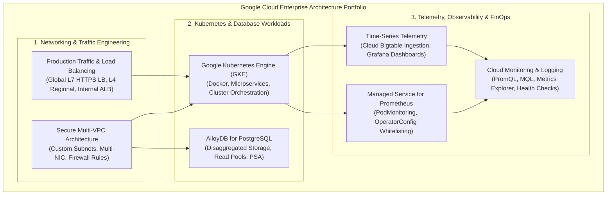

# Google Cloud DevOps & SRE Engineering Lab

> Hands-on engineering portfolio demonstrating practical implementation, troubleshooting, automation, and security across Google Cloud Platform, Google Kubernetes Engine (GKE), Prometheus Observability, AlloyDB, Networking, and Site Reliability Engineering.

[](https://www.skills.google/public_profiles/e1158899-3f93-4f1a-be6a-398d495945a0)
[](https://kubernetes.io/)
[](https://github.com/SwapnilSP000/Arcade--Google_Cloud_DevOps)
[](https://www.skills.google/public_profiles/e1158899-3f93-4f1a-be6a-398d495945a0)
[](https://www.credly.com/users/swapnil-patil.bbda7d25/badges/credly)

---

## 👤 Engineering Profile & Verified Links

- **Engineer:** Swapnil Patil
- **GitHub Repository:** [github.com/SwapnilSP000/Arcade--Google_Cloud_DevOps](https://github.com/SwapnilSP000/Arcade--Google_Cloud_DevOps)
- **Google Cloud Skills Boost Profile:** [skills.google/public_profiles/e1158899-3f93-4f1a-be6a-398d495945a0](https://www.skills.google/public_profiles/e1158899-3f93-4f1a-be6a-398d495945a0)
- **Credly Verified Badges:** [credly.com/users/swapnil-patil.bbda7d25/badges/credly](https://www.credly.com/users/swapnil-patil.bbda7d25/badges/credly)
- **Target Roles:** Google Cloud DevOps Engineer | Cloud Engineer | Site Reliability Engineer (SRE) | Platform Engineer

---

## 📊 Portfolio Summary & Metrics

| Portfolio Metric | Metric Value | Verification Source |
|---|---|---|
| **Core Technical Modules** | 7 Distinct Domains | Repository Directory Structure |
| **Documented Lab Implementations** | 15+ Verified Labs | End-to-end `README.md` & Shell/SQL Scripts |
| **Challenge Labs Mastered** | 4 Rigorous Scenarios | Timed assessment completions (`GSP313`, `GSP364`, `GSP395`, etc.) |
| **Forensic Screenshot Evidence** | 85+ Terminal & Console Proofs | Dedicated `Screenshot/` folders per lab |
| **Primary Cloud Platform** | Google Cloud Platform (GCP) | Compute, Networking, GKE, Databases, Observability |
| **Primary Automation Tools** | `gcloud` CLI, `kubectl`, Bash, PromQL, SQL | Automated implementation scripts |

---

## 🎯 Engineering Mindset

This repository presents hands-on cloud engineering implementations moving beyond theoretical tutorials to focus on real-world system architecture, operational triage, and reliability engineering:

```text
Learn  ──▶  Practice  ──▶  Reproduce  ──▶  Break  ──▶  Troubleshoot  ──▶  Fix  ──▶  Automate  ──▶  Measure  ──▶  Improve
```

---

## 🏆 Google Cloud Skills Boost — Verified Achievements

All achievements listed below are earned on the official Google Cloud Skills Boost platform and verified against the public profile:

### A. High-Value Skill Badges for DevOps & SRE (Tier 1 & Tier 2)

These assessment-based credentials validate hands-on execution of production architectures, security controls, and infrastructure delivery:

| Priority | Badge Title | Domain | Verified Earned Date | DevOps & SRE Practical Relevance |
|---|---|---|---|---|
| **Tier 1** | **Implement CI/CD Pipelines on Google Cloud** | CI/CD & Delivery | August 10, 2026 | Automated application delivery pipelines using Cloud Build, Artifact Registry container storage, Cloud Deploy canary/rolling rollouts, and GKE cluster release management. |
| **Tier 1** | **Privileged Access with IAM** | Security & Access Governance | August 8, 2026 | Least-privilege IAM roles, service account management, conditional role bindings, Identity-Aware Proxy (IAP), and audit logging. |
| **Tier 1** | **Connecting Cloud Networks with NCC** | Enterprise Cloud Networking | August 21, 2026 | Network Connectivity Center (NCC) hub-and-spoke connectivity, VPC peering, Hybrid interconnects, and cross-VPC routing. |
| **Tier 1** | **Implement Load Balancing on Compute Engine** (`GSP313`) | Traffic Engineering | September 28, 2026 | Layer 7 Global External Application Load Balancers, Layer 4 Regional Passthrough, Internal ALBs, Managed Instance Groups (MIG), and health check policies. |
| **Tier 1** | **Build a Secure Google Cloud Network** | Zero-Trust Infrastructure | September 25, 2026 | Custom-mode VPCs, multi-interface (Multi-NIC) appliances, stateful firewall rules, bastion host architecture, and network isolation. |
| **Tier 2** | **Spotting Phantoms on the Radar: Prometheus Observability** | Observability & FinOps | October 29–31, 2026 | Google Cloud Managed Service for Prometheus, PromQL querying, `PodMonitoring` custom resources, Grafana integration, and `OperatorConfig` metric ingestion filtering. |
| **Tier 2** | **Deliver the Treats: AlloyDB Performance** | Cloud Databases & SRE | October 31, 2026 | AlloyDB for PostgreSQL, Private Service Access (PSA), 2 vCPU primary instances, 2-node load-balanced read pools, SSL/TLS (`sslmode=require`), and on-demand snapshots. |

### B. Arcade Milestones & Simulator Badges

Official Google Cloud Arcade game tracks and interactive simulator achievements validating diverse operational skills:

| Category | Arcade Achievement Title | Verified Date | Focus Area |
|---|---|---|---|
| **Arcade Trail** | **Arcade Trail: Cloud Delivery Systems** | August 18, 2026 | Modern software supply chain, container packaging, and cloud release engineering. |
| **Arcade Simulator**| **Arcade Simulator: Network Security Engineer** | August 8, 2026 | Virtual network security, perimeter defense, Cloud Armor, and packet inspection. |
| **Arcade Voyage** | **Arcade Voyage: Google Sheets** | August 31, 2026 | Cloud workspace data automation, telemetry exports, and analysis. |

### C. Supporting Technical Learning & Foundation (Tier 3)

Complementary technical learning tracks covering Generative AI, MLOps, and Data Analytics on Google Cloud:
- **Vertex AI & Generative AI Foundations**: Practical exposure to foundation model APIs, Gemini on Google Cloud, and AI-assisted cloud workflows.
- **Responsible AI Principles**: Safety filters, model governance, and ethical deployment standards.
- **Big Data & Telemetry Ingestion**: Scalable ingestion architectures leveraging Cloud Bigtable and time-series engines.

---

## 🏛️ Comprehensive Architecture & Implementation Modules



---

## 📂 Detailed Module Directory & Lab Inventory

### 1. 🚦 [Production Traffic & Load Balancing](./Production%20Traffic%20%26%20Load%20Balancing)
*Enterprise traffic routing, global SSL offloading, and backend health monitoring across Compute Engine Managed Instance Groups.*
* **Set Up Network Load Balancers (`GSP007`)**: L4 regional passthrough load balancing distributing web traffic across NGINX instances via target pools.
* **Set Up Application Load Balancers (`GSP155`)**: Global Layer 7 HTTP(S) proxy load balancing with URL maps, path-based routing, and managed instance backends.
* **Use an Internal Application Load Balancer (`GSP041`)**: Private regional L7 proxy ensuring zero-public-IP isolation for internal microservice tiers.
* **Challenge Lab (`GSP313`)**: End-to-end multi-tier load balancing under timed challenge conditions (*Score: 100/100*).

### 2. 🛡️ [Secure Multi-VPC Architecture](./Secure-Multi-VPC-Architecture)
*Zero-trust network segmentation, inter-VPC routing, and virtual appliance traffic forwarding.*
* **Multiple VPC Networks (`GSP211`)**: Custom-mode VPCs (`managementnet`, `privatenet`), non-overlapping CIDR subnets, dual-homed router VMs (`vm-appliance`), and Linux policy routing (*Score: 100/100*).
* **VPC Networks - Controlling Access (`GSP213`)**: Tag-based firewall security (`web-server`), service accounts, and IAM network administrative roles.
* **Enhance Application Reliability with Internal LB**: High-availability internal backend scaling across multiple zones.
* **Challenge Lab**: Building resilient, secure enterprise Google Cloud VPC networks from scratch.

### 3. ☸️ [Deploy Kubernetes Applications on Google Cloud](./Deploy-Kubernetes-Applications-on-Google-Cloud)
*Containerization, microservice orchestration, and cluster lifecycle management on GKE.*
* **Introduction to Docker**: Image layering, Dockerfile optimization, caching strategies, and container runtimes.
* **Google Kubernetes Engine: Qwik Start**: Multi-zone cluster orchestration and automated pod scheduling.
* **Orchestrating the Cloud with Kubernetes**: Pods, Deployments, Services, ConfigMaps, Secrets, and rolling zero-downtime updates.
* **Challenge Lab**: Production-grade GKE workload configuration and deployment automation.

### 4. 🔍 [Secure Analytics & Observability](./Secure-Analytics)
*Runtime application troubleshooting, crash diagnostics, and log triage on Kubernetes.*
* **Debug Apps on Google Kubernetes Engine**: Diagnosing `CrashLoopBackOff` failures, fixing broken container probes, resolving CPU/memory resource starvation, and querying Cloud Logging.

### 5. 📈 [Time-Series Telemetry & Observability](./Monitor%20Time-Series%20Data%20with%20OpenTSDB)
*High-throughput telemetry ingestion, persistent distributed storage, and real-time visualization.*
* **Monitor Time-Series Data with OpenTSDB (`GSP142`)**: Provisioning Google Cloud Bigtable clusters, containerizing OpenTSDB on GKE via Artifact Registry, decoupling read/write daemonsets, building live Grafana dashboards, and diagnosing build/pull pipeline failures.

### 6. 📡 [Spotting Phantoms on the Radar — Prometheus Observability](./Spotting-Phantoms-on-the-Radar)
*Cloud-native telemetry instrumentation, managed Prometheus scraping, FinOps metric filtering, and Grafana dashboarding.*
* **Using Prometheus for Monitoring on Google Cloud: Qwik Start (`GSP1024`)**: Deploying Managed Service for Prometheus on GKE, instrumenting Python Flask apps, scraping via declarative `PodMonitoring` CRDs, and querying metrics in Cloud Monitoring.
* **Migrate Existing Prometheus Monitoring Workloads to Google Cloud (`GSP1025`)**: Self-deployed Prometheus data collection using GMP drop-in replacement engine, writing directly to Monarch storage, proxying via frontend service, deploying ephemeral Grafana, and validating telemetry via CSV export (*Score: 100/100*).
* **Reduce Costs for the Managed Service for Prometheus (`GSP1027`)**: Observability FinOps, configuring `OperatorConfig` `matchOneOf` selectors to drop unneeded metric series, and doubling scrape intervals (30s to 60s) to halve sample ingestion volume (*Score: 100/100*).
* **Monitor Environments with Google Cloud Managed Service for Prometheus: Challenge Lab (`GSP364`)**: Full challenge lab implementation provisioning GKE with Managed Prometheus, deploying the Prometheus Operator, configuring telemetry filtering rules, and archiving configuration manifests to Cloud Storage (*Score: Completed*).

### 7. 🍬 [Deliver the Treats — AlloyDB Performance & Database Operations](./Deliver%20the%20Treats%20AlloyDB%20Performance)
*Enterprise relational database architecture, Private Service Access (PSA), horizontal read scaling, and disaster recovery.*
* **Create and Manage AlloyDB Instances (`GSP395`)**: Provisioning AlloyDB for PostgreSQL clusters, establishing Private Service Access (PSA) network peering, deploying 2 vCPU primary instances, establishing encrypted SSL/TLS client connectivity from Compute Engine VMs (`sslmode=require`), creating relational schemas (19 verified records), scaling read throughput with a 2-node load-balanced read pool, and executing non-disruptive storage snapshots (*Score: 100/100*).
* **Accelerating Analytical Queries using the AlloyDB Columnar Engine (`GSP1087`)**: *Staged module* covering columnar memory caching and HTAP analytics.
* **AlloyDB - Database Fundamentals (`GSP1083`)**: *Staged module* covering database cluster basics.
* **Migrate to AlloyDB from PostgreSQL Using DMS (`GSP1085`)**: *Staged module* covering Database Migration Service workflows.

---

## 🛠️ Technical Skills Matrix

| Engineering Area | Practical Technologies | Verified Repository Evidence |
|---|---|---|
| **Cloud Infrastructure & Compute** | Google Cloud Platform, Compute Engine, Managed Instance Groups (MIG), Metadata, Cloud Storage | [`Production Traffic & Load Balancing`](./Production%20Traffic%20%26%20Load%20Balancing), [`Deliver the Treats`](./Deliver%20the%20Treats%20AlloyDB%20Performance) |
| **Cloud Networking & Security** | Custom VPCs, VPC Peering, Private Service Access (PSA), Firewall Rules, Cloud NAT, Bastion Hosts | [`Secure-Multi-VPC-Architecture`](./Secure-Multi-VPC-Architecture), [`GSP395`](./Deliver%20the%20Treats%20AlloyDB%20Performance/Create%20and%20Manage%20AlloyDB%20Instances%20Challenge%20Lab) |
| **Traffic Engineering & Load Balancing** | External HTTPS Load Balancing, Regional L4 Passthrough, Internal ALB, URL Maps, Health Checks | [`GSP313 Challenge Lab`](./Production%20Traffic%20%26%20Load%20Balancing/Implement-Load-Balancing-on-Compute-Engine-Challenge-Lab), [`GSP155`](./Production%20Traffic%20%26%20Load%20Balancing/Set-Up-Application-Load-Balancers) |
| **Containerization & Orchestration** | Docker, Google Kubernetes Engine (GKE), Pods, Deployments, Services, ConfigMaps, StatefulSets | [`Deploy-Kubernetes-Applications-on-Google-Cloud`](./Deploy-Kubernetes-Applications-on-Google-Cloud), [`Secure-Analytics`](./Secure-Analytics) |
| **Cloud-Native Observability & SRE** | Google Cloud Managed Service for Prometheus, PromQL, Grafana, OpenTSDB, Cloud Monitoring, Cloud Logging | [`Spotting-Phantoms-on-the-Radar`](./Spotting-Phantoms-on-the-Radar), [`Monitor Time-Series Data with OpenTSDB`](./Monitor%20Time-Series%20Data%20with%20OpenTSDB) |
| **Observability FinOps & Cost Governance**| `OperatorConfig` `matchOneOf` series filtering, `PodMonitoring` scrape interval modulation (30s to 60s) | [`GSP1027`](./Spotting-Phantoms-on-the-Radar/Reduce%20Costs%20for%20the%20Managed%20Service%20for%20Prometheus), [`GSP364`](./Spotting-Phantoms-on-the-Radar/Monitor%20Environments%20with%20Google%20Cloud%20Managed%20Service%20for%20Prometheus%20Challenge%20Lab) |
| **Database Engineering & Storage** | AlloyDB for PostgreSQL, Cloud Bigtable, `psql` Client, Read Pools, Relational Schemas, Snapshots | [`Deliver the Treats AlloyDB Performance`](./Deliver%20the%20Treats%20AlloyDB%20Performance), [`GSP142`](./Monitor%20Time-Series%20Data%20with%20OpenTSDB) |
| **Transport Security & Identity** | SSL/TLS Encryption (`sslmode=require`), Least-Privilege IAM Roles, Service Accounts | [`GSP395`](./Deliver%20the%20Treats%20AlloyDB%20Performance/Create%20and%20Manage%20AlloyDB%20Instances%20Challenge%20Lab), [`VPC Access Control`](./Secure-Multi-VPC-Architecture/VPC-Networks-Controlling-Access) |

---

## 🔎 How to Explore This Repository

Every project in this repository is designed as an independent engineering case study containing:
1. **`README.md`**: Architectural breakdown, business context, implementation workflow, and SRE triage notes.
2. **`commands/`**: Copy-paste-ready, variable-based shell scripts clearly distinguishing between Google Cloud Shell, Compute Engine VM terminals, and PostgreSQL consoles.
3. **`Screenshot/`**: Forensic visual evidence validating command outputs, resource health in Google Cloud Console, and assessment score completions.

---

## 📚 Official Technical References

- [Google Cloud Documentation](https://cloud.google.com/docs)
- [Google Kubernetes Engine (GKE) Guides](https://cloud.google.com/kubernetes-engine/docs)
- [Google Cloud Managed Service for Prometheus](https://cloud.google.com/stackdriver/docs/managed-prometheus)
- [Google Cloud AlloyDB for PostgreSQL](https://cloud.google.com/alloydb/docs)
- [Google Cloud VPC & Networking](https://cloud.google.com/vpc/docs)
- [Prometheus Query Language (PromQL) Reference](https://prometheus.io/docs/prometheus/latest/querying/basics/)

---

## 🚀 Quick Git Workflow

```bash
# Check status
git status

# Stage updated files
git add .

# Commit changes with descriptive message
git commit -m "docs: complete repository audit, badges valuation, and portfolio upgrade"

# Push to GitHub main branch
git push origin main
```
