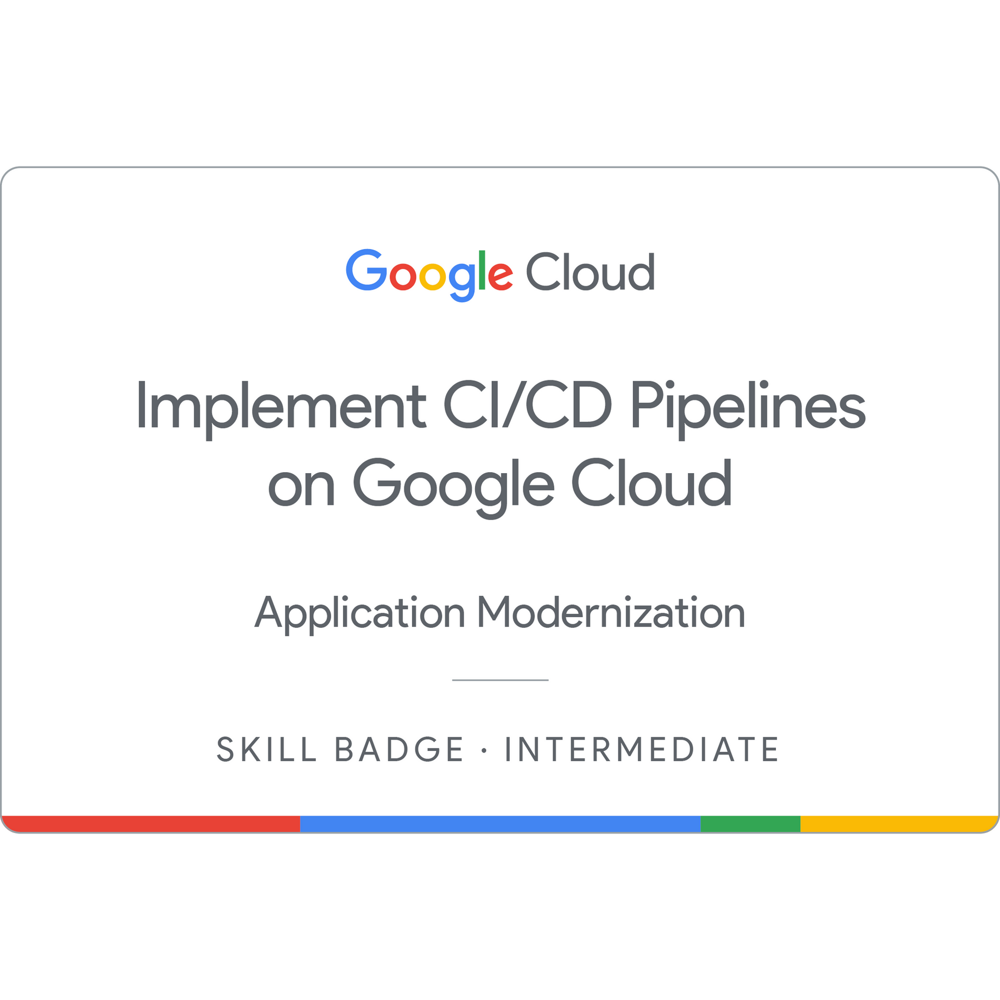
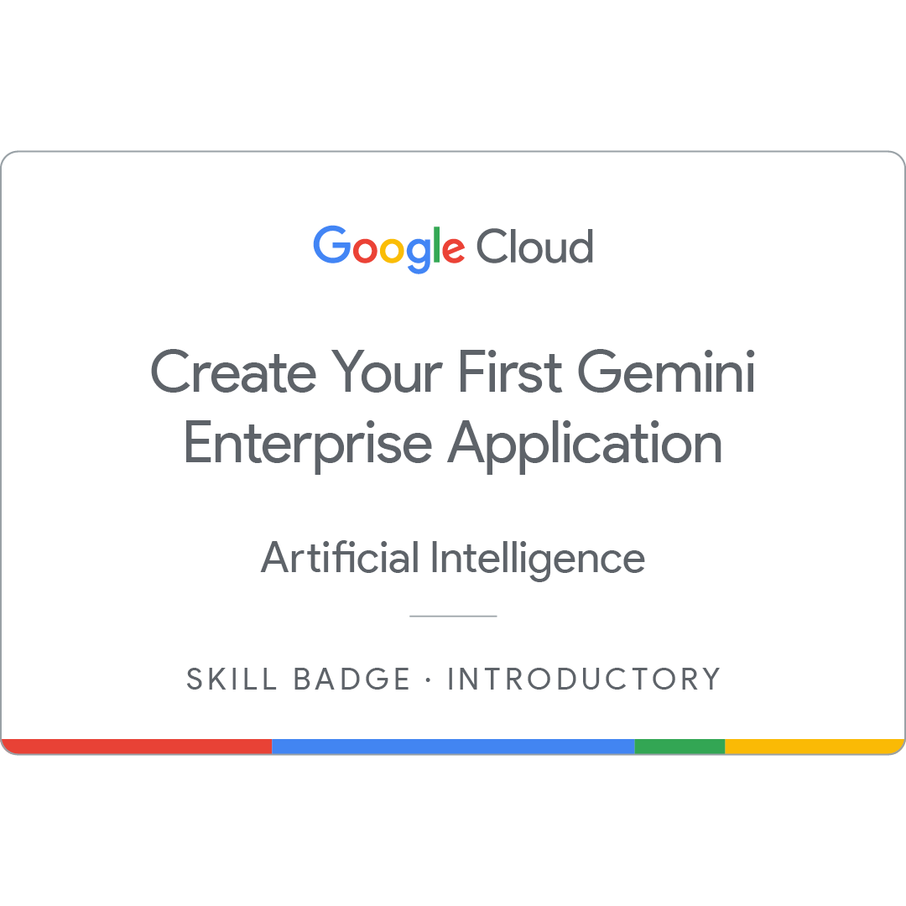
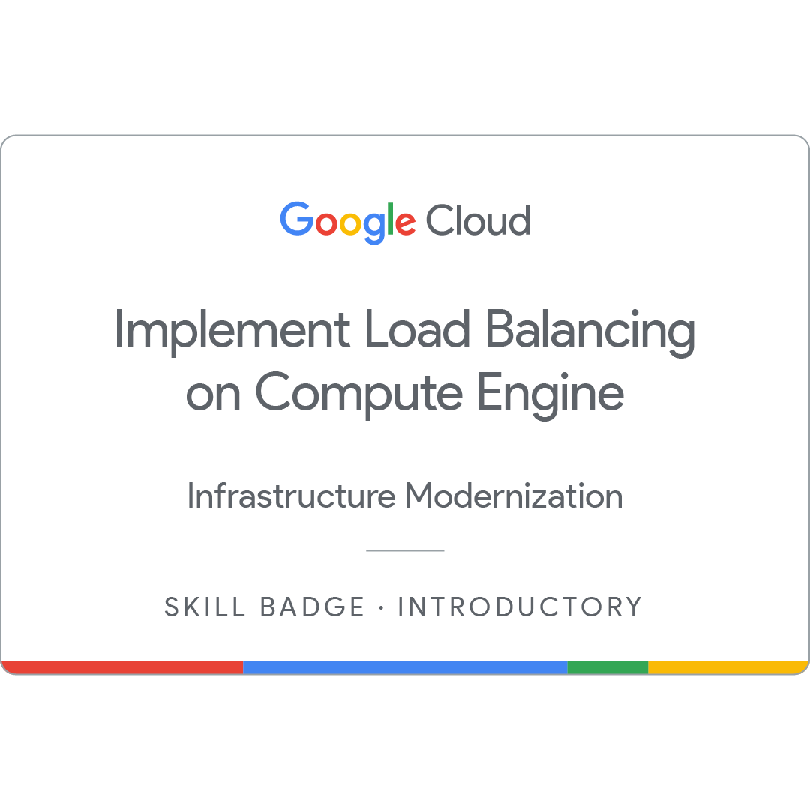
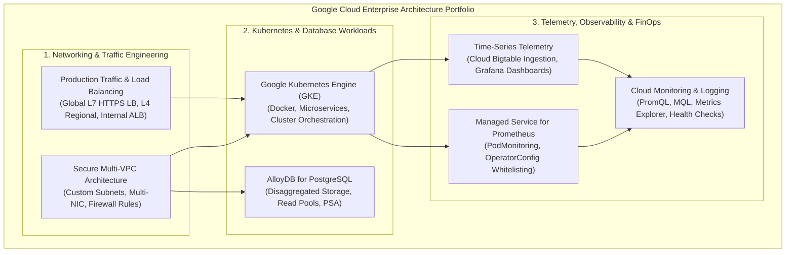

# Google Cloud DevOps & SRE Engineering Lab
### Google Cloud Arcade & Skills Achievement Portfolio

> Hands-on engineering portfolio demonstrating practical implementation, troubleshooting, automation, and security across Google Cloud Platform, Google Kubernetes Engine (GKE), Prometheus Observability, AlloyDB, Networking, and Site Reliability Engineering.

[](https://www.skills.google/public_profiles/e1158899-3f93-4f1a-be6a-398d495945a0)
[](https://kubernetes.io/)
[](https://github.com/SwapnilSP000/Arcade--Google_Cloud_DevOps)
[](https://www.skills.google/public_profiles/e1158899-3f93-4f1a-be6a-398d495945a0)
[](https://www.credly.com/users/swapnil-patil.bbda7d25/badges/credly)

---

## 👤 Engineering Profile & Verified Links

- **Engineer:** Swapnil Patil
- **GitHub Repository:** [github.com/SwapnilSP000/Arcade--Google_Cloud_DevOps](https://github.com/SwapnilSP000/Arcade--Google_Cloud_DevOps)
- **Google Cloud Skills Boost Public Profile:** [skills.google/public_profiles/e1158899-3f93-4f1a-be6a-398d495945a0](https://www.skills.google/public_profiles/e1158899-3f93-4f1a-be6a-398d495945a0)
- **Credly Verified Badges:** [credly.com/users/swapnil-patil.bbda7d25/badges/credly](https://www.credly.com/users/swapnil-patil.bbda7d25/badges/credly)
- **Target Roles:** Google Cloud DevOps Engineer | Cloud Engineer | Site Reliability Engineer (SRE) | Platform Engineer | Cloud Security Engineer

---

## 📋 Table of Contents

1. [Portfolio Summary & Metrics](#-portfolio-summary--metrics)
2. [Engineering Mindset](#-engineering-mindset)
3. [Featured Professional Credentials](#-featured-professional-credentials)
4. [Google Cloud Arcade — Complete Achievement Gallery](#-google-cloud-arcade--complete-achievement-gallery)
   - [A. Arcade Simulators](#a-arcade-simulators)
   - [B. Arcade Trails & Re-Trails](#b-arcade-trails--re-trails)
   - [C. Arcade Voyages](#c-arcade-voyages)
   - [D. Arcade Adventures & Events](#d-arcade-adventures--events)
5. [High-Value Skill Badges Ranked by Career Relevance](#-high-value-skill-badges-ranked-by-career-relevance)
6. [Professional Career Path Alignment](#-professional-career-path-alignment)
7. [Enterprise Architecture Overview](#-enterprise-architecture-overview)
8. [Detailed Repository Modules & Lab Inventory](#-detailed-repository-modules--lab-inventory)
9. [Technical Skills Matrix](#-technical-skills-matrix)
10. [How to Explore This Repository](#-how-to-explore-this-repository)
11. [Official Technical References](#-official-technical-references)

---

## 📊 Portfolio Summary & Metrics

| Portfolio Metric | Metric Value | Verification Source |
|---|---|---|
| **Core Technical Modules** | 7 Distinct Domains | Repository Directory Structure |
| **Documented Lab Implementations** | 15+ Verified Labs | End-to-end `README.md` & Shell/SQL Scripts |
| **Challenge Labs Mastered** | 4 Rigorous Scenarios | Timed assessment completions (`GSP313`, `GSP364`, `GSP395`, etc.) |
| **Forensic Screenshot Evidence** | 85+ Terminal & Console Proofs | Dedicated `Screenshot/` folders per lab |
| **Primary Cloud Platform** | Google Cloud Platform (GCP) | Compute, Networking, GKE, Databases, Observability |
| **Primary Automation Tools** | `gcloud` CLI, `kubectl`, Bash, PromQL, SQL | Automated implementation scripts |
| **Verified Skill & Arcade Badges** | Multiple Assessed Badges | [Google Cloud Skills Boost Profile](https://www.skills.google/public_profiles/e1158899-3f93-4f1a-be6a-398d495945a0) |

---

## 🎯 Engineering Mindset

This repository presents hands-on cloud engineering implementations moving beyond theoretical tutorials to focus on real-world system architecture, operational triage, and reliability engineering:

```text
Learn  ──▶  Practice  ──▶  Reproduce  ──▶  Break  ──▶  Troubleshoot  ──▶  Fix  ──▶  Automate  ──▶  Measure  ──▶  Improve
```

---

## 🌟 Featured Professional Credentials

These assessment-based credentials represent the core technical foundation of this portfolio, directly demonstrating hands-on proficiency in CI/CD pipeline automation, zero-trust network security, hybrid connectivity, production load balancing, and cloud observability. All badges below use verified locally-hosted repository artwork:

<table>
  <tr>
    <td width="20%" align="center">
      <br/>
      <b>Implement CI/CD Pipelines on Google Cloud</b>
    </td>
    <td width="80%">
      <b>Verified Earned Date:</b> August 10, 2026<br/>
      <b>Domain:</b> CI/CD, Container Packaging & Cloud Delivery<br/>
      <b>Technical Skills Demonstrated:</b> Automated software release management using Google Cloud Build, Artifact Registry Docker repository configuration, automated multi-target deployment pipelines with Google Cloud Deploy, and GKE cluster release engineering.<br/>
      <b>Professional Career Relevance:</b> <i>High Relevance (Tier 1)</i> — Fundamental for DevOps and Release Engineers responsible for continuous integration, immutable container artifacts, and declarative GitOps delivery.<br/>
      <b>Credential Verification:</b> <a href="https://www.skills.google/public_profiles/e1158899-3f93-4f1a-be6a-398d495945a0">View on Google Skills Profile</a> | <a href="https://www.credly.com/users/swapnil-patil.bbda7d25/badges/credly">View on Credly</a>
    </td>
  </tr>
  <tr>
    <td width="20%" align="center">
      <br/>
      <b>Privileged Access with IAM</b>
    </td>
    <td width="80%">
      <b>Verified Earned Date:</b> August 8, 2026<br/>
      <b>Domain:</b> Security, Identity & Governance<br/>
      <b>Technical Skills Demonstrated:</b> Implementing least-privilege IAM roles, auditing custom roles, managing Google Cloud service accounts and key delegation, enforcing conditional access policies, configuring Identity-Aware Proxy (IAP), and inspecting Cloud Audit Logs.<br/>
      <b>Professional Career Relevance:</b> <i>High Relevance (Tier 1)</i> — Critical for Cloud Security and DevSecOps engineers enforcing zero-trust perimeter defense, temporary privilege elevation, and compliance boundaries.<br/>
      <b>Credential Verification:</b> <a href="https://www.skills.google/public_profiles/e1158899-3f93-4f1a-be6a-398d495945a0">View on Google Skills Profile</a> | <a href="https://www.credly.com/users/swapnil-patil.bbda7d25/badges/credly">View on Credly</a>
    </td>
  </tr>
  <tr>
    <td width="20%" align="center">
      <br/>
      <b>Implement Load Balancing on Compute Engine</b>
    </td>
    <td width="80%">
      <b>Verified Earned Date:</b> September 28, 2026<br/>
      <b>Domain:</b> Traffic Engineering & High Availability<br/>
      <b>Technical Skills Demonstrated:</b> Layer 7 Global External Application Load Balancers, Layer 4 Regional Passthrough Network Load Balancers, Internal Application Load Balancers, Managed Instance Groups (MIG), URL maps, backend health checks, and autoscaling policies under timed challenge conditions (`GSP313`).<br/>
      <b>Professional Career Relevance:</b> <i>High Relevance (Tier 1)</i> — Core competence for Site Reliability Engineers (SRE) maintaining service availability, zero-downtime rolling upgrades, and traffic failover.<br/>
      <b>Credential Verification:</b> <a href="https://www.skills.google/public_profiles/e1158899-3f93-4f1a-be6a-398d495945a0">View on Google Skills Profile</a> | <a href="./Production%20Traffic%20%26%20Load%20Balancing">View Lab Implementation</a>
    </td>
  </tr>
  <tr>
    <td width="20%" align="center">
      <br/>
      <b>Build a Secure Google Cloud Network</b>
    </td>
    <td width="80%">
      <b>Verified Earned Date:</b> September 25, 2026<br/>
      <b>Domain:</b> Zero-Trust Infrastructure & VPC Design<br/>
      <b>Technical Skills Demonstrated:</b> Custom-mode VPC subnet design, stateful firewall rules with network tags, multi-homed virtual router appliances (Multi-NIC VMs), bastion hosts for administrative transit, and private network segmentation.<br/>
      <b>Professional Career Relevance:</b> <i>High Relevance (Tier 1)</i> — Foundational for Platform Engineers designing non-overlapping CIDR address space and hardened cloud network perimeters.<br/>
      <b>Credential Verification:</b> <a href="https://www.skills.google/public_profiles/e1158899-3f93-4f1a-be6a-398d495945a0">View on Google Skills Profile</a> | <a href="./Secure-Multi-VPC-Architecture">View Lab Implementation</a>
    </td>
  </tr>
  <tr>
    <td width="20%" align="center">
      <br/>
      <b>Connecting Cloud Networks with NCC</b>
    </td>
    <td width="80%">
      <b>Verified Earned Date:</b> August 21, 2026<br/>
      <b>Domain:</b> Enterprise Cloud Networking & Hybrid Architecture<br/>
      <b>Technical Skills Demonstrated:</b> Configuring Network Connectivity Center (NCC) hub-and-spoke models, multi-VPC spoke attachments, Cloud Router BGP dynamic routing, VPC Network Peering topologies, and cross-region hybrid connectivity.<br/>
      <b>Professional Career Relevance:</b> <i>High Relevance (Tier 1)</i> — Essential for Cloud Network Engineers and Enterprise Cloud Architects orchestrating large-scale corporate networks across multi-VPC and hybrid-cloud environments.<br/>
      <b>Credential Verification:</b> <a href="https://www.skills.google/public_profiles/e1158899-3f93-4f1a-be6a-398d495945a0">View on Google Skills Profile</a> | <a href="https://www.credly.com/users/swapnil-patil.bbda7d25/badges/credly">View on Credly</a>
    </td>
  </tr>
</table>

---

## 🎮 Google Cloud Arcade — Complete Achievement Gallery

The Google Cloud Arcade program features interactive gamified milestones, hands-on architectural simulators, and scenario-based challenge tracks. The sections below showcase verified Arcade achievements categorized by track:

### A. Arcade Simulators
*Interactive architectural simulations testing real-world engineering troubleshooting and design patterns:*

<table>
  <tr>
    <th width="20%">Badge Artwork</th>
    <th width="25%">Achievement Title</th>
    <th width="15%">Earned Date</th>
    <th width="40%">Engineering Focus & Skill Demonstration</th>
  </tr>
  <tr>
    <td align="center">
      
    </td>
    <td><b>Arcade Simulator: Network Security Engineer</b></td>
    <td>August 8, 2026</td>
    <td>Designing defensive network architectures, deploying perimeter Cloud Armor security policies, isolating virtual machines with private subnets, and inspecting network flow logs.<br/>🔗 <a href="https://www.skills.google/public_profiles/e1158899-3f93-4f1a-be6a-398d495945a0">Verify on Skills Boost</a></td>
  </tr>
</table>

---

### B. Arcade Trails & Re-Trails
*Curated hands-on pathways covering modern cloud infrastructure, delivery pipelines, and automation:*

<table>
  <tr>
    <th width="20%">Badge Artwork</th>
    <th width="25%">Achievement Title</th>
    <th width="15%">Earned Date</th>
    <th width="40%">Engineering Focus & Skill Demonstration</th>
  </tr>
  <tr>
    <td align="center">
      
    </td>
    <td><b>Arcade Trail: Cloud Delivery Systems</b></td>
    <td>August 18, 2026</td>
    <td>Hands-on mastery of software delivery pipelines, container image scanning in Artifact Registry, automated build triggers via Cloud Build, and deployment staging to Kubernetes clusters.<br/>🔗 <a href="https://www.skills.google/public_profiles/e1158899-3f93-4f1a-be6a-398d495945a0">Verify on Skills Boost</a></td>
  </tr>
</table>

---

### C. Arcade Voyages
*In-depth technical exploration quests into Google Cloud workspace, productivity, and automation:*

<table>
  <tr>
    <th width="20%">Badge Artwork</th>
    <th width="25%">Achievement Title</th>
    <th width="15%">Earned Date</th>
    <th width="40%">Engineering Focus & Skill Demonstration</th>
  </tr>
  <tr>
    <td align="center">
      
    </td>
    <td><b>Arcade Voyage: Google Sheets</b></td>
    <td>August 31, 2026</td>
    <td>Data manipulation, operational telemetry formatting, programmatic spreadsheet workflows, and reporting automation for cloud operational analytics.<br/>🔗 <a href="https://www.skills.google/public_profiles/e1158899-3f93-4f1a-be6a-398d495945a0">Verify on Skills Boost</a></td>
  </tr>
</table>

---

### D. Arcade Adventures & Events
<details>
<summary><b>🔍 Click to expand seasonal Arcade event achievements & trivia milestones</b></summary>
<br/>

<table>
  <tr>
    <th width="20%">Badge Category</th>
    <th width="30%">Track / Milestone</th>
    <th width="50%">Description & Verification</th>
  </tr>
  <tr>
    <td align="center"></td>
    <td><b>Arcade Base Camp & Trivia</b></td>
    <td>Foundational cloud computing challenges, architectural trivia, and multi-disciplinary Google Cloud platform navigation.<br/>🔗 <a href="https://www.skills.google/public_profiles/e1158899-3f93-4f1a-be6a-398d495945a0">Verified on Google Skills Boost Profile</a></td>
  </tr>
</table>

</details>

---

## 🎯 High-Value Skill Badges Ranked by Career Relevance

To provide technical recruiters and hiring managers with a structured view of competencies, earned badges are evaluated below by alignment with core DevOps and SRE industry responsibilities:

| Priority Tier | Badge Title | Category | Earned Date | DevOps & SRE Career Justification |
|---|---|---|---|---|
| **Tier 1 (Direct)** | **Implement CI/CD Pipelines on Google Cloud** | CI/CD & Delivery | Aug 10, 2026 | Direct validation of automated pipeline design with Cloud Build, Artifact Registry, Cloud Deploy, and GKE release automation. |
| **Tier 1 (Direct)** | **Privileged Access with IAM** | Security & Governance | Aug 8, 2026 | Demonstrates production access control: least-privilege IAM roles, service accounts, conditional bindings, and Identity-Aware Proxy (IAP). |
| **Tier 1 (Direct)** | **Connecting Cloud Networks with NCC** | Enterprise Networking | Aug 21, 2026 | Network Connectivity Center (NCC) hub-and-spoke topologies, cross-VPC routing, and hybrid connectivity patterns. |
| **Tier 1 (Direct)** | **Implement Load Balancing on Compute Engine** (`GSP313`) | Traffic Engineering | Sep 28, 2026 | Multi-tier L4/L7 load balancing, Global HTTPS proxies, URL maps, and health checking across Managed Instance Groups. |
| **Tier 1 (Direct)** | **Build a Secure Google Cloud Network** | Zero-Trust Infrastructure | Sep 25, 2026 | Custom-mode VPC segmentation, firewall policy authoring, multi-NIC virtual appliances, and private subnet isolation. |
| **Tier 2 (Supporting)** | **Spotting Phantoms on the Radar: Prometheus Observability** | Observability & FinOps | Oct 2026 | Google Cloud Managed Service for Prometheus, PromQL evaluation, `PodMonitoring` custom resources, Grafana integration, and `OperatorConfig` series filtering. |
| **Tier 2 (Supporting)** | **Deliver the Treats: AlloyDB Performance** (`GSP395`) | Cloud Databases | Oct 31, 2026 | Decoupled compute/storage, Private Service Access (PSA), primary read/write instances, 2-node read pools, and non-disruptive snapshot backups. |
| **Tier 3 (Foundation)** | **Vertex AI & Generative AI Foundations** | AI & MLOps | 2026 | Practical exploration of foundation model APIs, Gemini on Google Cloud, and AI-assisted cloud workflows. |

---

## 💼 Professional Career Path Alignment

| Career Target | Relevant Portfolio Achievements & Modules | Practical Skills Demonstrated |
|---|---|---|
| **Google Cloud DevOps Engineer** | • Implement CI/CD Pipelines on Google Cloud<br/>• Arcade Trail: Cloud Delivery Systems<br/>• Deploy Kubernetes Applications on GKE | Automated container builds, Artifact Registry OCI management, multi-environment Cloud Deploy releases, and immutable infrastructure automation. |
| **Site Reliability Engineer (SRE)** | • Spotting Phantoms on the Radar (`GSP1024`, `GSP1025`, `GSP1027`, `GSP364`)<br/>• Implement Load Balancing on Compute Engine (`GSP313`)<br/>• Time-Series Telemetry with OpenTSDB (`GSP142`) | Managed Prometheus scraping, PromQL rate transformations, Grafana dashboarding, SLA/SLO monitoring, and automated health-check failover. |
| **Cloud Infrastructure Engineer** | • Connecting Cloud Networks with NCC<br/>• Build a Secure Google Cloud Network<br/>• Multiple VPC Networks (`GSP211`) | Custom-mode VPC topologies, hub-and-spoke Network Connectivity Center, Multi-NIC appliances, and regional subnet isolation. |
| **Cloud Security Engineer (DevSecOps)** | • Privileged Access with IAM<br/>• Arcade Simulator: Network Security Engineer<br/>• VPC Networks: Controlling Access (`GSP213`) | Principle of least privilege, service account key rotation, tag-based firewall filtering, IAP private tunnels, and Cloud Audit Log inspection. |
| **Database & Platform Engineer** | • Deliver the Treats: AlloyDB Performance (`GSP395`)<br/>• Monitor Time-Series Data with OpenTSDB (`GSP142`) | Private Service Access (PSA) peering, disaggregated database compute/storage, load-balanced read pools, SSL/TLS encryption, and distributed time-series stores. |

---

## 🏛️ Enterprise Architecture Overview



---

## 📂 Detailed Repository Modules & Lab Inventory

### 1. 🚦 [Production Traffic & Load Balancing](./Production%20Traffic%20%26%20Load%20Balancing)
*Enterprise traffic routing, global SSL offloading, and backend health monitoring across Compute Engine Managed Instance Groups.*
* **Set Up Network Load Balancers (`GSP007`)**: L4 regional passthrough load balancing distributing web traffic across NGINX instances via target pools.
* **Set Up Application Load Balancers (`GSP155`)**: Global Layer 7 HTTP(S) proxy load balancing with URL maps, path-based routing, and managed instance backends.
* **Use an Internal Application Load Balancer (`GSP041`)**: Private regional L7 proxy ensuring zero-public-IP isolation for internal microservice tiers.
* **Challenge Lab (`GSP313`)**: End-to-end multi-tier load balancing under timed challenge conditions (*Score: 100/100*).

### 2. 🛡️ [Secure Multi-VPC Architecture](./Secure-Multi-VPC-Architecture)
*Zero-trust network segmentation, inter-VPC routing, and virtual appliance traffic forwarding.*
* **Multiple VPC Networks (`GSP211`)**: Custom-mode VPCs (`managementnet`, `privatenet`), non-overlapping CIDR subnets, dual-homed router VMs (`vm-appliance`), and Linux policy routing (*Score: 100/100*).
* **VPC Networks - Controlling Access (`GSP213`)**: Tag-based firewall security (`web-server`), service accounts, and IAM network administrative roles.
* **Enhance Application Reliability with Internal LB**: High-availability internal backend scaling across multiple zones.
* **Challenge Lab**: Building resilient, secure enterprise Google Cloud VPC networks from scratch.

### 3. ☸️ [Deploy Kubernetes Applications on Google Cloud](./Deploy-Kubernetes-Applications-on-Google-Cloud)
*Containerization, microservice orchestration, and cluster lifecycle management on GKE.*
* **Introduction to Docker**: Image layering, Dockerfile optimization, caching strategies, and container runtimes.
* **Google Kubernetes Engine: Qwik Start**: Multi-zone cluster orchestration and automated pod scheduling.
* **Orchestrating the Cloud with Kubernetes**: Pods, Deployments, Services, ConfigMaps, Secrets, and rolling zero-downtime updates.
* **Challenge Lab**: Production-grade GKE workload configuration and deployment automation.

### 4. 🔍 [Secure Analytics & Observability](./Secure-Analytics)
*Runtime application troubleshooting, crash diagnostics, and log triage on Kubernetes.*
* **Debug Apps on Google Kubernetes Engine**: Diagnosing `CrashLoopBackOff` failures, fixing broken container probes, resolving CPU/memory resource starvation, and querying Cloud Logging.

### 5. 📈 [Time-Series Telemetry & Observability](./Monitor%20Time-Series%20Data%20with%20OpenTSDB)
*High-throughput telemetry ingestion, persistent distributed storage, and real-time visualization.*
* **Monitor Time-Series Data with OpenTSDB (`GSP142`)**: Provisioning Google Cloud Bigtable clusters, containerizing OpenTSDB on GKE via Artifact Registry, decoupling read/write daemonsets, building live Grafana dashboards, and diagnosing build/pull pipeline failures.

### 6. 📡 [Spotting Phantoms on the Radar — Prometheus Observability](./Spotting-Phantoms-on-the-Radar)
*Cloud-native telemetry instrumentation, managed Prometheus scraping, FinOps metric filtering, and Grafana dashboarding.*
* **Using Prometheus for Monitoring on Google Cloud: Qwik Start (`GSP1024`)**: Deploying Managed Service for Prometheus on GKE, instrumenting Python Flask apps, scraping via declarative `PodMonitoring` CRDs, and querying metrics in Cloud Monitoring.
* **Migrate Existing Prometheus Monitoring Workloads to Google Cloud (`GSP1025`)**: Self-deployed Prometheus data collection using GMP drop-in replacement engine, writing directly to Monarch storage, proxying via frontend service, deploying ephemeral Grafana, and validating telemetry via CSV export (*Score: 100/100*).
* **Reduce Costs for the Managed Service for Prometheus (`GSP1027`)**: Observability FinOps, configuring `OperatorConfig` `matchOneOf` selectors to drop unneeded metric series, and doubling scrape intervals (30s to 60s) to halve sample ingestion volume (*Score: 100/100*).
* **Monitor Environments with Google Cloud Managed Service for Prometheus: Challenge Lab (`GSP364`)**: Full challenge lab implementation provisioning GKE with Managed Prometheus, deploying the Prometheus Operator, configuring telemetry filtering rules, and archiving configuration manifests to Cloud Storage (*Score: Completed*).

### 7. 🍬 [Deliver the Treats — AlloyDB Performance & Database Operations](./Deliver%20the%20Treats%20AlloyDB%20Performance)
*Enterprise relational database architecture, Private Service Access (PSA), horizontal read scaling, and disaster recovery.*
* **Create and Manage AlloyDB Instances (`GSP395`)**: Provisioning AlloyDB for PostgreSQL clusters, establishing Private Service Access (PSA) network peering, deploying 2 vCPU primary instances, establishing encrypted SSL/TLS client connectivity from Compute Engine VMs (`sslmode=require`), creating relational schemas (19 verified records), scaling read throughput with a 2-node load-balanced read pool, and executing non-disruptive storage snapshots (*Score: 100/100*).
* **Accelerating Analytical Queries using the AlloyDB Columnar Engine (`GSP1087`)**: *Staged module* covering columnar memory caching and HTAP analytics.
* **AlloyDB - Database Fundamentals (`GSP1083`)**: *Staged module* covering database cluster basics.
* **Migrate to AlloyDB from PostgreSQL Using DMS (`GSP1085`)**: *Staged module* covering Database Migration Service workflows.

---

## 🛠️ Technical Skills Matrix

| Engineering Area | Practical Technologies | Verified Repository Evidence |
|---|---|---|
| **Cloud Infrastructure & Compute** | Google Cloud Platform, Compute Engine, Managed Instance Groups (MIG), Metadata, Cloud Storage | [`Production Traffic & Load Balancing`](./Production%20Traffic%20%26%20Load%20Balancing), [`Deliver the Treats`](./Deliver%20the%20Treats%20AlloyDB%20Performance) |
| **Cloud Networking & Security** | Custom VPCs, VPC Peering, Private Service Access (PSA), Firewall Rules, Cloud NAT, Bastion Hosts | [`Secure-Multi-VPC-Architecture`](./Secure-Multi-VPC-Architecture), [`GSP395`](./Deliver%20the%20Treats%20AlloyDB%20Performance/Create%20and%20Manage%20AlloyDB%20Instances%20Challenge%20Lab) |
| **Traffic Engineering & Load Balancing** | External HTTPS Load Balancing, Regional L4 Passthrough, Internal ALB, URL Maps, Health Checks | [`GSP313 Challenge Lab`](./Production%20Traffic%20%26%20Load%20Balancing/Implement-Load-Balancing-on-Compute-Engine-Challenge-Lab), [`GSP155`](./Production%20Traffic%20%26%20Load%20Balancing/Set-Up-Application-Load-Balancers) |
| **Containerization & Orchestration** | Docker, Google Kubernetes Engine (GKE), Pods, Deployments, Services, ConfigMaps, StatefulSets | [`Deploy-Kubernetes-Applications-on-Google-Cloud`](./Deploy-Kubernetes-Applications-on-Google-Cloud), [`Secure-Analytics`](./Secure-Analytics) |
| **Cloud-Native Observability & SRE** | Google Cloud Managed Service for Prometheus, PromQL, Grafana, OpenTSDB, Cloud Monitoring, Cloud Logging | [`Spotting-Phantoms-on-the-Radar`](./Spotting-Phantoms-on-the-Radar), [`Monitor Time-Series Data with OpenTSDB`](./Monitor%20Time-Series%20Data%20with%20OpenTSDB) |
| **Observability FinOps & Cost Governance**| `OperatorConfig` `matchOneOf` series filtering, `PodMonitoring` scrape interval modulation (30s to 60s) | [`GSP1027`](./Spotting-Phantoms-on-the-Radar/Reduce%20Costs%20for%20the%20Managed%20Service%20for%20Prometheus), [`GSP364`](./Spotting-Phantoms-on-the-Radar/Monitor%20Environments%20with%20Google%20Cloud%20Managed%20Service%20for%20Prometheus%20Challenge%20Lab) |
| **Database Engineering & Storage** | AlloyDB for PostgreSQL, Cloud Bigtable, `psql` Client, Read Pools, Relational Schemas, Snapshots | [`Deliver the Treats AlloyDB Performance`](./Deliver%20the%20Treats%20AlloyDB%20Performance), [`GSP142`](./Monitor%20Time-Series%20Data%20with%20OpenTSDB) |
| **Transport Security & Identity** | SSL/TLS Encryption (`sslmode=require`), Least-Privilege IAM Roles, Service Accounts | [`GSP395`](./Deliver%20the%20Treats%20AlloyDB%20Performance/Create%20and%20Manage%20AlloyDB%20Instances%20Challenge%20Lab), [`VPC Access Control`](./Secure-Multi-VPC-Architecture/VPC-Networks-Controlling-Access) |

---

## 🔎 How to Explore This Repository

Every project in this repository is designed as an independent engineering case study containing:
1. **`README.md`**: Architectural breakdown, business context, implementation workflow, and SRE triage notes.
2. **`commands/`**: Copy-paste-ready, variable-based shell scripts clearly distinguishing between Google Cloud Shell, Compute Engine VM terminals, and PostgreSQL consoles.
3. **`Screenshot/`**: Forensic visual evidence validating command outputs, resource health in Google Cloud Console, and assessment score completions.

---

## 📚 Official Technical References

- [Google Cloud Documentation](https://cloud.google.com/docs)
- [Google Kubernetes Engine (GKE) Guides](https://cloud.google.com/kubernetes-engine/docs)
- [Google Cloud Managed Service for Prometheus](https://cloud.google.com/stackdriver/docs/managed-prometheus)
- [Google Cloud AlloyDB for PostgreSQL](https://cloud.google.com/alloydb/docs)
- [Google Cloud VPC & Networking](https://cloud.google.com/vpc/docs)
- [Prometheus Query Language (PromQL) Reference](https://prometheus.io/docs/prometheus/latest/querying/basics/)

---

## 🚀 Quick Git Workflow

```bash
# Check status
git status

# Stage updated files
git add .

# Commit changes with descriptive message
git commit -m "docs: fix badge image rendering with local repository assets"

# Push to GitHub main branch
git push origin main
```
