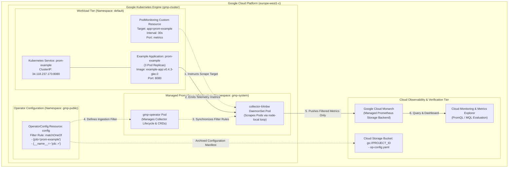
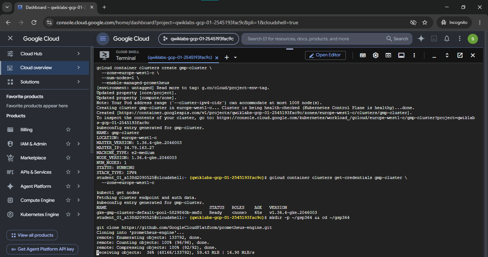
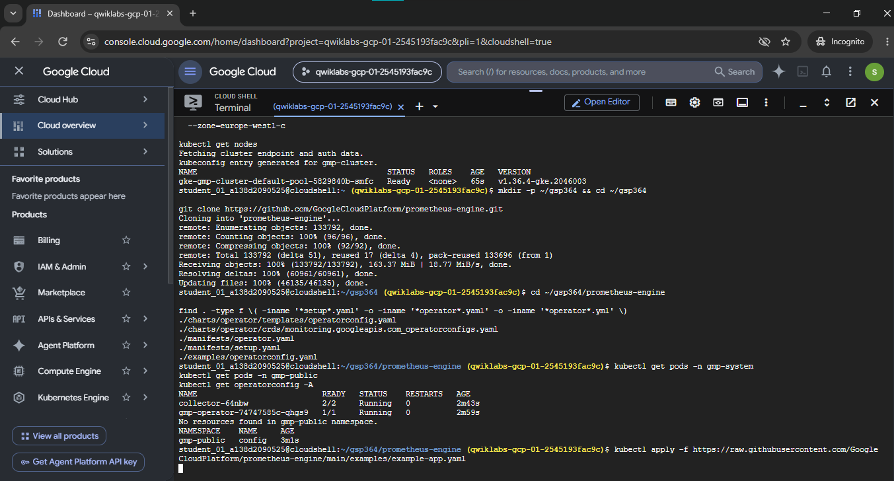
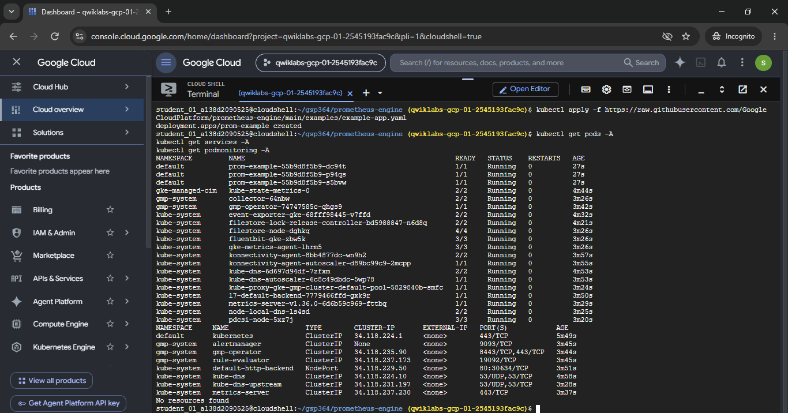
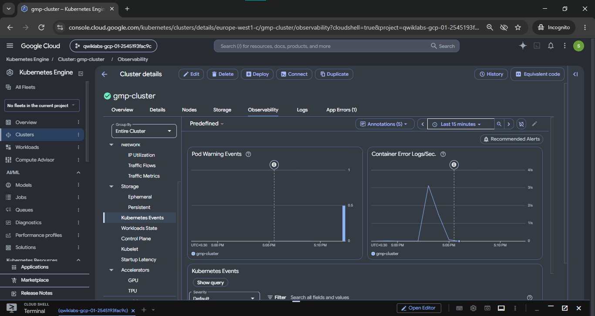
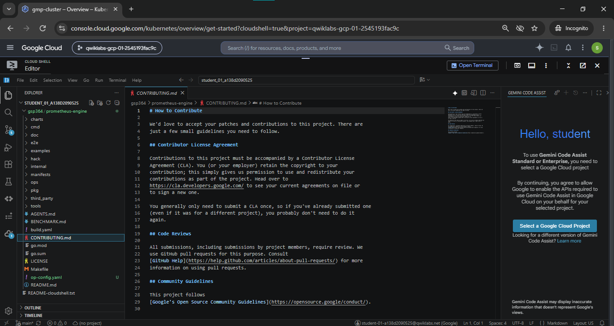

# Monitor Environments with Google Cloud Managed Service for Prometheus: Challenge Lab (GSP364)

A comprehensive Google Cloud Site Reliability Engineering (SRE) and Kubernetes Observability portfolio project demonstrating the deployment, configuration, metric scraping, and metric filtering capabilities of **Google Cloud Managed Service for Prometheus (GMP)** on **Google Kubernetes Engine (GKE)**.

[](https://cloud.google.com/)
[](https://kubernetes.io/)
[](https://cloud.google.com/stackdriver/docs/managed-prometheus)
[](https://cloud.google.com/monitoring)
[](https://prometheus.io/docs/prometheus/latest/querying/basics/)
[](https://cloud.google.com/storage)

---

## Lab Information

| Metadata Field | Specification Details |
|---|---|
| **Official Lab Title** | Monitor Environments with Google Cloud Managed Service for Prometheus: Challenge Lab |
| **Lab ID** | GSP364 |
| **Platform** | Google Cloud Skills Boost / Qwiklabs |
| **Difficulty** | Intermediate |
| **Category** | Google Cloud / Kubernetes / Observability / SRE |
| **Cluster Name** | `gmp-cluster` |
| **Target Zone & Region** | `europe-west1-c` / `europe-west1` (St. Ghislain, Belgium) |
| **Number of Nodes** | 1 (`e2-medium`) |
| **Workload Namespace** | `default` |
| **System Namespaces** | `gmp-system`, `gmp-public` |
| **Completion Status** | Completed *(Verified with terminal command outputs and console dashboard captures)* |

---

## Overview

As containerized microservices scale across enterprise Kubernetes clusters, self-hosted Prometheus architectures frequently suffer from operational burdens—including managing persistent block storage, handling high-cardinality ingestion spikes, engineering cross-cluster metric federation, and maintaining dedicated high-availability pairs.

**Google Cloud Managed Service for Prometheus (GMP)** delivers a serverless, planetary-scale Prometheus-compatible telemetry engine built directly upon Google's global time-series backend (Monarch). It eliminates storage administration toil and provides full compatibility with standard PromQL queries, alerting rules, and Grafana visualizations.

This challenge lab demonstrates the complete end-to-end implementation of managed Prometheus:
1. Provisioning a GKE cluster with managed collection enabled via the control plane.
2. Deploying the official Prometheus Operator infrastructure and verifying collector daemonset health.
3. Deploying an instrumented sample microservice (`prom-example`) with 3 replicas exposing metrics.
4. Implementing declarative metric filtering via `OperatorConfig` using `matchOneOf` PromQL selectors to restrict exported time series and optimize monitoring costs.
5. Archiving configuration manifests to Google Cloud Storage for compliance and automated assessment verification.

---

## Lab Objectives

1. **Deploy Google Cloud Managed Service for Prometheus**: Provision a GKE cluster with managed metric collection natively enabled.
2. **Deploy Managed Collection**: Initialize the Prometheus Operator and verify that collection daemonsets and custom resource definitions (CRDs) are active.
3. **Deploy Example Application**: Launch a 3-replica instrumented microservice exposing `/metrics` endpoints.
4. **Verify Prometheus Deployment & Scraping**: Inspect pod states, cluster IP services, and declarative `PodMonitoring` targets.
5. **Filter Exported Metrics**: Author an `OperatorConfig` resource to whitelist specific metric series and drop unneeded exporter noise.
6. **Upload Configuration to Cloud Storage**: Persist `op-config.yaml` to an authenticated Google Cloud Storage bucket.
7. **Verify Metric Filter Application**: Confirm that filtered telemetry correctly reaches Cloud Monitoring.

---

## Technology Stack

| Technology | Role in Architecture |
|---|---|
| **Google Cloud Platform (GCP)** | Enterprise cloud foundation hosting compute, storage, and observability APIs. |
| **Google Kubernetes Engine (GKE)** | Managed Kubernetes cluster runtime orchestrating containers on Compute Engine nodes. |
| **Managed Service for Prometheus (GMP)** | Fully managed, serverless metric collection, storage, and PromQL evaluation engine. |
| **Prometheus Operator** | Kubernetes controller managing collector daemonsets, pod monitoring CRDs, and operator configs. |
| **Prometheus Metrics** | Standard open-source exposition format (`counter`, `gauge`, `histogram`) emitted on port `8080`. |
| **Kubernetes YAML Manifests** | Declarative configuration for Deployments, Services, `PodMonitoring`, and `OperatorConfig`. |
| **Google Cloud CLI (`gcloud`)** | Programmatic infrastructure automation for cluster provisioning and storage operations. |
| **Google Cloud Storage (GCS)** | Object storage bucket used to archive configuration artifacts (`op-config.yaml`). |
| **Cloud Monitoring** | Unified observability suite providing PromQL querying, Metrics Explorer, and cluster dashboards. |

---

## Architecture Overview

The following diagram illustrates the monitoring architecture, showing how node-level collectors scrape application pods via declarative `PodMonitoring` rules and how `OperatorConfig` enforces metric filtering before data is exported to Monarch:



---

## GKE Cluster Deployment

### Task 1 — Provision Cluster with Managed Collection

Provision the Kubernetes cluster `gmp-cluster` in zone `europe-west1-c` with the `--enable-managed-prometheus` flag:

```bash
# Set environment variables
export CLUSTER_NAME="gmp-cluster"
export ZONE="europe-west1-c"
export NUM_NODES=1
export PROJECT_ID=$(gcloud config get-value project)

# Deploy GKE cluster with Managed Prometheus enabled
gcloud container clusters create "${CLUSTER_NAME}" \
  --zone="${ZONE}" \
  --num-nodes="${NUM_NODES}" \
  --enable-managed-prometheus \
  --project="${PROJECT_ID}"

# Fetch cluster authentication credentials for kubectl
gcloud container clusters get-credentials "${CLUSTER_NAME}" --zone="${ZONE}"

# Verify node status
kubectl get nodes
```

Terminal inspection confirmed:
- Cluster `gmp-cluster` created in `europe-west1-c` running GKE version `1.36.4-gke`.
- Machine type: `e2-medium` with status `RUNNING`.
- Single node `gke-gmp-cluster-default-pool-5829840b-smfc` reached `Ready` status.



*Reference script:* [`commands/01-create-gke-cluster.sh`](./commands/01-create-gke-cluster.sh)

---

## Managed Prometheus Collection

### Task 2 — Verify Operator and Managed Collection Components

When `--enable-managed-prometheus` is active, GKE automatically deploys the operator and collector infrastructure into system namespaces:

```bash
# Clone the official prometheus-engine repository for manifest access
mkdir -p ~/gsp364 && cd ~/gsp364
git clone https://github.com/GoogleCloudPlatform/prometheus-engine.git
cd ~/gsp364/prometheus-engine

# Verify collector pods in gmp-system namespace
kubectl get pods -n gmp-system

# Verify global OperatorConfig resource in gmp-public namespace
kubectl get operatorconfig -A
```

Verified system resources:
- `collector-64nbw`: Ready (2/2 Running).
- `gmp-operator-74747585c-qhgs9`: Ready (1/1 Running).
- `operatorconfig` resource named `config` active in namespace `gmp-public`.



*Reference script:* [`commands/02-deploy-managed-collection.sh`](./commands/02-deploy-managed-collection.sh)

---

## Example Application Deployment

### Task 3 — Deploy Instrumented Workload

Deploy the sample application manifest from the official Google Cloud Prometheus Engine repository:

```bash
kubectl apply -f https://raw.githubusercontent.com/GoogleCloudPlatform/prometheus-engine/main/examples/example-app.yaml
```

The manifest provisions:
1. **Deployment (`prom-example`)**: 3 pod replicas running `gke.gcr.io/prometheus-engine/example-app:v0.4.3-gke.0` exposing metrics on container port `8080`.
2. **Service (`prom-example`)**: ClusterIP service routing traffic to port `8080`.
3. **PodMonitoring (`prom-example`)**: Custom resource defining scrape target parameters (interval: `30s`, port: `metrics`).

```bash
# Verify application pods
kubectl get pods -l app=prom-example

# Verify cluster services
kubectl get service prom-example
```

Output:
```text
NAME                           READY   STATUS    RESTARTS   AGE
prom-example-55b9d8f5b9-dc94t   1/1     Running   0          27s
prom-example-55b9d8f5b9-p94qs   1/1     Running   0          27s
prom-example-55b9d8f5b9-s5bvw   1/1     Running   0          27s
```



*Reference script:* [`commands/03-deploy-example-app.sh`](./commands/03-deploy-example-app.sh)

---

## Prometheus Metric Scraping

### Task 4 — Audit Cluster Telemetry and Events

All running workloads across all namespaces were verified:

```bash
kubectl get pods -A
kubectl get services -A
kubectl get podmonitoring -A
```

In the Google Cloud Console, the GKE Observability dashboard for `gmp-cluster` confirmed active metric ingestion, healthy node conditions, and real-time event monitoring.



*Reference script:* [`commands/04-verify-prometheus.sh`](./commands/04-verify-prometheus.sh)

---

## Metric Filtering Configuration

### Task 5 — Configure Telemetry Whitelisting in OperatorConfig

By default, Prometheus collectors forward every scraped metric series to the backend. To control telemetry volume and optimize observability costs, the global `OperatorConfig` in the `gmp-public` namespace was configured with PromQL-style `matchOneOf` filtering:

```yaml
apiVersion: monitoring.googleapis.com/v1
kind: OperatorConfig
metadata:
  namespace: gmp-public
  name: config
collection:
  filter:
    matchOneOf:
    - '{job="prom-example"}'
    - '{__name__=~"job:.+"}'
```

#### Matcher Explanation
- `{job="prom-example"}`: Matches and exports all time series generated by the `prom-example` application workloads.
- `{__name__=~"job:.+"}`: Matches and exports any recording or summary rule metrics whose metric name starts with the prefix `job:`.
- **All other scraped series** (such as default exporter internals, container debug metrics, or system noise) are dropped at the node collector before being written to Monarch storage.

The manifest was saved as `op-config.yaml` and applied to the cluster:

```bash
kubectl apply -f op-config.yaml
```



*Reference script:* [`commands/05-configure-metric-filter.sh`](./commands/05-configure-metric-filter.sh)

---

## Google Cloud Storage Configuration

### Task 6 — Upload Configuration for Assessment Verification

The updated `op-config.yaml` was uploaded to an authenticated Google Cloud Storage bucket:

```bash
# Retrieve current project ID
export PROJECT=$(gcloud config get-value project)

# Create a regional GCS bucket matching project ID
gcloud storage buckets create --project="$PROJECT" gs://"$PROJECT"

# Upload the operator configuration manifest
gcloud storage cp op-config.yaml gs://"$PROJECT"

# Grant public read access required for automated assessment verification
gcloud storage buckets add-iam-policy-binding gs://"$PROJECT" \
  --member=allUsers \
  --role=roles/storage.objectViewer

# Verify object in GCS
gcloud storage ls gs://"$PROJECT"/op-config.yaml
```

> [!SECURITY]
> **Production IAM Security Notice:**
> Granting `allUsers` the `roles/storage.objectViewer` role was a specific lab requirement for automated grader verification. In production environments, public bucket access should be strictly prevented using Organization Policies (`constraints/storage.publicAccessPrevention`), and access should be restricted to authorized service accounts and engineers using least-privilege IAM bindings.

*Reference script:* [`commands/06-upload-configuration.sh`](./commands/06-upload-configuration.sh)

---

## Verification Results

| Verification Item | Command / Source | Verified State | Audit Status |
|---|---|---|---|
| **GKE Cluster Deployment** | `gcloud container clusters list` | `gmp-cluster`, `europe-west1-c`, `RUNNING` | **VERIFIED** |
| **Managed Prometheus Flag** | `--enable-managed-prometheus` | Automated operator deployment in `gmp-system` | **VERIFIED** |
| **Collector DaemonSet** | `kubectl get pods -n gmp-system` | `collector-64nbw` (2/2 Running) | **VERIFIED** |
| **GMP Operator** | `kubectl get pods -n gmp-system` | `gmp-operator` (1/1 Running) | **VERIFIED** |
| **Workload Pods** | `kubectl get pods -l app=prom-example` | 3/3 pods `Running` in `default` namespace | **VERIFIED** |
| **Workload Service** | `kubectl get service prom-example` | ClusterIP `34.118.237.173:8080` | **VERIFIED** |
| **OperatorConfig Filter** | `kubectl get operatorconfig -n gmp-public` | `matchOneOf` filter active (`prom-example`, `job:.+`) | **VERIFIED** |
| **Cloud Storage Archival** | `gcloud storage ls gs://$PROJECT` | `gs://$PROJECT/op-config.yaml` present | **VERIFIED** |
| **Lab Completion Score** | Google Cloud Skills Boost | Challenge Lab Completed | **VERIFIED** |

---

## Key Technical Learnings

### 1. Planetary-Scale Prometheus Without Storage Headaches
Traditional Prometheus requires managing StatefulSets, Persistent Volume Claims (PVCs), disk compaction, and retention policies. Managed Service for Prometheus writes metrics directly into Google Cloud Monarch, offering multi-cloud query compatibility and global multi-cluster retention with zero disk management.

### 2. Declarative Scraping with Custom Resources
Scrape configurations are decoupled from Prometheus server configurations. Developers declare scraping requirements using Kubernetes `PodMonitoring` custom resources that live alongside their application deployments.

### 3. Cost Governance via Ingestion Filtering
Metric cardinality directly drives cloud observability costs. Using `OperatorConfig` `matchOneOf` whitelisting allows DevOps teams to collect only high-value business and SLO metrics, dropping low-level container runtime noise before ingestion into Monarch.

### 4. GitOps and Configuration Archival
Exporting and archiving infrastructure-as-code manifests (`op-config.yaml`) to Cloud Storage ensures auditability, reproducibility, and automated compliance validation.

---

## Skills Demonstrated

- **Kubernetes Cluster Administration:** Deploying GKE clusters with specialized control-plane features (`--enable-managed-prometheus`).
- **Cloud-Native Observability:** Architecting Prometheus monitoring pipelines on Kubernetes using standard exposition formats.
- **Observability Cost Optimization (FinOps):** Designing and implementing metric whitelisting policies with regular expression selectors.
- **Custom Resource Management:** Applying and verifying Kubernetes CRDs (`PodMonitoring`, `OperatorConfig`).
- **Cloud Storage & IAM:** Automating bucket provisioning, object uploads, and IAM policy bindings via `gcloud storage`.

---

## Official References

- [Google Cloud Managed Service for Prometheus Documentation](https://cloud.google.com/stackdriver/docs/managed-prometheus)
- [Filtering Exported Metrics with OperatorConfig](https://cloud.google.com/stackdriver/docs/managed-prometheus/setup-managed#filtering)
- [Official Prometheus Engine GitHub Repository](https://github.com/GoogleCloudPlatform/prometheus-engine)
- [Google Kubernetes Engine (GKE) Documentation](https://cloud.google.com/kubernetes-engine/docs)
- [Prometheus Querying Basics (PromQL)](https://prometheus.io/docs/prometheus/latest/querying/basics/)

