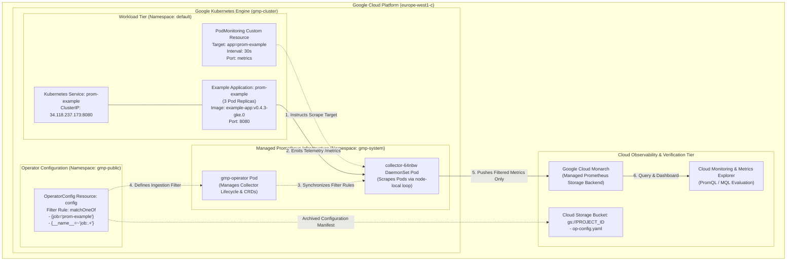

# Monitoring Architecture Overview (GSP364)

This document details the telemetry collection pipeline, component interactions, and metric filtering flow implemented with **Google Cloud Managed Service for Prometheus** in **GSP364: Monitor Environments with Google Cloud Managed Service for Prometheus: Challenge Lab**.

---

## Architecture Diagram

---

## Component Deep Dive

### 1. Google Kubernetes Engine (`gmp-cluster`)
The cluster is provisioned with `--enable-managed-prometheus`, which instructs the GKE control plane to automatically deploy and maintain the Managed Service for Prometheus operator and node-level collection components without requiring manual Helm chart management or local persistent disk volumes.

### 2. Managed Collection Engine (`gmp-system`)
- **`gmp-operator`**: Automates the lifecycle of collection agents, validates `PodMonitoring` custom resources, and translates `OperatorConfig` rules into local Prometheus collector configurations.
- **`collector` DaemonSet**: Runs on each Kubernetes node, discovering pods matched by `PodMonitoring` resources and scraping endpoints via the node network.

### 3. Application Telemetry (`default` namespace)
The `prom-example` microservice deploys with 3 replicas. Each replica exposes standard Prometheus application metrics on container port `8080` at the `/metrics` endpoint. The `PodMonitoring` custom resource specifies target selectors and a 30-second polling interval.

### 4. Telemetry Egress Filtering (`OperatorConfig`)
By default, Prometheus collectors forward every scraped metric series to the backend. The `OperatorConfig` resource deployed in the `gmp-public` namespace acts as a gateway filter, enforcing `matchOneOf` whitelisting to eliminate unneeded runtime debug metrics and prevent unnecessary storage ingestion costs in Monarch.

### 5. Google Cloud Storage Compliance Archival
The verified `op-config.yaml` is uploaded to an authenticated Google Cloud Storage bucket (`gs://$PROJECT/op-config.yaml`), ensuring infrastructure-as-code versioning and fulfilling assessment verification checks.

