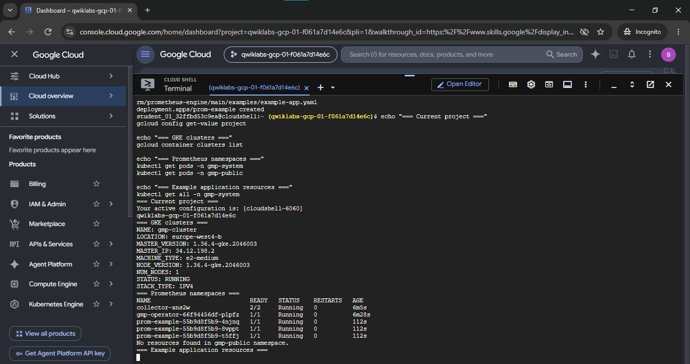
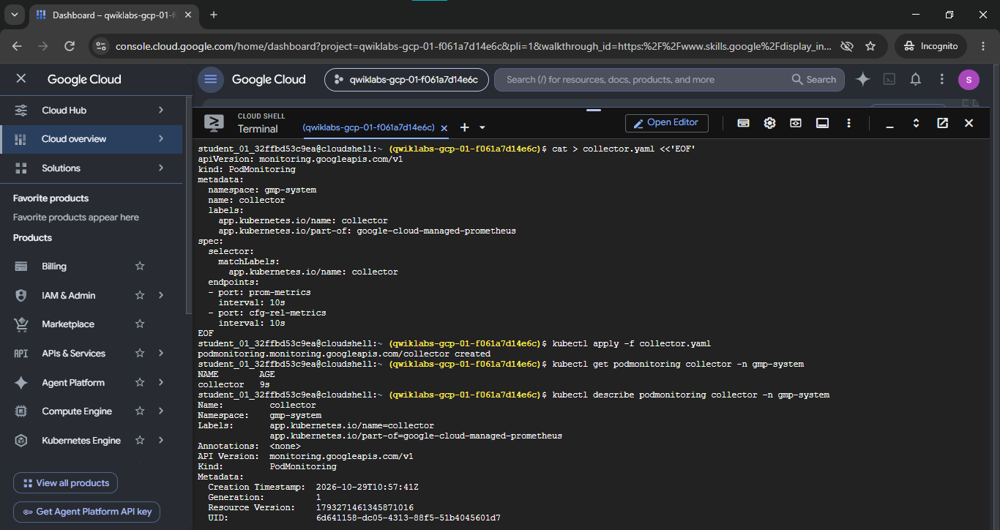
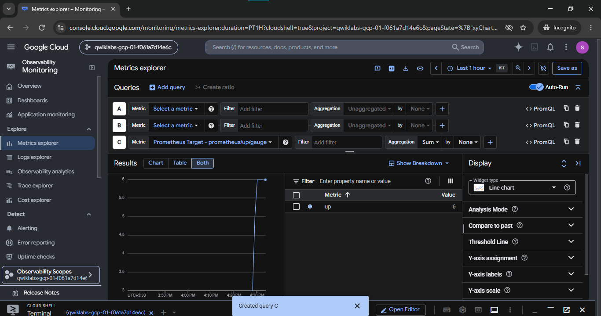
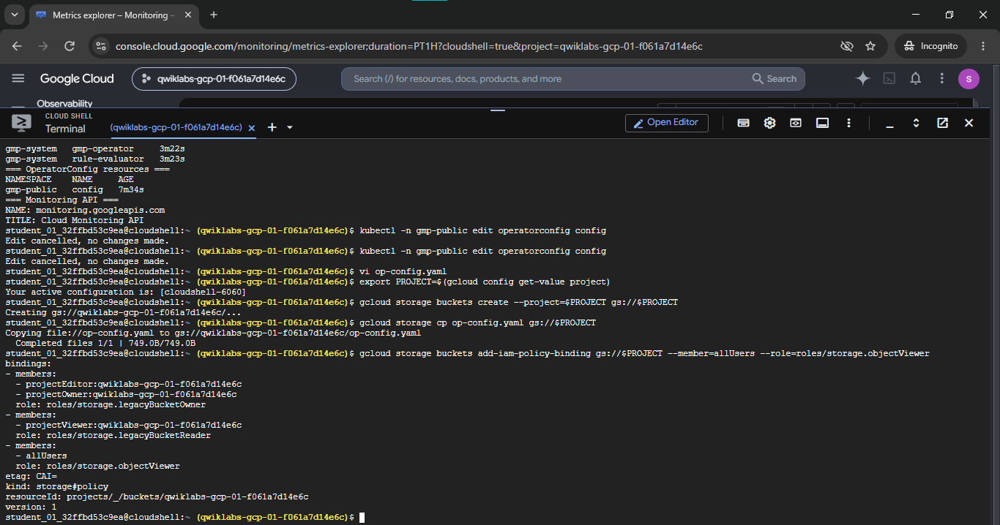
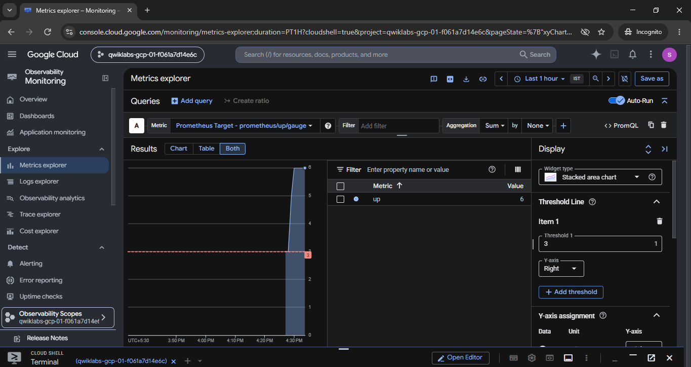
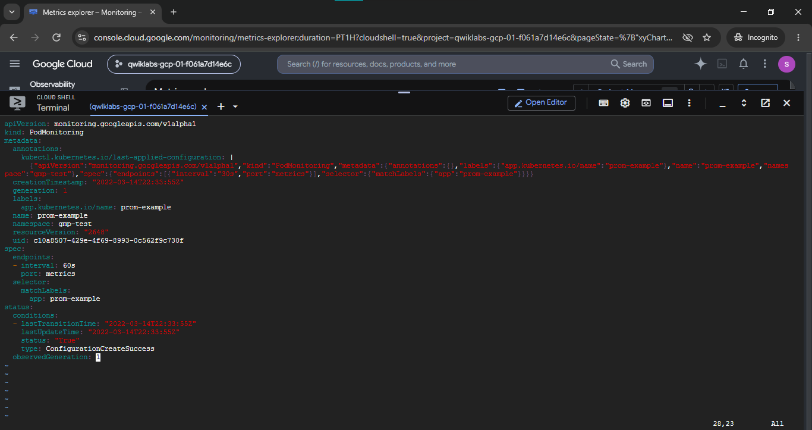

# Reduce Costs for the Managed Service for Prometheus (GSP1027)

A hands-on Google Cloud Site Reliability Engineering (SRE) and DevOps portfolio project demonstrating metric cost-optimization strategies for **Google Cloud Managed Service for Prometheus (GMP)** on **Google Kubernetes Engine (GKE)**. This implementation demonstrates how to govern telemetry ingestion volume through declarative metric filtering with `OperatorConfig`, tune scrape collection frequencies using `PodMonitoring` custom resources, query ingested time series with Cloud Monitoring and Metrics Explorer, and archive configurations to Cloud Storage for compliance and assessment verification.

[](https://cloud.google.com/)
[](https://kubernetes.io/)
[](https://cloud.google.com/stackdriver/docs/managed-prometheus)
[](https://cloud.google.com/monitoring)
[](https://prometheus.io/docs/prometheus/latest/querying/basics/)
[](https://cloud.google.com/storage)

---

## Lab Information

| Metadata Field | Specification Details |
|---|---|
| **Official Lab Title** | Reduce Costs for the Managed Service for Prometheus |
| **Lab ID** | GSP1027 |
| **Platform** | Google Cloud Skills Boost / Qwiklabs |
| **Difficulty** | Introductory |
| **Duration** | 15 minutes |
| **Cost** | No cost |
| **Completion Status** | Completed *(Verified with empirical terminal outputs and Metrics Explorer UI captures)* |
| **Category** | Google Cloud Monitoring / Prometheus / Kubernetes / FinOps / SRE |
| **Ephemeral Lab Project ID** | `qwiklabs-gcp-01-f061a7d14e6c` *(Observed in Cloud Shell execution evidence)* |
| **Target Zone & Region** | `europe-west1-c` / `europe-west1` (Belgium) |
| **Documentation Status** | Complete, Validated & Evidence-Backed |

---

## Overview

In enterprise-scale Kubernetes environments, monitoring costs are predominantly driven by **metric cardinality** (the total number of unique time series) and **metric ingestion frequency** (how often data points are written to storage). When monitoring hundreds of microservices, unconstrained Prometheus metric scraping can ingest massive quantities of ephemeral, default, or low-value metrics—such as Go runtime debug internals, low-level process metrics, or high-cardinality transient labels—leading to unexpected monitoring bills.

**Google Cloud Managed Service for Prometheus (GMP)** prices ingestion based on the volume of metric samples written to Monarch, Google's planetary-scale telemetry backend. 

This lab demonstrates two foundational FinOps and observability engineering controls to manage telemetry ingestion:
1. **Metric Filtering via `OperatorConfig`**: Restricting which scraped time series are forwarded to Monarch using declarative PromQL-style `matchOneOf` selector expressions, dropping unwanted metric series before they incur ingestion costs.
2. **Scrape Interval Modulation via `PodMonitoring`**: Increasing the target scrape interval (e.g., tuning polling frequency from 30 seconds to 60 seconds), reducing sample ingestion rate by up to 50% for non-latency-sensitive workloads.

> [!NOTE]
> This lab demonstrates practical cost-control mechanisms and ingestion levers. It does not provide a formal billing invoice comparison, so no specific dollar savings percentage is claimed.

---

## Objectives

1. **Deploy Managed Service for Prometheus**: Provision a GKE cluster with managed metric collection enabled.
2. **Configure Managed Collection & Sample Workload**: Deploy self-pod monitoring for collector telemetry in `gmp-system` and launch a 3-replica instrumented example application (`prom-example`).
3. **Analyze Metric Telemetry in Cloud Monitoring**: Use Monitoring Query Language (MQL) and PromQL in Metrics Explorer to inspect target availability (`up/gauge`) and runtime metrics (`go_memstats_heap_alloc_bytes`).
4. **Filter Exported Metrics using `OperatorConfig`**: Configure `matchOneOf` filter rules in the `gmp-public` namespace to drop unselected time series, then upload `op-config.yaml` to Cloud Storage.
5. **Tune Application Scrape Intervals**: Modify the `PodMonitoring` custom resource to reduce polling frequency from 30s to 60s, then archive `prom-example-config.yaml` to Cloud Storage.
6. **Visualize Metric Baselines & Thresholds**: Configure line charts, stacked area charts, and static threshold lines in Metrics Explorer.

---

## Technologies Used

- **Google Cloud Platform (GCP)**: Enterprise cloud foundation hosting the GKE cluster, Cloud Monitoring API, and Cloud Storage buckets.
- **Google Kubernetes Engine (GKE)**: Managed container orchestration platform hosting the monitored workloads.
- **Google Cloud Managed Service for Prometheus (GMP)**: Managed telemetry collection engine operating with Monarch storage.
- **Kubernetes Custom Resource Definitions (CRDs)**: Declarative `PodMonitoring` and `OperatorConfig` resources.
- **Cloud Monitoring & Metrics Explorer**: Interactive observability interface supporting MQL and PromQL query evaluation.
- **PromQL & MQL**: Query languages used to analyze time series and filter exporter metrics.
- **Cloud Storage (`gsutil` / `gcloud storage`)**: Object storage used for configuration persistence and evaluation verification.
- **`kubectl` & Google Cloud Shell**: Command-line administrative tooling.

---

## Architecture

The following diagram illustrates the metric collection lifecycle, showing how scrape intervals govern collection frequency at the pod level and how `OperatorConfig` acts as an egress gateway filter before samples reach Cloud Monitoring Monarch:

```mermaid
flowchart TD
    subgraph GKE ["Google Kubernetes Engine (gmp-cluster)"]
        subgraph AppNS ["Namespace: gmp-test"]
            App["prom-example Pods (3 Replicas)<br/>Port: 8080 (/metrics)"]
            PodMon["PodMonitoring CRD<br/>interval: 60s (Tuned from 30s)<br/>selector: app=prom-example"]
        end

        subgraph SystemNS ["Namespace: gmp-system"]
            Collector["Managed Collector DaemonSet<br/>(Scrapes Pods & Exposes Internal Telemetry)"]
            SelfMon["Self-PodMonitoring CRD<br/>(Collector Telemetry)"]
        end

        subgraph PublicNS ["Namespace: gmp-public"]
            OpConfig["OperatorConfig Resource<br/>matchOneOf Selectors:<br/>- {job='prom-example'}<br/>- {__name__=~'job:.+'}"]
        end

        PodMon -.->|1. Governs Scrape Frequency (60s)| Collector
        SelfMon -.->|2. Scrapes Collector Internal Endpoints| Collector
        App -->|3. Raw Prometheus Metrics Exposing| Collector
        Collector -->|4. Evaluates Filter Rules| OpConfig
    end

    subgraph GCPCloud ["Google Cloud Platform Observability & Storage"]
        OpConfig -->|5. Ingests Only Matching Filtered Series| Monarch["Google Cloud Monarch<br/>(Metrics Ingestion Engine)"]
        Monarch -->|6. Visualizes Filtered Telemetry| MetricsExplorer["Cloud Monitoring<br/>Metrics Explorer<br/>(Line / Stacked Area Charts)"]
        GCS["Cloud Storage Bucket<br/>gs://qwiklabs-gcp-01-f061a7d14e6c<br/>- op-config.yaml<br/>- prom-example-config.yaml"]
    end
```

---

## Implementation Workflow

### Task 1 — Deploy the GKE Cluster & Verify Workloads

A GKE cluster named `gmp-cluster` was provisioned in zone `europe-west1-c` with Google Cloud Managed Service for Prometheus enabled:

```bash
# Obtain authentication credentials for kubectl
gcloud container clusters get-credentials gmp-cluster --zone=europe-west1-c

# Verify running GKE cluster and node health
gcloud container clusters list
```

Terminal inspection verified that `gmp-cluster` was running with `1.36.4-gke` master and node versions on an `e2-medium` machine type in `RUNNING` status.

All running pods across the `gmp-system` namespace were verified:
```text
NAME                                 READY   STATUS    RESTARTS   AGE
collector-xns2w                      2/2     Running   0          6m5s
gmp-operator-66f94456df-plpfz        1/1     Running   0          6m28s
prom-example-55b9d8f5b9-4njnq        1/1     Running   0          112s
prom-example-55b9d8f5b9-8vppt        1/1     Running   0          112s
prom-example-55b9d8f5b9-t5ffj        1/1     Running   0          112s
```



---

### Task 2 — Deploy Managed Collection & Self-Pod Monitoring

To collect diagnostic health metrics from the Managed Service for Prometheus collector itself, a `PodMonitoring` custom resource was deployed to the `gmp-system` namespace targeting the collector's internal metric endpoints (`prom-metrics` and `cfg-rel-metrics`):

```bash
cat > collector.yaml <<'EOF'
apiVersion: monitoring.googleapis.com/v1
kind: PodMonitoring
metadata:
  namespace: gmp-system
  name: collector
  labels:
    app.kubernetes.io/name: collector
    app.kubernetes.io/part-of: google-cloud-managed-prometheus
spec:
  selector:
    matchLabels:
      app.kubernetes.io/name: collector
  endpoints:
  - port: prom-metrics
    interval: 10s
  - port: cfg-rel-metrics
    interval: 10s
EOF

kubectl apply -f collector.yaml
```

The resource creation was confirmed via `kubectl get podmonitoring collector -n gmp-system` and `kubectl describe podmonitoring`:

```text
podmonitoring.monitoring.googleapis.com/collector created
NAME        AGE
collector   9s
```

Next, the sample instrumented web application (`example-app.yaml`) was deployed, launching 3 replicas producing synthetic Prometheus metrics:

```bash
kubectl apply -f https://raw.githubusercontent.com/GoogleCloudPlatform/prometheus-engine/main/examples/example-app.yaml
```



---

### Task 3 — View Target Metrics in Cloud Monitoring

In Cloud Monitoring Metrics Explorer, Prometheus scrape targets can be queried using Monitoring Query Language (MQL) to confirm that target instances are active and reporting:

```text
fetch prometheus_target::prometheus.googleapis.com/up/gauge
```

The `up` metric is a standard Prometheus gauge indicating target reachability (value `1` represents healthy reachability). When aggregated with `Sum`, all 6 active scrape targets (3 `prom-example` pods + collector components) report a total availability count of `6`.



---

### Task 4 — Populate a Telemetry Graph with PromQL

Metrics Explorer provides native PromQL evaluation. For instance, Go runtime heap allocations can be inspected using:

```promql
go_memstats_heap_alloc_bytes
```

This query tracks the dynamic memory footprint of the instrumented application containers and collector processes, demonstrating how standard PromQL syntax executes seamlessly against the managed Monarch backend.

---

### Task 5 — Filter Exported Metrics via OperatorConfig

By default, Prometheus collectors forward every scraped metric series to the backend. To optimize costs and prevent unwanted series from being ingested into Monarch, the global `OperatorConfig` resource located in the `gmp-public` namespace was configured with PromQL-style `matchOneOf` filters:

```yaml
apiVersion: monitoring.googleapis.com/v1
kind: OperatorConfig
metadata:
  namespace: gmp-public
  name: config
collection:
  filter:
    matchOneOf:
      - '{job="prom-example"}'
      - '{__name__=~"job:.+"}'
```

#### How the Filter Works
- `matchOneOf`: Operates as a logical `OR` whitelist. A scraped time series is forwarded to Monarch **only** if it matches at least one of the specified selectors.
- `{job="prom-example"}`: Retains all metrics emitted by the sample application.
- `{__name__=~"job:.+"}`: Retains any recording or summary rule metrics prefixed with `job:`.
- **All other scraped series** (such as default exporter noise, container runtime internals, or unneeded system telemetry) are dropped at the node collector before network transmission and ingestion into Monarch.

The configuration was persisted to `op-config.yaml` and archived to Cloud Storage for verification:

```bash
export PROJECT=$(gcloud config get-value project)
gcloud storage buckets create --project=$PROJECT gs://$PROJECT
gcloud storage cp op-config.yaml gs://$PROJECT
gcloud storage buckets add-iam-policy-binding gs://$PROJECT \
  --member=allUsers \
  --role=roles/storage.objectViewer
```



---

### Task 6 — Run Advanced Queries & Visualization in Metrics Explorer

The ingested `prometheus/up/gauge` target metric was analyzed in Metrics Explorer:
1. Configured metric query for `Prometheus Target - prometheus/up/gauge`.
2. Applied `Sum` aggregation across targets.
3. Switched visualization from Line chart to **Stacked area chart**.
4. Established a visual SRE threshold line at value `3` to monitor minimum replica availability.

As shown in the screenshot, the total healthy target count plateaued at `6`, well above the alert threshold line of `3`.



---

### Task 7 — Change Application Scraping Interval to 60s

The collection frequency directly impacts metric sample volume. The default scrape interval for `prom-example` is `30s`. For many operational workloads, polling every 30 seconds generates unnecessary samples when a 1-minute resolution is sufficient for SLO tracking and alerting.

The `PodMonitoring` resource in the `gmp-test` namespace was edited to tune the scrape interval:

```yaml
apiVersion: monitoring.googleapis.com/v1
kind: PodMonitoring
metadata:
  name: prom-example
  namespace: gmp-test
spec:
  selector:
    matchLabels:
      app: prom-example
  endpoints:
    - port: metrics
      interval: 60s
```

The resource update was verified in terminal editor inspection, confirming:
- `spec.endpoints[0].interval: 60s` (increased from `30s`).
- `status.conditions[0].type: ConfigurationCreateSuccess` with `status: "True"`.

```bash
# Archive the updated PodMonitoring configuration to GCS
gcloud storage cp prom-example-config.yaml gs://$PROJECT
```

By doubling the interval from 30 seconds to 60 seconds, the rate of samples ingested by Monarch for this target is effectively halved (from 2 samples per minute to 1 sample per minute per series).



---

## Cost Optimization Summary

| Optimization Lever | Implementation Mechanism | Impact on Telemetry Volume | FinOps Impact |
|---|---|---|---|
| **Metric Filtering** | `OperatorConfig.collection.filter.matchOneOf` | Drops non-matching time series before export to Monarch | Reduces billable active metric series |
| **Scrape Interval Modulation** | `PodMonitoring.spec.endpoints[].interval: 60s` | Reduces collection frequency from 30s to 60s | Cuts sample write frequency by up to 50% per series |
| **Target Visibility** | Metrics Explorer (`up/gauge`) | Verifies that critical targets remain observable | Prevents over-monitoring while protecting SLO visibility |

> [!TIP]
> **FinOps Best Practice**: When tuning Prometheus costs, apply a two-tier approach:
> 1. Use `OperatorConfig` filtering to eliminate noisy, unused metric names globally.
> 2. Differentiate scrape intervals: keep short intervals (10s–15s) only for critical customer-facing latency endpoints, and increase intervals (60s–120s) for batch workers and background jobs.

---

## Screenshots and Evidence

| Figure | Filename | Related Task | What It Demonstrates | Evidence Status |
|---|---|---|---|---|
| **Figure 1** | [`./screenshot/01-gke-cluster-and-workload-readiness.png`](./screenshot/01-gke-cluster-and-workload-readiness.png) | Task 1 & 2 | GKE cluster `gmp-cluster` in `RUNNING` status; 3x `prom-example` application pods and `collector-xns2w` running in `gmp-system` | **VERIFIED** |
| **Figure 2** | [`./screenshot/02-managed-collection-podmonitoring-applied.png`](./screenshot/02-managed-collection-podmonitoring-applied.png) | Task 2 | Application of `collector.yaml` defining self-pod-monitoring for `prom-metrics` and `cfg-rel-metrics` (10s intervals); `kubectl describe` confirmation | **VERIFIED** |
| **Figure 3** | [`./screenshot/03-metrics-explorer-up-gauge-line-chart.png`](./screenshot/03-metrics-explorer-up-gauge-line-chart.png) | Task 3 & 4 | Cloud Monitoring Metrics Explorer plotting line chart for `Prometheus Target - prometheus/up/gauge` with Sum aggregation showing 6 active targets | **VERIFIED** |
| **Figure 4** | [`./screenshot/04-metric-filter-operatorconfig-and-gcs-upload.png`](./screenshot/04-metric-filter-operatorconfig-and-gcs-upload.png) | Task 5 | Cloud Shell terminal displaying `OperatorConfig` inspection, bucket creation `gs://$PROJECT`, upload of `op-config.yaml`, and public read IAM binding | **VERIFIED** |
| **Figure 5** | [`./screenshot/05-metrics-explorer-stacked-area-chart.png`](./screenshot/05-metrics-explorer-stacked-area-chart.png) | Task 6 | Metrics Explorer rendering Stacked Area Chart for `up` metric with an SRE Threshold Line configured at value `3` | **VERIFIED** |
| **Figure 6** | [`./screenshot/06-scrape-interval-tuning-podmonitoring-60s.png`](./screenshot/06-scrape-interval-tuning-podmonitoring-60s.png) | Task 7 | Vim editor showing `PodMonitoring` resource for `prom-example` updated from 30s to `60s` interval with `ConfigurationCreateSuccess` status | **VERIFIED** |

---

## Troubleshooting & SRE Observations

### 1. Collector Pod Not Ready or CrashLooping
- **Symptom:** Collector pods in `gmp-system` fail to enter `Running` state.
- **Diagnostic:** Run `kubectl -n gmp-system describe pod -l app.kubernetes.io/name=collector` and check container logs with `kubectl -n gmp-system logs -l app.kubernetes.io/name=collector -c prometheus`.
- **Resolution:** Verify that the GKE cluster was provisioned with the `--enable-managed-prometheus` flag and that the underlying node service account has the `roles/monitoring.metricWriter` IAM role.

### 2. Exported Metric Filters Dropping Required Series
- **Symptom:** Application metrics disappear from Cloud Monitoring Metrics Explorer after applying `OperatorConfig`.
- **Diagnostic:** Inspect the active configuration with `kubectl get operatorconfig -n gmp-public config -o yaml`.
- **Resolution:** Check regex selectors in `matchOneOf`. PromQL regex matching must match the entire string. If targeting a specific metric, add `'{__name__="<metric_name>"}'` or widen the job filter to `'{job="<target-job>"}'`.

### 3. Missing Metrics Explorer Results
- **Symptom:** Querying `prometheus.googleapis.com/up/gauge` returns no data points immediately after configuration.
- **Diagnostic:** Managed Service for Prometheus writes data in batches. Wait approximately 60 to 90 seconds for Monarch ingestion buffering. Verify that the time range in Metrics Explorer is set to "Last 1 hour" or "Last 30 minutes" to view real-time data.

### 4. Invalid PodMonitoring Custom Resource Syntax
- **Symptom:** `kubectl apply` reports schema validation errors.
- **Diagnostic:** Ensure the API version is `monitoring.googleapis.com/v1`. The `endpoints.interval` field requires standard duration suffixes (`30s`, `1m`, `60s`). Inspect status with `kubectl get podmonitoring <name> -n <namespace> -o yaml`.

---

## Learning Outcomes

- **Managed Prometheus Architecture**: Understood the separation of concerns between GKE node collectors, operator managers, and the Monarch telemetry engine.
- **Observability Cost Engineering**: Mastered practical metric reduction levers using `OperatorConfig` PromQL selector whitelisting.
- **Declarative Telemetry Scraping**: Configured `PodMonitoring` custom resources for both application microservices and collector internal metrics.
- **Collection Frequency Tuning**: Evaluated trade-offs between metric granularity and ingestion volume by adjusting scrape intervals.
- **Metrics Explorer Visualization**: Formulated MQL and PromQL queries, switched visualization types (Line vs. Stacked Area), and established visual threshold markers.
- **Cloud Storage Integration**: Used `gcloud storage` commands to archive manifest artifacts and configure bucket access policies.

---

## References

- [Google Cloud Managed Service for Prometheus Overview](https://cloud.google.com/stackdriver/docs/managed-prometheus)
- [Filtering Exported Metrics with OperatorConfig](https://cloud.google.com/stackdriver/docs/managed-prometheus/setup-managed#filtering)
- [Configuring Scraping with PodMonitoring CRDs](https://cloud.google.com/stackdriver/docs/managed-prometheus/setup-managed#podmonitoring)
- [Querying Managed Prometheus Metrics in Cloud Monitoring](https://cloud.google.com/stackdriver/docs/managed-prometheus/query)
- [Google Kubernetes Engine Documentation](https://cloud.google.com/kubernetes-engine/docs)
- [Prometheus Querying Basics (PromQL)](https://prometheus.io/docs/prometheus/latest/querying/basics/)

---

## Completion Status

- **Status:** **Completed**
- **Artifacts Preserved:** 6 forensic screenshots stored in `./screenshot/`, full architecture diagram, and complete technical documentation.

